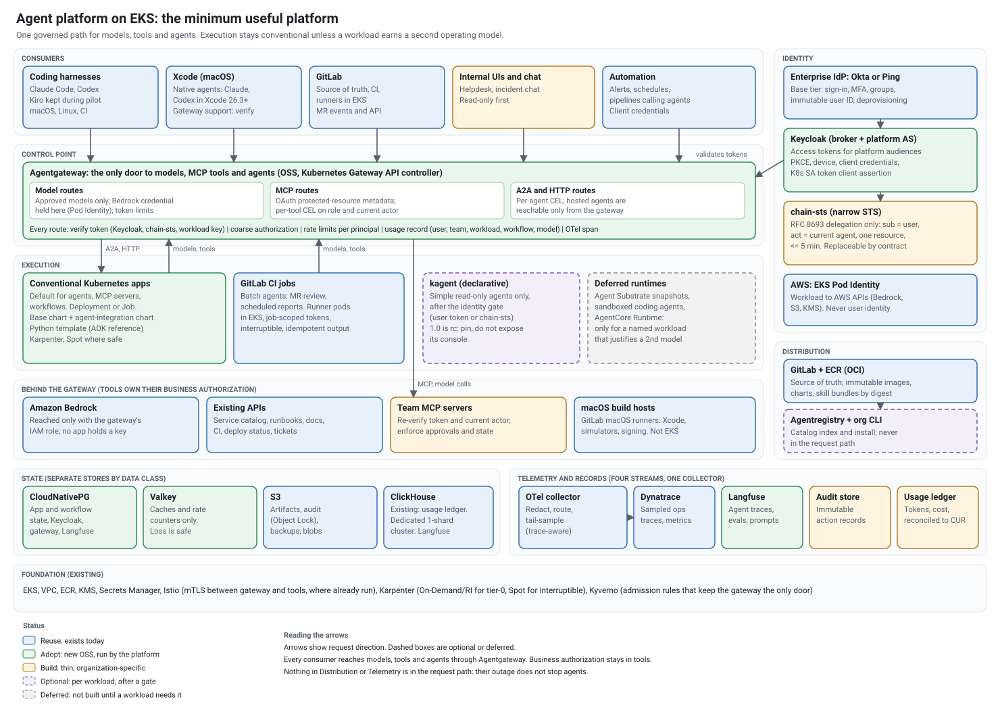
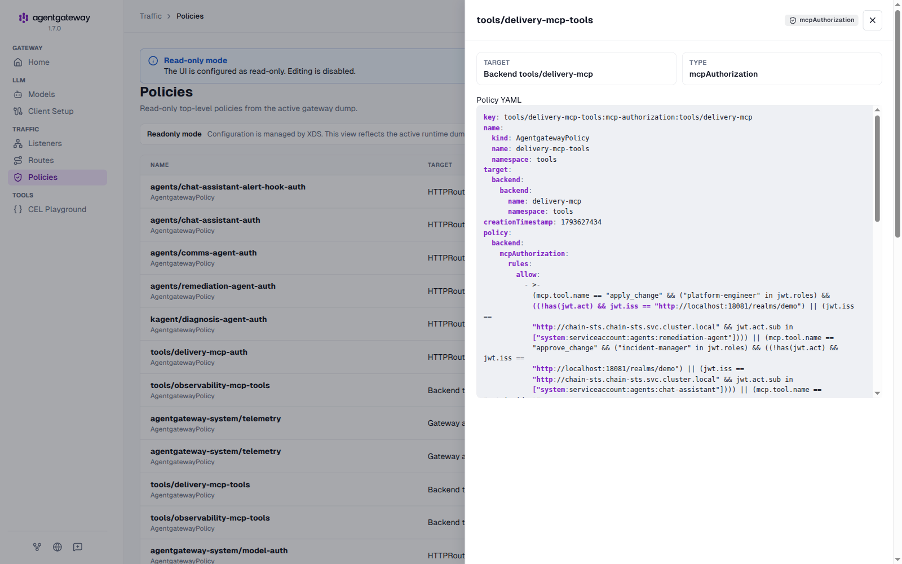

# Recommendation: an enterprise agent platform on EKS

| | |
|---|---|
| Status | Architecture review and proposal. Nothing selected or deployed |
| Updated | 4 November 2026 |
| Evidence | Current vendor documentation, upstream code and standards read on 4 November 2026; the agentgateway demo's code, records and running cluster (viewed read-only); AWS Price List data published 12 October 2026 |
| Audience | Architects, platform and identity engineers, engineering leadership, security |

## Recommendation

Build the **minimum useful platform**: one governed door to models, tools
and agents, with identity that reaches the tool, on the EKS skills and
infrastructure the organization already has. Defer every second operating
model until a named workload pays for it.

1. **Agentgateway OSS is the only door** to Bedrock, MCP tools and agents.
   It authenticates every token, makes coarse authorization decisions in CEL,
   holds the Bedrock credential (Pod Identity), limits tokens per principal
   and records usage. Calls around it are blocked by IAM, network policy and
   admission rules, and tested. ([Gateway and registry](11-gateway-and-registry.md))
2. **Keycloak brokers the enterprise IdP and issues platform tokens;
   chain-sts stays a narrow delegation service.** Okta or Ping on its
   current tier remains the source of people. A written interoperability
   profile and an executable conformance suite make chain-sts replaceable by
   a commercial product the day one passes. ([Identity profile](04-identity-profile.md))
3. **Agents run as ordinary Deployments, Jobs and GitLab CI jobs.** kagent is
   optional behind a gate; Agent Substrate and AgentCore are deferred.
   ([Runtimes](12-runtimes.md))
4. **One supported build path:** a Copier template, a small shared package
   with an ADK adapter, and two Helm charts (base application, agent
   integration) as separate releases. A framework-independent conformance
   suite is the enforcement; teams on other stacks pass the same suite.
   ([Frameworks and charts](15-frameworks-and-charts.md))
5. **GitLab and ECR are the source of truth for artifacts,** pinned by digest
   and signed; a generated catalog indexes them; a thin org CLI installs them
   into harnesses. Agentregistry is not ready to be a system of record.
6. **Claude Code through the gateway is the supported harness;** Kiro is
   measured, not expanded, because it cannot route through a gateway.
   ([Developer harnesses](16-developer-harnesses.md))
7. **Four record streams from one collector:** sampled operations to
   Dynatrace, agent traces and evaluations to Langfuse OSS on a dedicated
   single-shard ClickHouse, unsampled audit to S3 Object Lock, unsampled usage
   to a ledger reconciled with the Cost and Usage Report.
   ([Observability](14-observability.md))
8. **Workflows become explicit contracts** run by GitLab pipelines or the
   Python template; skills remain guidance inside bounded model steps.
   Conductor is piloted once, not adopted. ([Workflow automation](05-workflow-automation.md))

Pilot order: the MR reviewer and coding harnesses first (governed model
access, workload identity, accounting), then CI failure triage (explicit
workflows), then a read-only developer helpdesk (delegated identity), then
the platform assistant's investigation mode. Writes come last, behind
approvals bound to exact parameters and resource versions.
([Use cases](06-use-cases.md), [Implementation plan](09-implementation-plan.md))

Cost at 200 developers: about **$590,000 a year in steady state, 75% of it
people**. The largest avoidable risk is a gateway that strips prompt
caching (+$180,000 a year). ([Cost model](08-cost-model.md))

## Assumptions this review corrects

| Assumption | What the evidence says | Confidence |
|---|---|---|
| kagent and ADK fit together, and kagent runs on EKS like any Kubernetes app | kagent **1.0.0-rc1** (30 October 2026) runs Go ADK; Python ADK only by command override. Substrate sessions die with their node, workers need `SYS_ADMIN` and unconfined seccomp, EKS **1.37+** is likely required, and agents "cannot" use IAM roles for Bedrock | Documented upstream; EKS version inferred, to validate |
| The demo shows hosted agents carrying user identity | **Observed:** 739,161 of 744,320 tokens (99.3%) in the last 24 hours carried no user, because the kagent-hosted agent used a workload key | Observed in the demo, 4 November 2026 |
| Keycloak could replace the custom STS | Keycloak 26.8.1: token exchange "does not yet have support for the `resource` parameter"; delegation is **preview** and single-hop; `scope` can widen a token unless a policy forbids it | Documented upstream |
| Routing a harness through a gateway is transparent | Agentgateway's Bedrock Runtime path translates to Converse and drops document and server-tool blocks and beta flags Claude Code uses; Bedrock **Mantle** or passthrough is required | Documented upstream; parity to validate in phase 1 |
| Agentregistry versions and governs artifacts | 0.4.0 stores pointers, defaults to `latest`, lets `apply` replace a tag, and "omits authentication" by default | Documented upstream; observed (`latest` everywhere) |
| Langfuse can share the existing ClickHouse, and a ClickHouse contract may include Langfuse Enterprise | Langfuse needs single-shard ClickHouse 25.12+ in UTC. Enterprise is "additive to your ClickHouse commercial plan"; nothing public says a support contract includes it | Documented; entitlement to verify with ClickHouse |
| Gateway spans give agent traces | **Observed:** about 6,760 observations for 59 model calls, named after HTTP routes. Application-level attributes are needed | Observed in the demo |
| Skills make workflows consistent | **Observed:** the runbook as a skill cost one extra model call (5 to 7 s, 10,000 to 25,000 tokens) per diagnosis and the model still varied the procedure | Observed in the demo |
| Conductor provides durable, repeatable workflows | Typed I/O and bounded steps, yes; durable execution, credential refresh and remote MCP with refreshed tokens, no | Documented upstream (code read at `f794e00`) |
| AgentCore Runtime V2 starts any session in about 2 s | True for cold starts of echo agents. A new session on an existing runtime was **slower** than V1 in the one published test (1.9 s vs 0.6 s, single run). V2 runs in **five** regions | Documented; article verified; to validate per workload |
| Kiro's concerns may be historical | Gateway routing still unsupported; telemetry is daily metrics; Sonnet 5.x credit weighting still about 50% above its list-price ratio to Opus 5 | Documented; per-task cost needs internal measurement |

The full list, and the decisions they leave open, is in
[Open decisions](10-open-decisions.md).

## What the demo contributes

The demo ([review](20-demo-review.md)) is a capability demonstration, not
pilot evidence. It proves the shape: gateway CEL rules on role, issuer and
current actor; per-target delegation tokens; a tool-enforced
propose-approve-apply state machine; a leaver cut off at the reconciliation
interval plus token lifetime. It also exposes what production must add:
approvals bound to live state and durable, the tool tier enforcing the actor
chain, chain-sts narrowing, budgets, Bedrock proven end to end, and readable
traces.

## What we are asking for

| Ask | Why now |
|---|---|
| Answer the eight questions in [Open decisions](10-open-decisions.md#questions-that-change-the-design) | Each changes what is built |
| Approve phase 0 (3 weeks) and phase 1 (8 weeks) | Phase 1 delivers governed access for the largest token volume and the existing MR reviewer, with measurable acceptance criteria |
| Staff 2.9 FTE for the build year, folded into the existing platform team | Staffing is 75% of cost and the main sensitivity |
| Agree the stop conditions in [Implementation plan](09-implementation-plan.md#stop-conditions) | So a missed criterion narrows the program instead of extending it |
