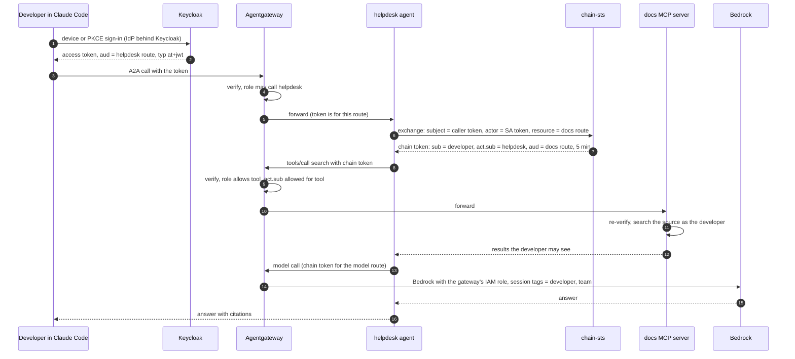

# Architecture and responsibility boundaries

| | |
|---|---|
| Status | Proposal |
| Updated | 4 November 2026 |

![The minimum useful platform on EKS. Consumers at the top (coding harnesses, Xcode, GitLab, internal UIs, automation) reach Agentgateway, the only door to models, MCP tools and agents. The identity column on the right has the enterprise IdP, Keycloak as broker and authorization server, chain-sts for delegation, and EKS Pod Identity for AWS. Below the gateway, execution is conventional Kubernetes apps and GitLab CI jobs, with kagent optional and Substrate and AgentCore deferred. Behind the gateway are Bedrock, existing APIs, team MCP servers and macOS build hosts. State is CloudNativePG, Valkey, S3 and ClickHouse. Telemetry flows through one OTel collector to Dynatrace, Langfuse, an audit store and a usage ledger.](diagrams/platform-architecture.svg)

## Five principles

1. **One door.** Every model, MCP tool and agent call goes through
   Agentgateway. A call around it is a defect, prevented by IAM, network
   policy and admission rules, and tested ([Gateway and registry](11-gateway-and-registry.md#bypass-prevention-by-layer)).
2. **Identity travels, credentials do not.** The person's identity reaches
   the tool in a short token for that tool alone, naming every agent in
   between. AWS credentials stay with the gateway and never carry a person.
3. **Each decision has one owner.** Gateway: may this caller use this route,
   tool or model. Identity: may this agent act for this person on this
   target. Tool: may this happen to this resource now. Application: how much
   work one task may do.
4. **Conventional execution by default.** An agent is a Deployment or a Job
   until a workload proves it needs something else.
5. **Nothing outside the request path can stop agents.** Catalog, Langfuse
   and dashboards can fail without stopping work. Identity and the gateway
   cannot, so they are tier 0.

## The credential on each hop

![A person signs in through Keycloak, which brokers the IdP, and calls an agent's route on the gateway with an access token for that route. The agent exchanges the token at chain-sts for a five-minute token naming the person as subject and itself as current actor, for the tool's route only. The gateway checks role and current actor; the tool checks the token again and enforces business rules. A table lists each hop's credential, who checks it and what is decided there, including Bedrock reached with the gateway's IAM role and workloads without a user using client credentials or a workload key.](diagrams/credential-hops.svg)

The same flow as a sequence, for the helpdesk asking a documentation tool on
a developer's behalf:

## Responsibility boundaries

| Owner | Owns | Does not own |
|---|---|---|
| **Platform team** | Agentgateway, chain-sts, the integration chart, base chart, templates, shared package, org CLI, catalog, conformance suite, Langfuse service, collector pipelines for the four streams | Agents' business logic, prompts, tools' rules, model quality of team agents |
| **Identity team** (or platform, decision D-03) | Keycloak realm-as-code, IdP federation, group-to-role mapping, reconciliation job, leaver objective | Which agent may act on which target (platform policy, reviewed by security) |
| **Application team** | Its agent or workflow: code, prompts, skills it uses, evaluations, budgets within platform limits, its on-call for its service | Gateway, identity, shared infrastructure |
| **Tool owner** (often a service team) | Its MCP server, business authorization, approvals and state, audit records | Who may reach it (gateway) |
| **Infrastructure team** (existing) | EKS, VPC, Karpenter, Istio, ECR, KMS, existing ClickHouse | Platform services running on it |
| **Observability team** (existing) | OTel collector platform, Dynatrace | Langfuse content and evaluation design |
| **Security** | Approves delegation policy, data classes, retention, the bypass tests; owns the SIEM | Day-to-day operation |
| **FinOps** | Reconciliation of the usage ledger with the Cost and Usage Report; chargeback rules | Budgets per principal (platform, with owners) |

## In and out of the request path

| In the request path (tier 0 or tier 1) | Out of the request path |
|---|---|
| Agentgateway and its configuration | Agentregistry or the catalog index |
| Keycloak (sign-in and refresh only; issued tokens keep working) | Langfuse |
| chain-sts (for delegated calls) | Dynatrace dashboards |
| The tool or service being called | The org CLI |
| Bedrock | GitLab (except for CI-hosted agents) |
| Valkey only if global rate limits are enabled, with a fail-open or fail-closed policy per route | The usage ledger |

## What changed from the demo, and why

| Demo | This design | Reason |
|---|---|---|
| Keycloak as a stand-in, plain HTTP | Keycloak 26.8.1 as a production broker, HTTPS, realm as code, `at+jwt` | The demo already proposed this; 26.8.1 fixes a token-exchange CVE |
| chain-sts copies every claim, `typ: JWT` | Narrows scope and roles; explicit type; KMS signer; `jti` replay cache | Profile R4, R9, R12, R15 |
| Tool trusts the gateway for the actor rule | Tool enforces the current actor too | Defense in depth; the demo's rule held only because of NetworkPolicy |
| Approvals in memory, bound by record ID | Durable, digest-bound to parameters and resource version, expiring, with separation at apply | Profile APR tests |
| kagent hosts the diagnosis agent with a workload key | Conventional Deployment with a chain token; kagent optional behind a gate | 99% of demo tokens had no user; kagent 1.x is rc and cannot use IAM roles for Bedrock |
| No budgets | Per-principal token limits; workload budgets; application task limits | Runaway work |
| Langfuse fed raw gateway and runtime spans | Application root spans with Langfuse attributes; infrastructure spans filtered; whole-trace sampling | 6,760 observations for 59 model calls were not readable |
| Registry entries all `latest` | GitLab and OCI digests as the source; catalog generated | Immutability |
