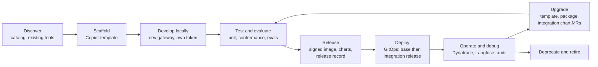

# Developer lifecycle

| | |
|---|---|
| Status | Proposal |
| Updated | 4 November 2026 |

Two kinds of developer use the platform: **people using a coding harness**,
who need governed access, and **teams building an agent, MCP server or
workflow**, who need a path from idea to retirement. Both use the same
gateway, identity and artifacts.

## Harness users

| Step | Command or action | What happens |
|---|---|---|
| Set up | `platform login` | Device-flow sign-in at Keycloak (IdP behind it); writes the gateway base URL, a token helper and OTel settings into each installed harness's managed settings. Where MDM distributes managed settings, this only refreshes the token |
| Discover | `platform search ci-triage` | Searches the catalog index: owner, support status, versions, required tools and roles, last evaluation |
| Install | `platform install skill/ci-triage@1.4.0` | Verifies the signature, pulls by digest, writes to `.claude/skills`, `.agents/skills` or `.kiro/skills`, records the pin in `platform.lock` |
| Use remote tools | `platform install mcp/docs` | Adds the MCP server's gateway URL to the harness; the harness signs in through the gateway's OAuth metadata |
| Stay current | `platform outdated`, `platform update` | Lists newer versions and deprecations; re-pins |
| Check | `platform check` | Harness points at the gateway; telemetry on; no deprecated or unsigned artifacts |

## Teams building on the platform

| Stage | Developer does | Platform provides | Gate |
|---|---|---|---|
| **Discover** | Searches the catalog for an existing agent or tool before building | Catalog with owners, support status, evaluation evidence | None |
| **Scaffold** | `platform new python-agent` (or the GitLab "create project" pipeline): name, team, data class, tools needed | Copier template with the shared package, both charts' values, CI, evaluation scaffold, catalog file | Team exists in GitLab; name unique |
| **Develop locally** | `uv run app` against the **dev gateway** with the developer's own token from `platform login`; tool calls go through dev chain-sts and dev tools | A dev environment that mirrors production identity; mock STS and mock tools for offline unit tests | None |
| **Request access** | Merge request adding the agent's routes, tool permissions and delegation policy entries to the platform's policy repository | Policy schema, review by platform and the tool owner | Tool owner approves its tools; security approves new write delegations |
| **Test** | Unit tests; `platform test` against a deployed preview in an ephemeral namespace | Framework-independent conformance suite; ephemeral namespaces from CI | Conformance passes |
| **Evaluate** | Maintains a dataset of real cases in Langfuse; runs it on every prompt, model, skill or code change | Langfuse project, evaluation job template, baseline comparison | No regression beyond the agreed threshold |
| **Release** | Tags a version | Pipeline builds, signs, attests, pushes by digest; writes the release record ([Frameworks and charts](15-frameworks-and-charts.md#the-release-record)) | Signature, record and evaluation present |
| **Deploy** | Merge request to the deployment repository: image digest and chart versions per environment | GitOps applies the base release, then the integration release; staging first, production by promotion MR | Staging conformance and smoke pass; owner approves production |
| **Operate** | Watches its service's SLOs; owns its on-call | Dashboards per workload (gateway metrics by route, token use, budget burn); alerts on error rate, latency, budget | |
| **Debug** | Follows one trace from the client through gateway, agent, tools and model; reads the audit record for a refused call; replays a failed case from Langfuse into a dataset | Trace ID end to end; `platform.task.id` on every span and record; gateway refusal reasons in access logs | |
| **Upgrade** | Reviews and merges automated MRs: Copier template updates, shared package bumps, integration chart bumps | Scheduled pipelines and Renovate open MRs with changelogs; minor bumps auto-merge after conformance in staging | Majors need owner approval |
| **Deprecate** | Sets `support: deprecated`, `replacedBy`, a date | CLI warns installers and users; gateway usage shows who still calls it | |
| **Retire** | Removes the integration release (traffic stops), then the base release; archives the project | Retention policy for its data; Langfuse project archived; catalog entry marked retired; artifact kept for reproducibility | No traffic for 14 days before removal |

## Debugging, concretely

A developer reports "the helpdesk said I can't see runbook X".

1. The chat response carries `task_id`. Search Langfuse by it: one trace, the
   tool call to `docs-mcp:search` with an empty result.
2. The gateway access log for the same trace shows the call allowed, with
   `user.sub`, `actor.chain` = `[helpdesk]`, target `/mcp/docs`.
3. The docs MCP server's audit record shows the search ran as the user and
   the source returned nothing the user may read.
4. Conclusion: the source's permissions, not the agent. The fix is an access
   request, which the helpdesk can explain.

That path needs: one trace ID across hops, the task ID on every record, and
tools that log as whom they acted. All three are conformance tests.

## What a team must not have to do

- Hold a model provider key, or an AWS role for Bedrock.
- Write token validation, token exchange, retries, telemetry setup or
  redaction.
- Install or upgrade CRDs or controllers.
- Run its own tracing backend.
- Ask the platform team to deploy anything: GitOps merge requests do it.
