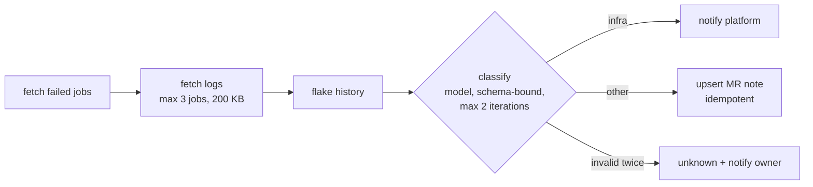

# Workflow automation: from skills to explicit workflows

| | |
|---|---|
| Status | Proposal and pilot design |
| Updated | 4 November 2026 |
| Versions checked | microsoft/conductor **0.1.44** (1 November 2026; HEAD `f794e00`, read without running), google-adk 2.13.0, Temporal server 1.32.2, Restate 1.8.1, DBOS Python 3.4.0. GitLab CI documentation, current |

## Five things that get called "workflow"

| Concept | What it is | What it guarantees | Example |
|---|---|---|---|
| **Skill** | Instructions and files a model may load into its context | Nothing. The model decides whether and how to follow it | SKILL.md "how to triage a failed deploy" |
| **Orchestration** | Code or configuration that decides which step runs next | Order and branching, if the orchestrator owns control flow | A pipeline, a state machine, a Conductor workflow |
| **Tool** | An action with its own interface and authorization | What the tool enforces: inputs, permissions, idempotency | `get_pipeline_logs`, `propose_change` |
| **Platform enforcement** | Identity, gateway policy, network, admission | Who may call what, regardless of prompt or orchestrator | Gateway CEL, chain-sts policy |
| **Durable execution** | Persisted step results that survive process loss | Resume without redoing completed steps; exactly-once only with idempotent effects | Temporal, DBOS, a PostgreSQL state machine |

Inconsistency today comes from asking a skill to provide orchestration.
**Observed in the demo:** with the diagnosis runbook as a skill, every turn
spent one extra model call loading it (5 to 7 seconds, 10,000 to 25,000 more
input tokens), and in four of five turns the model read Prometheus and Tempo
in a different order than the runbook said (`docs/measurements.md`,
"diagnosis-agent"). The skill improved the answer; it did not control the
procedure.

## What determinism buys, and what it does not

- **Deterministic routing** fixes which step runs next. It does not make a
  model step's output deterministic; a re-run of a model step can return a
  different answer.
- **Safe retries** come from idempotent tools and operation IDs, not from the
  orchestrator.
- **Durable recovery** needs step results persisted before the next step
  starts, and a resume that skips completed steps. A checkpoint file in a
  pod's `/tmp` is not durable.
- **Bounded model steps** need limits the orchestrator enforces: iterations,
  tool calls, tokens, wall time, and a schema the output must match.

## Microsoft Conductor, verified

Conductor is a Python 3.12 CLI that runs YAML workflows of agent, script,
MCP, human-gate and sub-workflow steps. MIT license, "Development Status 4 -
Beta", created February 2026, 44 releases (roughly weekly), one maintainer
with 227 of the commits.

| Requirement | Conductor 0.1.44 | Fit |
|---|---|---|
| Typed inputs and outputs | Typed `input:` (string, number, boolean, array, object, defaults type-checked). Typed step `output:` with enum, pattern, ranges, nested properties, as JSON Schema; malformed output re-prompted. Workflow-level output is template-only | Good |
| Dependencies and branching | State machine: first matching `when:` route; `$end`. Not a declared DAG | Adequate |
| Deterministic steps | `script` (routes on exit code or JSON stdout; timeout) and `mcp` (direct tool call, no model). **`script` not allowed inside parallel groups; `mcp` steps are stdio only** | Partial |
| Bounded model steps | `max_agent_iterations`, `max_session_seconds`, `timeout_seconds`, `retry`, workflow `budget_usd` with enforce mode, `limits.max_iterations` | Good |
| Parallelism | Static `parallel` and `for_each` with `max_concurrent` and failure modes | Good |
| Timeouts, cancellation, failure paths | Workflow timeout; `terminate` with failed status; exit codes | Good |
| Human approvals | `human_gate` answered in the terminal or a local dashboard; `--skip-gates` picks the first option in CI. No external approval API | **Poor for CI**: approvals must move to GitLab |
| Validation and testing | `conductor validate`, `--dry-run`. **No mock or replay model provider** | Partial |
| Telemetry | OTel traces (`invoke_workflow`, `invoke_agent`, `execute_tool`) by environment variables | Good |
| **Bedrock through Agentgateway** | No native Bedrock. Works with `claude` provider (`base_url`, `auth_token`), `openai` provider (Chat Completions), or Copilot SDK BYOK (`type: anthropic`, custom headers) | Workable |
| **Remote MCP with STS tokens** | Remote MCP only on the `copilot` and `claude-agent-sdk` providers; headers from environment variables only; the OAuth helper calls the Azure CLI | **Poor** |
| **Credential refresh** | **None.** Headers and secrets resolved at start and at resume; no refresh, no retry on 401 | **Poor**: tokens must outlive the run |
| GitLab runners and local runs | Headless CLI fine. Checkpoints in `$TMPDIR`; must be saved as artifacts or on a volume. Backends: local, Docker, Azure Container Apps; no Kubernetes backend | Workable with effort |
| Checkpoint and recovery | Off by default (written only on exception); periodic at step boundaries when enabled; resume re-runs the in-flight step; sub-workflows restart | Not durable execution |
| Provider differences | Structured output native on two providers, prompt-injected on two; skills injected in full on two providers (the bundled skill is about 33,000 tokens per call); tool allowlists not enforceable on one | **Large**: standardize on one provider |
| Supply chain | The PyPI name `conductor-cli` belongs to an unrelated project. Install only from a GitHub tag | Risk to manage |

**Verdict:** Conductor's YAML is a good model of what an explicit workflow
should declare. As a runtime in this environment it is pre-1.0, single-
maintainer, Copilot- and Azure-leaning, cannot refresh credentials, and
reaches remote MCP only through two providers with static headers. Pilot it
on one workflow as an authoring format; do not adopt it as the platform's
workflow engine.

## Options compared for one workflow

| Option | Good for | Costs |
|---|---|---|
| Skill only (today) | Guidance, exploration, rare tasks | Inconsistent execution; no guarantees |
| **GitLab pipeline** with deterministic jobs and one bounded model step | Event-driven, minutes-long work tied to a repository: MR review, CI triage, release notes | Approvals as manual jobs; state in artifacts; familiar to every developer; runners already in EKS |
| **Application** (Python template, PostgreSQL state machine, or ADK graph workflow) | Interactive or service-shaped work with approvals in a UI, many tenants, SLAs | More code; needs the shared package's limits and telemetry |
| Conductor | Authoring typed multi-step agent workflows quickly, run locally or in a runner | See verdict above |
| Durable engine (Temporal, Restate, DBOS) | Hours-to-days workflows with human waits, many retriable activities, strict resume | New infrastructure (Temporal) or a library on existing PostgreSQL (DBOS). Justify per workload |

**Durable engines: only on demonstrated need.** None of the priority use
cases runs for hours with human waits. If one does, start with DBOS (a
library on the existing PostgreSQL, MIT) before Temporal (a cluster of
services), and keep Step Functions for coarse AWS-native orchestration.

## The recommendation

1. **Define a workflow contract the platform owns,** independent of the
   runner: typed inputs and outputs (JSON Schema), named steps, which steps
   are deterministic and which are bounded model steps, limits, approvals,
   failure paths, and the tools each step may call. Conductor's YAML is a
   reasonable starting shape.
2. **Run CI-shaped workflows as GitLab pipelines** (deterministic jobs, one
   container image that runs bounded model steps through the gateway,
   approvals as protected manual jobs, `interruptible: true`).
3. **Run service-shaped workflows in the Python template,** with state in
   PostgreSQL and the shared package's limits.
4. **Keep skills for guidance** inside model steps, pinned by digest, and
   measure whether they help.
5. **Pilot Conductor once** (below). Adopt organization-wide only if it
   passes, and only after credential refresh and remote MCP are solved
   upstream or by a gateway-held credential.

### Example: one workflow, explicit

```yaml
# workflows/ci-failure-triage.yaml : platform workflow contract v1
name: ci-failure-triage
version: 1.2.0
inputs:
  project_id: {type: integer}
  pipeline_id: {type: integer}
outputs:
  classification: {type: string, enum: [flaky-test, infra, code-regression, dependency, unknown]}
  evidence: {type: array, items: {type: string}, maxItems: 10}
  suggested_owner: {type: string}
limits: {deadline_seconds: 300, max_model_calls: 4, max_tokens: 60000}
steps:
  - id: fetch-failed-jobs        # deterministic
    tool: gitlab-mcp:list_failed_jobs
  - id: fetch-logs               # deterministic, bounded
    tool: gitlab-mcp:get_job_trace
    for_each: "{{ steps.fetch-failed-jobs.jobs[:3] }}"
    max_bytes: 200000
  - id: known-flakes             # deterministic
    tool: test-history-mcp:flake_rate
  - id: classify                 # bounded model step
    model: claude-sonnet         # alias resolved by the gateway
    skill: ci-triage@1.4.0       # guidance only, pinned
    output_schema: outputs       # must match, or one re-prompt, then 'unknown'
    max_iterations: 2
  - id: route
    when: "{{ steps.classify.classification == 'infra' }}"
    then: notify-platform
    else: comment-on-mr
  - id: comment-on-mr            # deterministic, idempotent by pipeline_id
    tool: gitlab-mcp:upsert_note
on_failure: {classification: unknown, notify: owner}
```



## Pilot: one inconsistent skill workflow

**Pick** a skill workflow that is run often, whose inconsistency people
complain about, and whose result can be checked: CI failure triage is a good
candidate, because the pipeline's eventual fix gives ground truth.

| Step | Detail |
|---|---|
| Baseline | 30 recent failures run through today's skill in the current harness; record classification, steps taken, tokens, time |
| Implement three ways | (a) GitLab pipeline with the contract above; (b) Conductor with the `claude` provider through the gateway; (c) the skill as is, for comparison |
| Measure | Deterministic steps executed in order (target 100%); output schema valid (100%); classification agreement with ground truth; tokens and seconds per run; behavior on: runner killed mid-run, token expiry mid-run, tool 5xx, invalid model output |
| Decide | Adopt the contract and runner that wins on agreement and failure handling at no more than 1.2 times the baseline's cost. Conductor qualifies only if it also passes the failure tests without a workaround the platform must maintain |
| Time box | Four weeks, one engineer plus the workflow's owning team |
