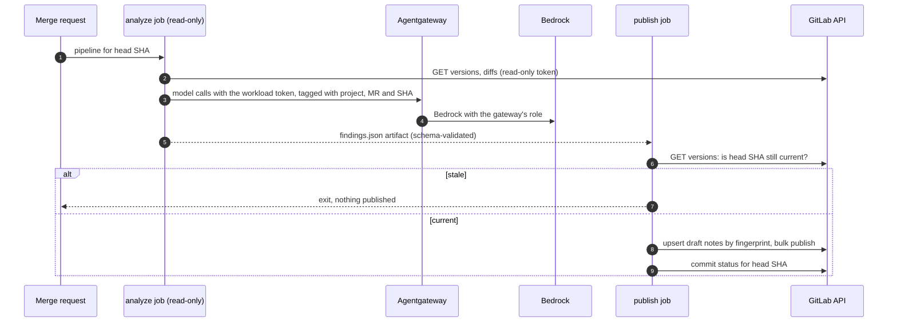

# Use cases and pilot order

| | |
|---|---|
| Status | Proposal |
| Updated | 4 November 2026 |
| GitLab facts | docs.gitlab.com, current on 4 November 2026. Tier notes are for GitLab.com unless marked; check the self-managed version, because webhook signing needs 19.1, service accounts on Free need 18.11 |

The use cases test the architecture. Each row below says which platform
capability it exercises first, so the pilot order also orders the platform
work.

## Pilot order

| Order | Use case | Exercises first | Why this position |
|---|---|---|---|
| 1 | **MR reviewer, incremental improvement** | Gateway model access to Bedrock, workload identity, budgets, usage records, telemetry, evaluations | Exists today, so value is measurable against a baseline. No user delegation needed |
| 1 (parallel) | **Coding harnesses through the gateway** (Claude Code; iOS developers included) | Bedrock routing fidelity, managed settings, harness telemetry | Largest token volume and most users; "access before hosting" |
| 2 | **CI failure triage** (the workflow pilot) | Explicit workflow contract, GitLab MCP server, bounded model steps | Reuses step 1's pieces; ground truth comes from the eventual fix |
| 3 | **Developer helpdesk, read-only** | User identity end to end, chain-sts, MCP sign-in from a harness, permission-aware retrieval | First use of delegation; read-only limits the blast radius |
| 4 | **Platform engineering assistant**, investigation first | Kubernetes read tools under the user's identity; later bound approvals | Writes wait until approval binding is implemented and tested |
| Later | Additional cases below | | |

None of these needs kagent, Agent Substrate or AgentCore.

## 1. GitLab MR reviewer

### Runner job or persistent service

| | GitLab runner job (recommended) | Persistent service |
|---|---|---|
| Trigger | MR pipeline (`rules: if: $CI_PIPELINE_SOURCE == "merge_request_event"`) | Webhook (`X-Gitlab-Token`, or HMAC `webhook-signature` from 19.1) |
| Stale reviews | `interruptible: true` with `workflow:auto_cancel:on_new_commit: interruptible` cancels the old run | Must cancel in-flight work itself |
| State across runs | In a small PostgreSQL table, keyed by MR and finding fingerprint | Same table |
| Cost | Runner pods on Spot, already paid for | Always-on pods |
| Operating model | Developers already debug pipelines | A new service to own |
| Choose the service when | Reviews must run without a pipeline, or across many projects with one queue and global rate control | |

### Design

| Concern | Treatment |
|---|---|
| Incremental review | Review only the diff between the last reviewed version's head and the current one (`GET …/merge_requests/:iid/versions`); full review on request |
| Commit-specific results | Every finding carries `head_sha`, `base_sha`, `start_sha` from the version, and a position with those SHAs (`POST …/discussions` with `position[...]`) |
| Duplicates | Fingerprint = hash(rule, file, normalized code snippet). The publisher upserts by fingerprint; findings no longer present are resolved (`PUT …/discussions/:id?resolved=true`) |
| Cancellation and retries | Interruptible jobs; the publisher re-checks the head SHA before writing; publishing is idempotent by fingerprint, so a retried job does not duplicate |
| Untrusted repository content | Code, commit messages and MR text are input data and may contain instructions. The analysis job has **no write credential and no write tools**; its output is schema-validated JSON; the publisher is deterministic code that escapes Markdown, caps comment count and length, and never follows links from the content |
| Separation of analysis and publishing | Two jobs, two credentials. Analysis: read-only token (`read_api`) or `CI_JOB_TOKEN` for repository reads. Publishing: a GitLab **service account** (Free tier since 18.11) or project access token, scoped to `api` on the project, used only by the publish job, stored as a protected, masked variable |
| `CI_JOB_TOKEN` limits | It cannot post discussions, so it cannot be the publisher's credential |
| Status | Commit status API (Free). External status checks need **Ultimate**; use them only if the review must block merge through approval rules |
| Duo | None of these APIs needs GitLab Duo |
| Model identity | The job's Kubernetes service account authenticates at Keycloak (client credentials by client assertion) and calls the gateway as the workload `mr-reviewer`. Attributes: project, MR, SHA, author team |

### Measures

| Measure | Definition | Source |
|---|---|---|
| Actionable rate | Findings followed by a change to the same lines in a later commit of the MR | Fingerprint store + diff |
| False positive rate | Findings resolved without change or marked with a "not useful" reaction | GitLab API |
| Developer acceptance | Share of MRs whose authors resolved at least one finding by change | Same |
| Cost per MR | Gateway usage records for `mr-reviewer` by MR | Usage ledger |
| Latency | Pipeline event to published review | Job timings |
| Quality regression | Langfuse dataset of 50 labeled MRs, run on every prompt, model or skill change | Langfuse experiments |

Baseline all six with the current reviewer before changing anything.

## 2. CI failure triage

The workflow pilot in [Workflow automation](05-workflow-automation.md). A
pipeline failure triggers a job that fetches failed jobs and logs
(deterministic), checks flake history, classifies with one bounded model
step, and posts or updates one MR note. Shared capabilities over a
standalone script: the same gateway, budgets and evaluations as the
reviewer; a GitLab MCP server reused by the helpdesk; one trace per run.

## 3. Developer helpdesk, read-only

| Question | Source of authority | Tool |
|---|---|---|
| Who owns service X, and what is its runbook? | Service catalog (authoritative for ownership) | `catalog-mcp` |
| Where is the documentation or code for Y? | GitLab search, documentation system's search | `gitlab-mcp`, `docs-mcp` |
| Why did my pipeline fail? | GitLab CI | `gitlab-mcp` (from step 2) |
| Is my deployment out? | GitOps controller and deployment status | `deploy-mcp` |
| How do I get access to Z? | Access-request process documentation, IGA catalog | `docs-mcp`, `iga-mcp` (read) |
| Escalate with evidence | Ticketing | Later, as a write with user confirmation |

**Permission-aware retrieval by construction.** Each tool searches its source
with the **user's** identity (chain token, `sub` = user), so the source's own
access control decides what comes back. No central vector index copies
documents and their ACLs at first. That avoids stale permissions, deleted
documents lingering, and a second access model to secure. Add an index only
for a measured gap (for example, semantic search across sources), and then
store ACL metadata with every chunk and re-check access at fetch time.

| Concern | Treatment |
|---|---|
| Authority | Each answer type has one authoritative source (ownership: catalog; status: GitOps). Conflicting sources are shown side by side with owners and dates, not merged |
| Freshness | Every citation shows its source's last-modified time; answers older than the source's freshness rule are flagged |
| Citations | Required: an answer without a citation is returned as "not found" |
| Deletions and permission changes | Handled by query-time access through the source |
| Prompt injection from documents | Retrieved text is data. The agent has no write tools in this phase; outputs are rendered as text |

## 4. Platform engineering assistant

Builds on the demo. Two modes with different tools and credentials.

| Mode | Tools | Identity at the cluster |
|---|---|---|
| Investigate | Kubernetes read, metrics, logs, traces, recent deployments, Dynatrace problems | The Kubernetes MCP server uses **impersonation** (`Impersonate-User`, `Impersonate-Group`) from the verified chain token, so cluster RBAC decides per user. Its own service account may impersonate only the platform's groups |
| Change | `propose_change`, `approve_change`, `apply_change`, `restart_workload` | Approval bound to a digest of action, parameters and resource version; expiry; revalidation and separation of duties enforced by the executing tool ([Identity profile](04-identity-profile.md), APR tests) |

Logs and tool responses are untrusted input: an attacker who controls a log
line can try to instruct the model. Investigation tools are read-only, and a
change needs a human approval of the exact parameters, so injection can at
worst produce a wrong proposal that a person must approve.

## 5. iOS development with Xcode

| Work | Where | Platform role |
|---|---|---|
| Edit, refactor, write tests | Developer's Mac: Claude Code or Codex with `xcrun mcpbridge`, or Xcode's native agents | Gateway routing, managed settings, shared skills |
| Build and test diagnosis | Mac or macOS GitLab runner | Same harness, `xcodebuild`, `simctl` |
| Signing, provisioning, devices | macOS runners and devices only | None: agents never receive signing material |
| MR preparation and review | EKS | The MR reviewer |
| Crash triage with symbolicated reports | EKS | A read-only agent, later |

Details and the open validations are in [Developer harnesses](16-developer-harnesses.md#xcode-and-ios-work).

## Additional use cases

Each is chosen because it reuses pieces the pilots build, so its marginal
cost is small.

| Use case | Why the platform beats a standalone script |
|---|---|
| **Incident summaries** from Dynatrace problems, deployments and chat timelines, read-only | Reuses the platform assistant's read tools and identity; summaries are evaluated in Langfuse against post-incident reviews |
| **Dependency update triage** for Renovate MRs: changelog reading, risk notes, test impact | Reuses the MR reviewer's pipeline, publisher and evaluations; costs are attributed per project |
| **Release notes** from merged MRs per release | Reuses GitLab MCP and the workflow contract; one deterministic collection step and one bounded model step |

Not proposed: a general autonomous coding agent hosted in EKS. Coding work
stays in developers' harnesses until a workload shows that hosted,
sandboxed execution pays for its second operating model.
