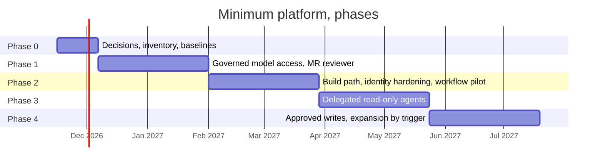

# Phased implementation plan

| | |
|---|---|
| Status | Proposal. Dates assume a start on 16 November 2026 and the build-year staffing in [Cost model](08-cost-model.md#staffing) |
| Updated | 4 November 2026 |

Each phase ends with measurable acceptance criteria. A phase that misses its
criteria does not extend silently: it either fixes the gap within two weeks
or triggers a stop condition.

## Phase 0: decisions, inventory, baselines (3 weeks)

| Work | Acceptance |
|---|---|
| Name the decision owner, budget and review dates | Recorded |
| Close decisions D-01 to D-08 in [Open decisions](10-open-decisions.md) | Each has an owner and an answer, or a dated plan to answer |
| Inventory: EKS versions, Istio presence, ClickHouse topology and version, GitLab version and tier, IdP and licensed SKUs | One page, checked against this review's assumptions |
| Baselines: current MR reviewer (actionable rate, false positives, cost per MR, latency); Kiro usage and spend per user; 30 recent CI failures with their eventual cause | Numbers recorded, with method |
| Upgrade the demo to Keycloak 26.8.1 and rerun its drills | Drills pass |

## Phase 1: governed model access (8 weeks)

Build: Agentgateway in staging and production with Bedrock through Pod
Identity; Keycloak 26.8.1 brokering the real IdP; device-flow login and
managed settings for Claude Code; per-principal token limits; usage ledger;
collector pipelines for the four streams; IAM, network and admission bypass
controls; the MR reviewer moved behind the gateway as a workload, split into
analyze and publish jobs.

| Acceptance criterion | Measure |
|---|---|
| **Claude Code fidelity through the gateway** | On Bedrock Mantle (or Bedrock passthrough), a scripted feature test passes: streaming, tool use, extended thinking, prompt caching (cache-read tokens > 0 in the usage ledger), document blocks, beta headers. Fewer than 0.1% of requests fail with 400 over one week of pilot use |
| Pilot adoption | 20 developers (at least 3 iOS) use Claude Code through the gateway for 2 weeks; at least 95% of their Claude traffic passes the gateway |
| No bypass | Every bypass test in [Gateway and registry](11-gateway-and-registry.md#bypass-prevention-by-layer) passes; CloudTrail shows no `InvokeModel` by non-gateway principals for 2 weeks |
| Accounting | The usage ledger reconciles with the Cost and Usage Report within 5% for the pilot month, by model |
| Attribution | 100% of model calls carry a user or a workload owner; no anonymous rows (the demo had 99% without a user) |
| MR reviewer | Actionable rate at or above baseline, false-positive rate at or below, cost per MR at or below, for 4 weeks |
| Gateway objective | p99 added latency under 50 ms at twice the expected peak in a staging load test |
| Leaver | Deactivation to refusal at or under 20 minutes, measured (REV-1) |
| Recovery | The tests in [Infrastructure](13-infrastructure-and-data.md#tests-that-must-pass-before-a-workload-uses-spot-or-claims-recovery) for tier-0 services pass, including a gateway restart while its database is down |

## Phase 2: build path, identity hardening, workflow pilot (8 weeks)

Build: the two-day Strands spike, then the shared package with its ADK
adapter; Copier templates; base and integration charts; org CLI (`login`,
`search`, `install`, `check`, `test`); catalog generator; framework and
identity conformance suites; chain-sts hardening (explicit type, narrowing,
replay cache, KMS signer, scheduled rotation); dedicated ClickHouse for
Langfuse; the CI-failure-triage workflow pilot, including Conductor.

| Acceptance criterion | Measure |
|---|---|
| Identity conformance | Every Required test in [Identity profile](04-identity-profile.md#executable-conformance-suite-for-any-sts-or-idp-replacement) passes against chain-sts in staging; ROT-1 passes during a 15-minute load test |
| Time to first agent | A volunteer team creates and deploys an agent to staging in 2 working days or less with the template |
| Upgrade path | An integration chart release reaches 3 projects by automated MRs and merges after conformance, with no manual platform work |
| Readable traces | One task produces one trace in Langfuse with user, session and task attributes, and no more than 10 observations per model call on average |
| Workflow pilot | Decision recorded with the pilot's measures ([Workflow automation](05-workflow-automation.md#pilot-one-inconsistent-skill-workflow)) |
| Release record | Every staging deployment has a signed release record; deployment without passing evaluations is refused |

## Phase 3: delegated read-only agents (8 weeks)

Build: MCP sign-in from Claude Code through gateway OAuth metadata (closing
the demo's gap 3: a public issuer); the developer helpdesk with query-time,
user-scoped retrieval; the platform engineering assistant in investigation
mode with Kubernetes impersonation.

| Acceptance criterion | Measure |
|---|---|
| MCP sign-in | A harness connects to an MCP route with no manual token: MCP-1 and MCP-2 pass |
| No permission leaks | 50 scripted queries by two users with different access: zero results returned to a user who cannot open them at the source |
| Citations | 100% of helpdesk answers cite a source, or say "not found" |
| Usefulness | Agreed threshold on a 100-question dataset built from real support requests |
| Token cache isolation | CACHE-1 passes with 50 concurrent users |
| Investigation | Platform assistant answers 20 recorded incidents with the correct cause in at least the agreed share, read-only |

## Phase 4: approved writes and expansion by trigger (8 weeks and on)

Build: approval binding in the tool tier (digest of parameters and resource
version, expiry, revalidation, separation at apply) for one write path of
the platform assistant. Then evaluate the triggers this review lists, one at
a time: gateway Enterprise, Langfuse Enterprise, kagent at GA, Agentregistry,
AgentCore for a named workload.

| Acceptance criterion | Measure |
|---|---|
| Approvals | APR-1 to APR-4 pass |
| Safe writes | One write path in production for 30 days with zero executions lacking a valid approval in the audit stream |
| Expansion | Each adopted trigger has a recorded decision with the evidence named in this review |

## Stop conditions

Meeting one narrows or ends the program; it does not extend a phase.

1. Claude Code cannot reach feature parity through the gateway on any Bedrock
   path, and developers will not accept the loss.
2. Calls around the gateway cannot be blocked for workloads in EKS.
3. Nobody can staff tier-0 identity on-call.
4. Phase 1's accounting cannot reconcile within 10% after one fix cycle.
5. Run cost exceeds the agreed budget by more than 25% with no path back.
