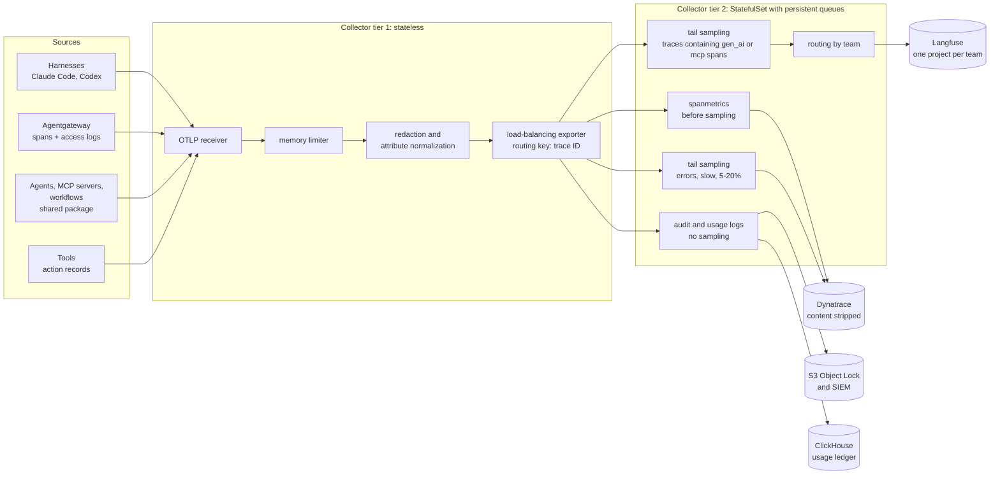

# Observability, audit and accounting

| | |
|---|---|
| Status | Proposal, with verified capabilities and commercial terms |
| Updated | 4 November 2026 |
| Versions checked | Langfuse **4.74.0** (3 November 2026; the demo runs 4.46.x). OTel GenAI semantic conventions: status "Development", moved to `open-telemetry/semantic-conventions-genai` (May 2026), no tagged release. Dynatrace AI Observability docs (28 September 2026) and rate card (retrieved 4 November 2026, undated). Sources: langfuse.com docs and pricing, langfuse/langfuse repository, clickhouse.com blog and legal pages, docs.dynatrace.com |

## Four kinds of record, kept apart

Traces are not an audit log, and an audit log is not a bill. Each record
type has its own source of truth, sampling rule, retention and readers.

| | 1. Operational tracing | 2. Security and action audit | 3. Usage and billing | 4. Agent quality and evaluation |
|---|---|---|---|---|
| Question it answers | Why was this slow or broken? | Who did what, through which agents, approved by whom? | Who used how many tokens, at what cost? | Is the agent good, and is it getting better? |
| Source | OTel spans and metrics from everything | Tool and gateway decisions: allow, refuse, approve, execute | Gateway access logs (one line per model call) | Application spans with content, scores, datasets |
| Sampling | Tail-sampled (errors, slow, 5 to 20% of the rest) | **Never sampled** | **Never sampled** | Sampled by evaluation need; whole traces only |
| Store | Dynatrace | S3 with Object Lock, forwarded to the SIEM | ClickHouse (existing cluster, own database) | Langfuse |
| Content (prompts, outputs) | Stripped | Parameters of actions, not prompts | None | Kept, under classification |
| Retention | Dynatrace default (10 days included) | Audit policy (for example 1 to 7 years) | 13 months or more | 30 to 90 days, by data class |
| Readers | Developers, on-call | Security, auditors | FinOps, team leads | Agent owners |
| Delivery guarantee | Best effort | At least once, persistent queue, alert on loss | At least once, recomputable from logs | Best effort |

**Observed in the demo:** the gateway access log already carries `user.sub`,
`user.roles`, `user.team`, `session.id`, `token.jti` and `actor.chain`, and
the tool writes its own records joined on `operation.id`. That is the right
start for streams 2 and 3. What was missing: a durable store for the tool's
records (in memory by default), and any workflow or task ID on model spans.

## Collector topology

Rules that make this work, each documented upstream:

- **Tail sampling needs every span of a trace on one collector instance.**
  Tier 1 load-balances by trace ID; tier 2 does the sampling. Scaling tier 2
  briefly splits traces.
- **`decision_wait` defaults to 30 seconds,** shorter than agent runs that
  take minutes. Set it to the 99th-percentile task duration, and size
  `num_traces` for memory.
- **Compute span metrics before sampling,** or Dynatrace's metrics are biased.
- **Dynatrace bills ingest before OpenPipeline transforms,** so strip
  content in the collector. Illustration from the rate card: 10 million model
  spans a day at about 20 KB with content is about $13,600 a year to ingest;
  at about 2 KB without, about $1,400.
- **Langfuse accepts OTLP over HTTP only** (no gRPC), authenticates with one
  project's keys, and needs the header `x-langfuse-ingestion-version: 4`.
  Routing to projects happens in the collector.
- **Filtering spans breaks traces.** Keep or drop whole traces; Langfuse
  shows children of a dropped root as orphans.
- The load-balancing exporter's per-endpoint queues cannot be persistent.
  Audit and usage streams therefore take a separate pipeline with a
  `file_storage` queue, and an alert on export failures.
- Tail sampling, the load-balancing exporter and the redaction processor are
  beta. Pin collector versions.

## What a useful agent trace needs

**Observed in the demo:** about 6,760 observations for 59 model calls,
generations named after HTTP routes, most traces unnamed, and one incident
split into several traces ([screenshots](20-demo-review.md#tracing-spans-arrive-but-not-in-a-shape-people-can-read)).
Gateway spans alone give a token, cost and latency ledger with tool calls.
They do not give the agent's structure, the user or session (unless injected),
or the content an evaluator needs.

The shared package sets these on every span the application creates:

| Attribute | Why | Langfuse mapping |
|---|---|---|
| A root span per task, named after the agent and operation, with the task's input and output | Langfuse v4 needs a root with overall input and output; evaluators read it | `langfuse.trace.name`, input, output |
| `user.id` (the `sub`), `session.id` or `gen_ai.conversation.id`, on **every** span via OTel Baggage | Langfuse v4 no longer propagates them from the root | `langfuse.user.id`, `langfuse.session.id` |
| `gen_ai.agent.name`, `gen_ai.operation.name` (`invoke_agent`, `execute_tool`, `chat`) | Observation types | agent, tool, generation |
| `platform.task.id`, `platform.workflow.name`, `platform.workflow.version`, `platform.team` | Cost and quality by workflow; joins to audit and usage | `langfuse.trace.metadata.*` (only these are filterable) |
| `platform.release` (image digest, chart versions, prompt and skill digests) | Ties a score to the exact configuration | `langfuse.release`, `langfuse.version` |
| Content under `OTEL_INSTRUMENTATION_GENAI_CAPTURE_CONTENT` | Off by default; on only for the Langfuse route, by data class | input, output |

`traceparent` must cross every hop: client to gateway, gateway to agent
(A2A), agent to gateway, gateway to tool. The conformance suite checks that
one task produces one trace ID end to end.

Because the GenAI conventions are still "Development", pin instrumentation
versions and normalize attribute names in the collector's `transform`
processor, so a renamed attribute is fixed in one place.

### Telemetry from each source

| Source | What it emits (documented upstream) | Gap |
|---|---|---|
| Claude Code | Metrics, logs and events, traces (beta); `cost.usage`, `token.usage`, `session.id`, `user.email`; content redacted unless enabled; managed settings can enforce | Traces are beta |
| Codex | `[otel]` exporters; events with token counts, tool decisions; `turn.token_usage` | No cost metric, no user email |
| Kiro | Enterprise only: daily metrics (credits, messages) at 02:00 UTC | No traces, no per-session data |
| Xcode | None documented | Use the gateway's view only |
| Agentgateway | GenAI spans, MCP spans, metrics (tokens, TTFT, cost), CEL-enriched access logs | Prompts and completions need explicit CEL fields |
| kagent 1.x | OTel traces (GenAI semconv) for its harnesses; Substrate metrics and logs | A turn can lose its last spans (**observed in the demo**) |
| AgentCore Runtime | CloudWatch by default; `DISABLE_ADOT_OBSERVABILITY=true` plus OTLP variables to send to the collector; platform metrics stay in CloudWatch | Ports 4317 and 4318 reserved inside the microVM |
| Conductor | Traces (`invoke_workflow`, `invoke_agent`, `execute_tool`) via env-configured OTLP | Traces only |

## Langfuse: what OSS gives and what it does not

| Feature | OSS (MIT) | Enterprise (license key) |
|---|---|---|
| Tracing, sessions, users, dashboards | Yes | Yes |
| LLM-as-judge, playground, annotation queues, datasets, experiments | Yes, no limits | Yes |
| Prompt management with labels | Yes | Yes |
| **Protected prompt labels** (who may move `production`) | No | Yes |
| SSO via OIDC (Keycloak), disable sign-up and passwords | Yes, instance-wide | Yes |
| Organization roles (Owner, Admin, Member, Viewer, None) | Yes | Yes |
| **Project-level roles** | No | Yes |
| Project API keys with permission sets (full, viewer, ingestion) | Yes | Yes |
| **Organization API and org-scoped keys** (create projects and keys by API) | No | Yes |
| **Who may create organizations** | No (any user can) | Yes |
| **SCIM** | No | Yes |
| **Data retention policies** | No | Yes |
| **Audit logs** | No | Yes |
| Server-side masking | No (client-side only) | Yes |
| Telemetry to Langfuse | Can be disabled | **Cannot be disabled** ("license compliance") |

Sources: [pricing-self-host](https://langfuse.com/pricing-self-host),
[RBAC](https://langfuse.com/docs/administration/rbac), repository
`entitlements.ts`, read 4 November 2026.

### Workable OSS tenancy

- **One Langfuse organization per team,** projects per environment inside it.
  Organization roles then act as team roles.
- `AUTH_DISABLE_SIGNUP=true`, `AUTH_DISABLE_USERNAME_PASSWORD=true`,
  `LANGFUSE_DEFAULT_ORG_ROLE=NONE`, Keycloak SSO only, a shorter
  `AUTH_SESSION_MAX_AGE` than the 30-day default.
- The collector holds **ingestion-only** project keys; people never handle
  keys for ingestion.
- Redaction happens in the collector, before Langfuse.
- Retention without EE: S3 lifecycle rules for blobs, and a ClickHouse TTL
  managed by hand. That is a schema change Langfuse does not support; treat it
  as an operational risk on every upgrade.
- Project creation is a manual admin task in the UI. At 10 to 20 teams that
  is acceptable; beyond that, the missing organization API is the trigger to
  buy.

What OSS cannot enforce: per-project roles, who creates organizations,
deprovisioning by SCIM, retention, audit of who read what, and who may
promote a prompt to `production`. If any of those is a hard requirement for
a data class, that data class waits for Enterprise.

### Commercial facts, and what they do not say

| Fact | Source and date |
|---|---|
| ClickHouse acquired Langfuse; announced 16 January 2026. Terms not disclosed | Langfuse and ClickHouse blogs, January 2026 |
| "There are no planned changes to licensing." Core features remain MIT | Langfuse blog; ClickHouse blog |
| Self-hosted Enterprise is "Custom Pricing", billed "via AWS Marketplace or invoice" | langfuse.com/pricing-self-host, read 4 November 2026 |
| Enterprise is "Bundled with ClickHouse Cloud, ClickHouse BYOC, or ClickHouse Private", and "Langfuse pricing is additive to your ClickHouse commercial plan" | Same page |
| The ClickHouse Support Services Policy (effective 16 October 2026) has its own row for "Self-hosted Langfuse Enterprise" (Sev 1: 1 hour, 24x7). It applies only to products the customer has a right to support for under its agreement | clickhouse.com/legal/support-services-policy |
| The ClickHouse Self-Managed Addendum (effective 15 July 2026) does not mention Langfuse | clickhouse.com legal |

**What this does not say:** that an existing or future ClickHouse support
contract includes Langfuse Enterprise, or that Langfuse Enterprise can be
bought for self-managed ClickHouse OSS. The pricing page's wording points the
other way: Enterprise is additive to a ClickHouse *commercial plan* (Cloud,
BYOC or Private). **Verify with ClickHouse in writing** before any plan
assumes it.

### Should Langfuse use the existing ClickHouse cluster?

Not for production. Documented constraints:

- **Single shard only.** "Today, Langfuse does not support a multi-shard
  cluster." An existing sharded cluster is out.
- ClickHouse **25.12 or later** for Langfuse v4, and server timezone **UTC**
  ("Langfuse does not support non-UTC ClickHouse timezones").
- A cluster name other than `default` means disabling automatic migrations
  and running them by hand on every upgrade.
- Grants include DDL and mutations on its database and `SELECT` on
  `system.query_log`, which on a shared cluster exposes other applications'
  query text.
- Heavy merges and mutations, and about 3 times disk headroom during a v4
  backfill, contend with the cluster's other tenants.
- Only ClickHouse Cloud, BYOC and the official Kubernetes operator are
  "Official"; other setups are best effort.

So: **a dedicated single-shard ClickHouse** (3 replicas, 3 Keeper) for
Langfuse, run by the team that already knows ClickHouse. The existing
cluster is acceptable for a proof of concept if it is single-shard, UTC,
25.12 or later, and has a database for Langfuse alone. The usage ledger, an
ordinary append-only table, can live in the existing cluster.

### When to buy Langfuse Enterprise

Buy when one of these becomes a requirement, not before:

1. A data class requires retention enforcement or audit of access.
2. More than about 20 teams need projects (the missing organization API).
3. Promotion of prompts to production needs enforced control.
4. SCIM deprovisioning is mandated for every tool with user data.

At that point the realistic options are Enterprise with ClickHouse BYOC in
the organization's AWS account, or Langfuse Cloud. Both change the
data-residency review. Price both against the cost of the controls built
around OSS.

## Dynatrace's role

Dynatrace stays the operational backend: service health, latency, errors,
and gateway and agent metrics. Its AI Observability app also ingests GenAI
spans and offers LLM-as-judge evaluations, which overlaps with Langfuse.
Pick one evaluation home per agent. The proposal: Langfuse for evaluation,
datasets and prompts; Dynatrace for operations. Revisit if the organization
prefers to keep one tool and Dynatrace's evaluation features meet the agent
owners' needs.
