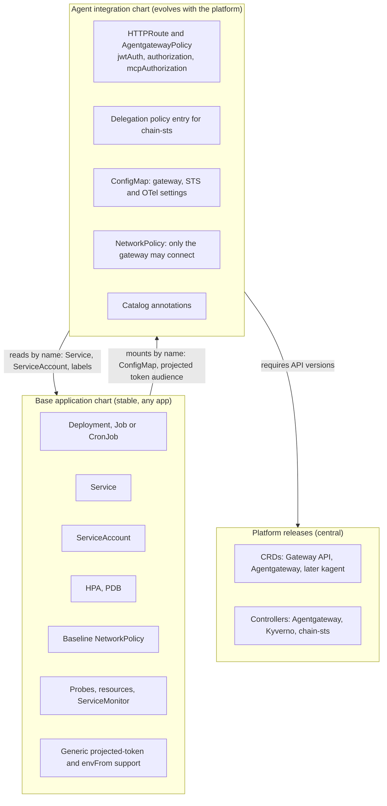

# Frameworks, the shared package, templates and the two-chart model

| | |
|---|---|
| Status | Proposal |
| Updated | 4 November 2026 |
| Versions checked | google-adk **2.13.0** (23 October 2026), google-adk-community 0.5.0, Strands Agents 1.63.0, LangGraph 1.2.19, Pydantic AI 2.65.0, Claude Agent SDK 0.2.178, Copier 9.19.1, Cookiecutter 2.7.1, cruft 2.16.0. PyPI and project docs, read 4 November 2026 |

## Three development paths

| Path | For | Supported by | Contract |
|---|---|---|---|
| 1. Declarative agent | A read-only assistant: prompt, model alias, a few MCP tools | **Deferred** until kagent passes its gate ([Runtimes](12-runtimes.md)). Until then, the Python template with a configuration file covers it | Same conformance suite |
| 2. Python template (reference) | Agents, MCP servers and workflows with real logic | Platform team: template, shared package, charts, docs, office hours | Same conformance suite |
| 3. Independent implementation | Teams with another language or framework | The owning team. Platform supports the gateway, identity and charts, not their code | **Must pass the same conformance suite** |

The conformance suite, not the SDK, is the platform's enforcement. Templates
and the shared package are defaults that make passing easy.

## Python ADK as the reference framework

ADK does not require GCP. It has GCP-coupled defaults that the template must
avoid. Findings from the 2.13.0 wheel and its documentation:

| Need | ADK 2.13.0 on AWS | Assessment |
|---|---|---|
| Models through Agentgateway | `OpenAILlm` with `base_url` and an `api_key` callable "re-invoked on every request"; or `AnthropicLlm` with `client=AsyncAnthropic(base_url=…, auth_token=…)`. The `Claude` class is Vertex-only; Bedrock directly only through LiteLLM | **Fine.** Behind the gateway, native Bedrock support does not matter. Avoid LiteLLM in the template (two compromised releases in 2026, documented by ADK) |
| Sessions | `DatabaseSessionService` on PostgreSQL (asyncpg) | Fine. Session locks are in-process: one replica per session, or sticky routing. **To validate** under HPA |
| Artifacts | Core: memory, file, GCS only. `S3ArtifactService` exists in the community package | **Gap.** Use the shared package's own S3 artifact service (about 150 lines) rather than depend on a community package |
| Memory | In-memory, SQLite, MongoDB; Vertex Memory Bank | Defer memory; no use case needs it |
| MCP with per-call tokens | `McpToolset(StreamableHTTPConnectionParams(...), header_provider=fn(context))` | **Good.** The header provider calls chain-sts per target and per session |
| A2A | `to_a2a()`, `RemoteA2aAgent`, `get_fast_api_app(a2a=True)` | Good |
| Serving | `get_fast_api_app(...)` in a container | Good. Ordinary FastAPI |
| OTel | Core dependency; standard `OTEL_EXPORTER_OTLP_*` | Good. Avoid `trace_to_cloud` |
| Workflows | Sequential, Parallel, Loop agents; ADK 2.x graph `Workflow` with retries and timeouts; resume is "best-effort", at-least-once tool calls | Adequate for in-process steps; not durable execution |
| Fit with kagent | kagent 1.x's own engine is Go ADK; Python ADK runs only through a command override, without skills or MCP token passthrough | **Weaker than assumed.** Choosing ADK does not buy kagent compatibility |
| Release cadence | 2.x minors roughly every two to three weeks | Pin; upgrade monthly with the shared package |

**Recommendation:** keep ADK as the reference, because it is model-agnostic
behind the gateway, has first-class A2A and per-call MCP headers, and its
GCP couplings are avoidable. Hide its model, session, artifact and telemetry
wiring inside the shared package's ADK adapter, so that a change of
framework costs an adapter, not every agent.

**The one alternative worth a two-day spike:** Strands Agents. It is
AWS-maintained, has native Bedrock with Pod Identity, MCP, OTel, A2A and S3
session managers, and would remove the artifact gap. Its native Bedrock is
moot behind the gateway, so the spike should compare per-call MCP header
injection, A2A behavior and the cost of the shared-package adapter. If
Strands is clearly simpler on those, switch before the first template ships.
Other options do not change the decision: LangGraph's Postgres checkpointer
is the strongest resume but brings a heavier model; Pydantic AI has typed
outputs and durable-engine integrations; the Claude Agent SDK runs SKILL.md
natively and refreshes MCP headers on 401 but is Claude-only.

## The shared package

One framework-independent core and one adapter per supported framework
(only ADK at first). Business logic, prompts and tools stay in the
application.

| Module | Responsibility | Tested by |
|---|---|---|
| `context` | Builds a request context from the verified inbound token: `sub`, `act` chain, roles, teams, task ID, deadline. Re-verifies the token against JWKS (the gateway already did; the app does not trust headers) | Conformance: identity tests |
| `sts` | RFC 8693 client for chain-sts: one call per (subject, target); cache keyed by (hash of subject token, target) until 30 s before `exp`; never shared across subjects | CACHE-1 |
| `clients` | MCP and A2A clients with the `sts` header provider, `traceparent`, deadline propagation, idempotency keys on writes, bounded retries (at most 2, only on idempotent or keyed calls, exponential backoff with jitter) | Conformance: resilience tests |
| `models` | Gateway base URL and model aliases from configuration; token provider; per-task token budget counter that stops the task when exceeded | Conformance: budget test |
| `telemetry` | OTel setup, Baggage for `user.id` and `session.id`, the attribute names in [Observability](14-observability.md), content capture by data class, redaction hook | Conformance: telemetry tests |
| `storage` | Session service from a PostgreSQL URL; S3 artifact service with per-app prefix and KMS key | Integration tests |
| `limits` | Task deadline, cancellation (propagates to in-flight model and tool calls), maximum iterations and tool calls per task | Conformance: runaway tests |
| `errors` | Typed errors: `AuthorizationLost`, `StaleApproval`, `BudgetExceeded`, `DeadlineExceeded`, mapped to A2A and HTTP status codes | Unit tests |

Versioned with semver. The platform supports the current and previous minor.
Each release lists the base chart contract, integration chart and platform
contract versions it was tested with.

## Templates and updates

**Copier, not Cookiecutter.** Cookiecutter generates but cannot update a
generated project; cruft adds updates but has had no release since December
2024. Copier 9.19 records answers in `.copier-answers.yml`, updates with a
three-way merge (`copier update`), runs migrations between template
versions, and `copier check-update --quiet` exits 2 when an update exists,
which CI can use.

| Template | Produces |
|---|---|
| `python-agent` | ADK agent: FastAPI app, shared package, A2A, Dockerfile, both charts' values, evaluation scaffold, conformance job |
| `python-mcp-server` | MCP server: token verification, current-actor check, audit records, approval helpers for writes |
| `workflow` | Added after the workflow pilot ([Workflow automation](05-workflow-automation.md)) |

Lifecycle:

1. **Create:** `platform new python-agent` or a "create project" pipeline
   in the templates project, which runs Copier and creates the GitLab
   project by API.
2. **Update:** a scheduled pipeline in each generated project runs
   `copier check-update`; when an update exists it runs `copier update` and
   opens a merge request. Conflicts are marked inline for the owner.
3. **Migrate:** breaking template changes ship with Copier migration scripts
   and a note in the template's changelog; the merge request links to it.
4. **Drift:** `platform check` fails if the project is more than one template
   minor behind, or its shared package is unsupported.

## The two-chart model

### What each chart owns



The base chart contains nothing agent-specific: its projected-token and
`envFrom` support is generic, so a non-agent app never sees an agent
concept. The integration chart never edits the Deployment; it reads the
base release's objects by name and provides a ConfigMap the base release
mounts by name.

### The interface (versioned, contract `1`)

| From base to integration | From integration to base |
|---|---|
| Service `<release>` on port `http` | ConfigMap `<release>-agent-env` with `GATEWAY_URL`, `STS_URL`, `OTEL_RESOURCE_ATTRIBUTES` |
| ServiceAccount `<release>` | Required: a projected token with audience `chain-sts` at `/var/run/secrets/platform/sts-token` |
| Labels `app.kubernetes.io/name`, `app.kubernetes.io/instance`, `platform.example.com/team` | |
| Annotation `platform.example.com/integration-contract: "1"` | Annotation of the same name on every integration resource |

Helm cannot check another release's values at render time in a GitOps
pipeline (`lookup` returns nothing in a dry run). So the contract is checked
twice: in CI, `platform check` renders both charts and validates the
interface; at admission, a Kyverno rule rejects an integration route whose
backend Service lacks the contract annotation or team label.

### Separate releases, not an umbrella

| Concern | Two releases | Umbrella chart |
|---|---|---|
| Independent upgrade | Integration chart bumps without touching the Deployment | Every integration change re-renders and re-applies the app |
| Rollback | Roll back routes and policy without rolling back the app, and the reverse | One rollback for both |
| Ownership | App team owns base values; platform owns integration chart versions | Blurred |
| Install order | Base, then integration (Argo CD sync waves or Flux `dependsOn`) | Implicit |
| Cleanup | Uninstall integration first (traffic stops), then base | Single uninstall |
| Cost | Two releases per app in GitOps | One |

Two releases. The cost is one more entry per app, which the template
generates.

### CRDs and compatibility

- CRDs and controllers are installed only by platform releases, never by
  app charts.
- Each integration chart declares the platform API versions it needs
  (annotation `platform.example.com/requires: agentgateway.dev/v1alpha1>=1.7`).
- The platform publishes a compatibility matrix: integration chart ×
  Agentgateway release × base chart contract × shared package. CI rejects a
  combination outside it.
- When Agentgateway's CRDs change, the platform ships a new integration
  chart minor that renders the new resources, tested against the conformance
  suite in staging before any app bumps.

### Existing applications

An existing app keeps its own chart. It adopts only the integration chart,
once it meets the interface: Service and ServiceAccount names, the three
labels, the projected token and the ConfigMap mount. The adoption guide
lists those five changes; `platform check` verifies them.

### When kagent owns execution (deferred)

If a kagent agent passes the gate, there is no Deployment and no base chart.
The integration chart gains a second mode, `workload: kagent`, that renders
the `Agent`, `AgentTemplate` and `Harness` alongside the same route and
policy. Do not build this mode until the first such agent is approved.

### Distributing integration-chart upgrades

Renovate (or a GitLab scheduled pipeline doing the same) opens merge
requests in each app's deployment repository when a new integration chart
is published. Patch and minor bumps merge automatically after the app's
staging deployment passes the conformance suite; major bumps need the owner's
approval and come with a deprecation window of at least one platform release.

## The release record

Every deployment produces one record, attached to the image in ECR as an
in-toto attestation and copied into the Langfuse release attribute:

```yaml
release:
  app: helpdesk-agent
  gitSha: 4f2c1e9
  image: 123456789012.dkr.ecr.eu-west-1.amazonaws.com/helpdesk-agent@sha256:...
  charts: {base: 1.3.2, agentIntegration: 2.1.0, contract: "1"}
  framework: {google-adk: 2.13.0, platform-agent-core: 0.6.1, platform-agent-adk: 0.6.1}
  template: {name: python-agent, version: 1.4.0}
  models:                       # alias -> what the gateway resolved at deploy time
    default: {alias: claude-sonnet, provider: bedrock, id: <from gateway config>, gatewayRelease: 1.7.0}
  prompts: [{name: helpdesk-system, digest: sha256:...}]
  skills: [{name: runbook-search, version: 1.2.0, digest: sha256:...}]
  workflows: []
  permissions:
    routes: [/a2a/helpdesk-agent]
    tools: [docs-mcp:search, catalog-mcp:get_service]
    delegation: {target: /mcp/docs, after: [chat-ui]}
  evaluation: {suite: evals/helpdesk, run: <langfuse dataset run id>, passed: true}
```

The pipeline refuses to deploy without a passing evaluation run for the
same image digest and prompt digests.

## Framework-independent conformance suite

Runs against any deployed agent or MCP server, whatever its language. It
uses a mock STS, a mock tool and the real gateway in a test namespace.

| Group | Tests |
|---|---|
| Identity | Rejects missing, expired, wrong-audience and untyped tokens; re-verifies rather than trusting headers; uses chain-sts for downstream calls (the mock tool sees `aud` = itself and `act.sub` = the agent); never forwards its inbound token |
| Resilience | Honors a deadline header; propagates cancellation to in-flight calls; retries at most twice, only idempotent or keyed calls; sends idempotency keys on writes |
| Runaway | Stops at the configured iteration limit and per-task token budget with `BudgetExceeded`; stops at the deadline with `DeadlineExceeded` |
| Telemetry | One trace ID end to end; required attributes present; a canary secret in input does not appear in exported spans |
| Network | Cannot reach Bedrock, public model APIs or tools except through the gateway |
| Lifecycle | Ready only when dependencies are; drains on SIGTERM within the grace period; no state lost on restart (stateful paths) |
| Packaging | Image signed and digest-pinned; release record present; both charts at supported versions |
