# The demo: what it shows, what it does not, and where docs and code differ

| | |
|---|---|
| Status | Review. Nothing in the demo repository was changed |
| Updated | 4 November 2026 |
| Reviewed | `agentgateway-demo` as of its last commit on 3 November 2026 (`cbc3ffb`): Agentgateway 1.7.0, Keycloak 26.7.5, chain-sts 0.2.1 (some docs still say 0.2.0), kagent and Agent Substrate 1.0.0-rc1, Agentregistry, Langfuse 4.46.x |
| Method | Read the README, CONTRIBUTING, `docs/`, the chain-sts and delivery-mcp source, the charts and policies. Viewed the running kind cluster in a browser, read-only. Later the same day, at the reader's request, one incident was driven through the UI (`task demo:preflight`, `demo:reset`, `demo:break`, clicks as the three roles, `demo:reset`) to capture `screenshots/incident-*.png` |

Paths below are relative to the demo repository root
(`/mnt/data/rocket/Projects/Work/Architecture/agentgateway-demo`).
**Observed in the demo** means seen on the running cluster or in its dated
records. **In code** means read in the source, not run.

## What the demo is

A kind cluster runs one incident. A release breaks a sample app's search. An
alert starts a read-only diagnosis agent. Three signed-in roles propose,
approve and apply a rollback from an incident card. Every agent, tool and
model call goes through Agentgateway, with three named exceptions (section
"What still goes around the gateway"). Its own README calls its results
"observations, not pilot evidence". This review keeps that framing.

## Screenshots from the running demo (4 November 2026)

The views below were taken at the reset state (search 2.0.0, no open
incident); the gateway, Langfuse and kagent pages show the incidents run on
3 November. A full incident was driven later the same day (09:54 to 09:56
UTC): its fifteen screenshots, `screenshots/incident-01` to `incident-15`, are
in the [Confluence demo walkthrough](confluence/12-demo-walkthrough.md).

### Identity: one sign-in, brokered

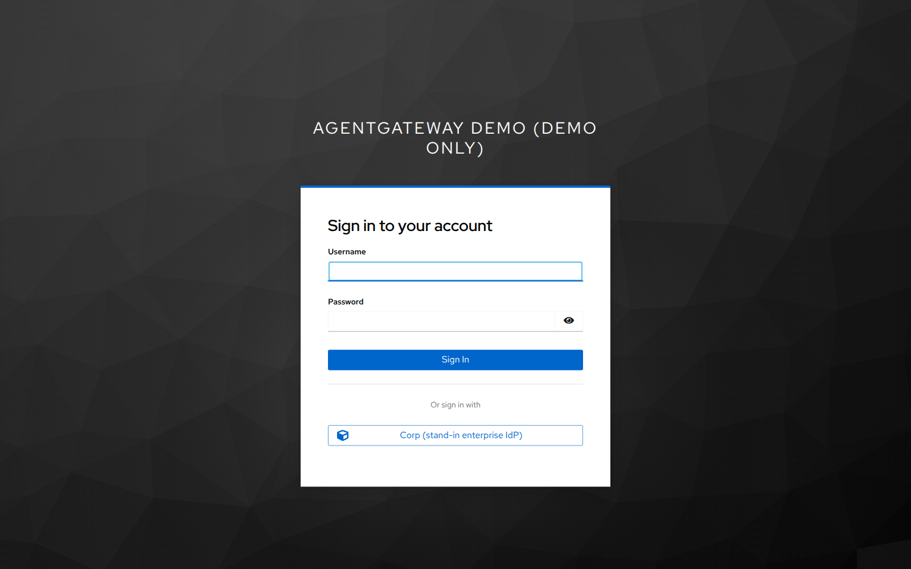

Keycloak is the platform's authorization server and brokers an
enterprise IdP. In the demo a second Keycloak realm, `corp`, stands in for
Okta or Ping. This is the design proposed in `docs/production-design.md`,
section 2, and run on 3 November with a revocation drill
(`docs/measurements.md`, "The identity broker").

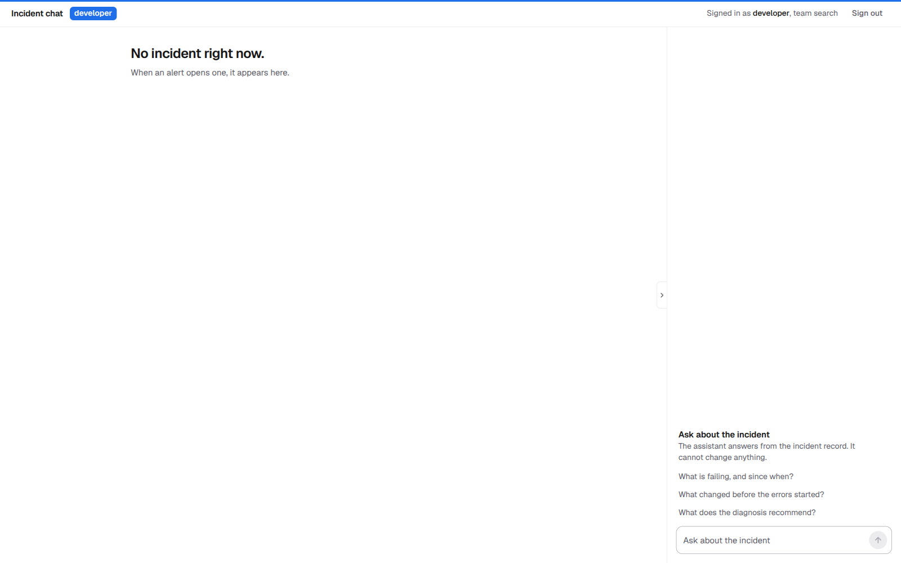

### Gateway: rules live in the gateway, not in prompts

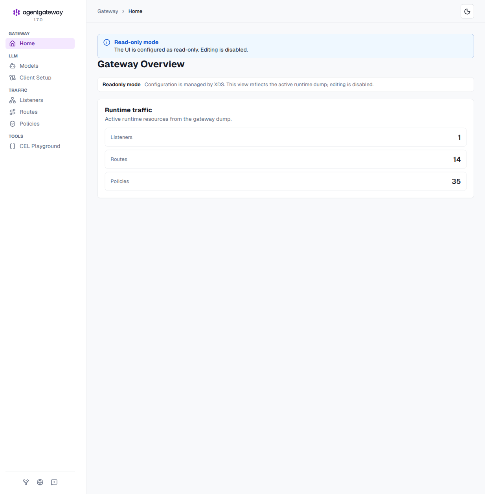

The UI is read-only because configuration comes from Kubernetes resources
through the controller, which is the GitOps-friendly mode. One listener
carries every model, MCP and agent route.

The per-tool rule checks three things: the role, the issuer, and the
**current** actor (`jwt.act.sub`). It does not use prior actors for access
decisions, which is what RFC 8693 section 4.1 requires. **In code:** the tool
server behind it does not check the actor at all
(`components/delivery-mcp/src/delivery/service.py:7-10`: "The chain decides
nothing here"). The rule holds only because NetworkPolicy keeps every caller
but the gateway out.

### Cost and attribution: the gateway knows tokens and cost, but not always who

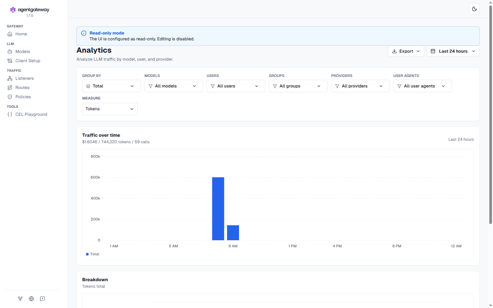

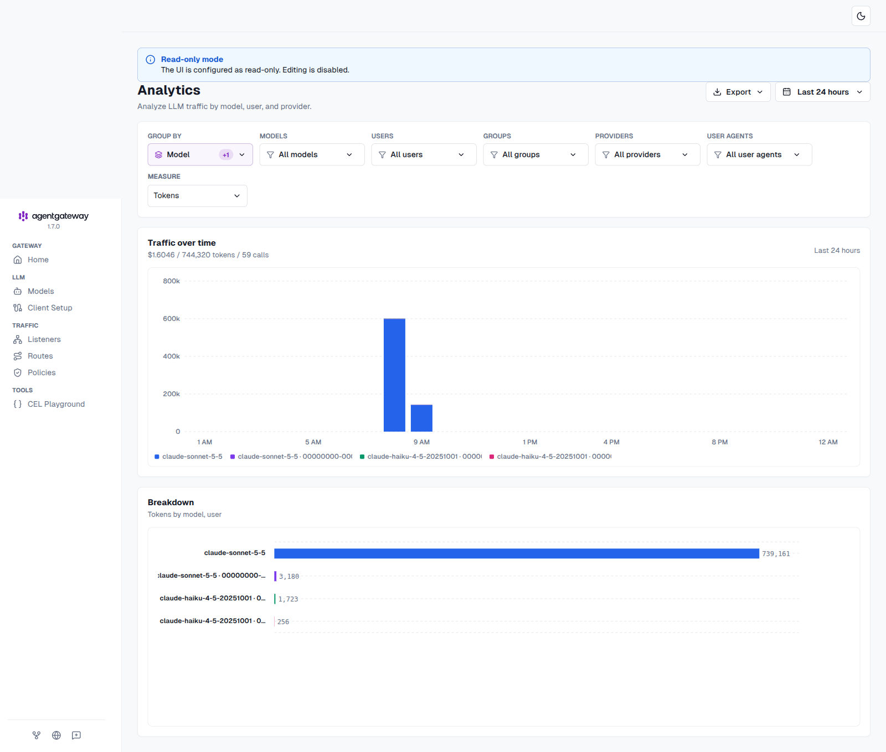

**Observed in the demo:** 739,161 of 744,320 tokens (99.3%) in the last 24
hours carry no user. They are the diagnosis agent's, which calls the model
with a workload key because kagent cannot join a chain-sts delegation chain
(`agent-deployments/clusters/dev/platform/60-kagent/README.md`). The rows that
are attributed show Keycloak `sub` UUIDs, not names or teams. Attribution
needs a join to a directory, and every workload needs a workflow or owner
attribute, before this page can be used for chargeback.

### Tracing: spans arrive, but not in a shape people can read

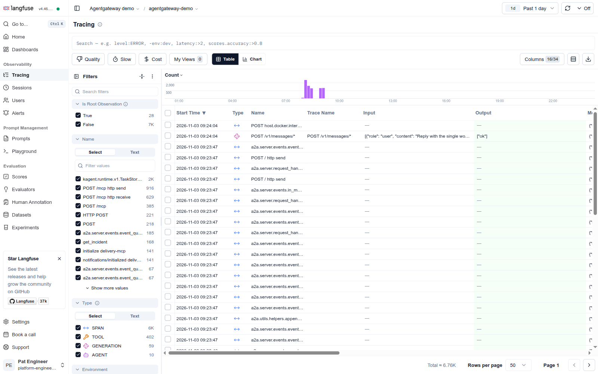

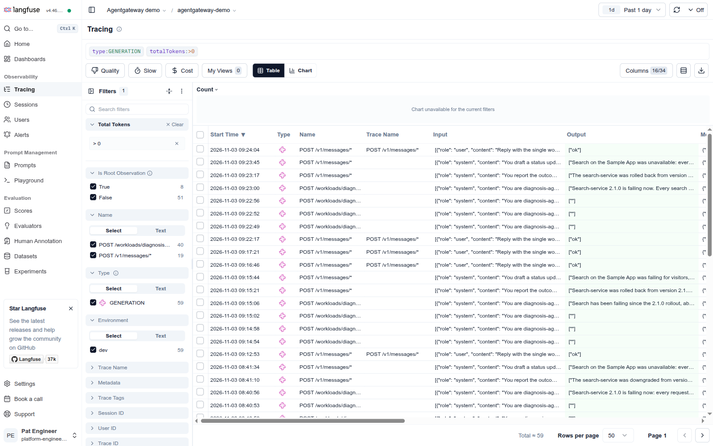

**Observed in the demo:** about 6,760 observations for 59 model calls.
Generations are named after gateway routes, and most traces have no name. One
incident appears as several traces (`docs/measurements.md`, "The full
incident"). OTLP export works, but the result is not yet a useful agent trace
for evaluation. Section [Observability](14-observability.md) proposes the
fix: semantic span names and `langfuse.*` attributes set by the application,
and filtering infrastructure spans in the collector.

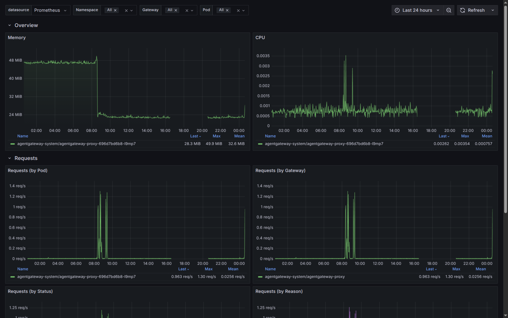

The proxy is small: 24 to 50 MiB and under 0.004 CPU at demo load. That says
nothing about production throughput, but it does show the gateway is not
where cost goes.

### Catalog: useful listing, no versions

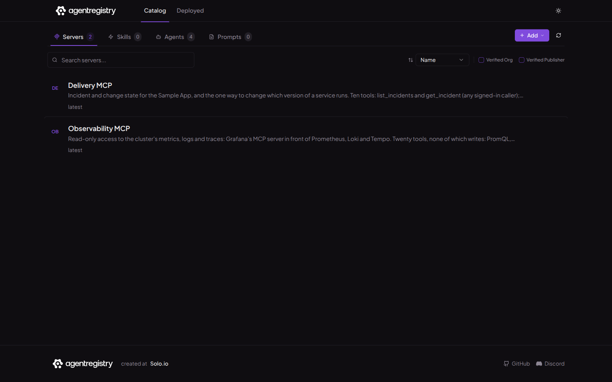

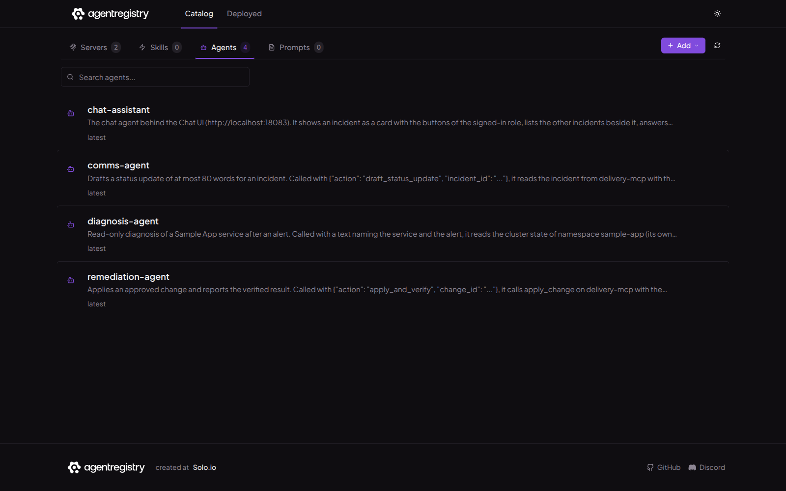

Every entry is `latest`. There are no skills, because the Agentregistry
version used accepts skills only from Git sources
(`agent-deployments/clusters/dev/platform/70-agentregistry/README.md:16-19`).
The registry is a catalog, not in any request path. That is the right role,
but immutable versions and digests are what the organization most needs from
it (section [Gateway and registry](11-gateway-and-registry.md)).

### kagent and Agent Substrate: Kubernetes, but not Deployments

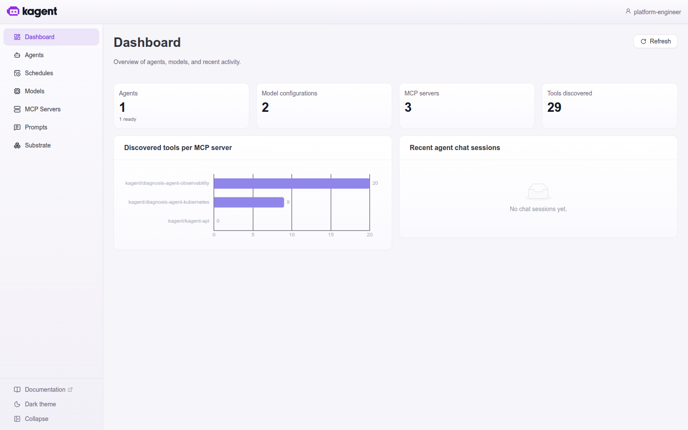

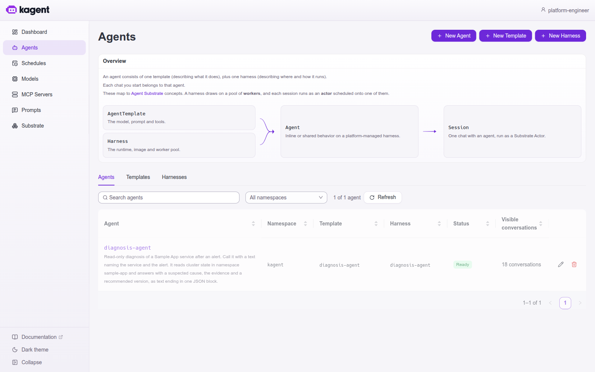

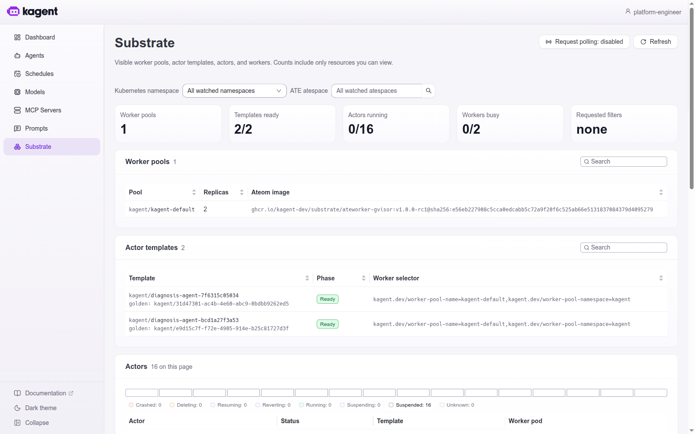

**Observed in the demo:** each chat session is a Substrate *actor* that is
suspended to a snapshot and resumed onto a worker from a pool. The worker
image is `ateworker-gvisor`. Actors, worker pools, golden snapshots and
"atespaces" are concepts with no Deployment, ReplicaSet or Pod-per-agent
equivalent. `kubectl get pods` does not show sessions. A platform engineer
debugging a stuck session needs new tools (`kubectl-ate`) and new failure
modes (snapshot store, restore, worker pool exhaustion). This is the
strongest argument in the review for keeping kagent and Substrate optional
(section [Runtimes](12-runtimes.md)).

## Patterns worth carrying to production

Ranked by value. Each is **in code** and, where noted, **observed in the demo**.

| # | Pattern | Where |
|---|---|---|
| 1 | **Two layers of authorization.** The gateway makes the coarse decision in CEL: route, role, current actor and tool name. The tool re-verifies the token and enforces business rules and state. Prompts hold no rules | `agent-platform/policies/agentgateway/route-auth/templates/policy.yaml:42-89`; `components/delivery-mcp/src/delivery/service.py:254-324` |
| 2 | **Per-target delegation tokens.** An agent asks chain-sts for a token for exactly one route (RFC 8707 `resource`), naming the user as `sub` and itself as current `act`. Lifetime is `min(subject.exp, now+300s)` | `components/chain-sts/src/chain_sts/service.py:158-237` |
| 3 | **Actors proven by Kubernetes TokenReview,** which also rejects a token whose pod is gone | `components/chain-sts/src/chain_sts/actors.py:171-234` |
| 4 | **The gateway is the only door, by policy and not by convention.** Default-deny NetworkPolicy with gateway-only ingress, and Kyverno rules that close five bypasses demonstrated on Agentgateway 1.6.0 | `agent-platform/policies/network/workload-boundary/`; `agent-platform/policies/kyverno/gateway-rules/values.yaml:5-47` |
| 5 | **Writes are a tool-enforced state machine.** Propose, approve, apply are separate calls; apply is an atomic transition from `approved`; parameters are fixed at proposal; replays return `replayed: true`. No model is in the decision | `components/delivery-mcp/src/delivery/store.py:368-422`; `components/chat-assistant/packages/server/src/actions.ts:9-12` |
| 6 | **One audit schema joined on `sub`, `sid`, `jti` and an operation ID,** across gateway access logs and tool records | `agent-platform/profiles/gateway/telemetry/templates/policy.yaml:51-95` |
| 7 | **Workload keys stored as hashes, scoped per route,** for clients that cannot carry a user token | `agent-platform/profiles/kagent/model-access/values.yaml:18-51` |
| 8 | **Separation of duties on the immutable `sub`,** not the user name or `(iss, sub)` | `docs/production-design.md`, section 2.5 |
| 9 | **Leaver drill with measured timings.** Disabled at the IdP, the reconciliation job ended the Keycloak session in 0.12 s; the last access token was refused 1.2 s after its `exp` (1,800 s) | `docs/measurements.md`, "The identity broker" |
| 10 | **A candid evidence vocabulary** (observed, documented upstream, to validate, to verify) and dated measurements | `CONTRIBUTING.md` |

## Gaps a production design must close

Ranked by risk. All **in code** unless marked.

| # | Gap | Evidence | What production needs |
|---|---|---|---|
| 1 | **Approvals are not bound to live state and do not expire.** `previous_version` is recorded at proposal and never compared at apply. No TTL. Apply has no separation-of-duties check. Helm upgrade uses `--reuse-values` without an expected revision | `components/delivery-mcp/src/delivery/service.py:294, 308-324, 375-397`; `applier.py:92-107` | Approval bound to a digest of action, parameters and resource version; expiry; revalidation at execution; SoD on apply ([Identity profile](04-identity-profile.md), test group APR) |
| 2 | **Approval state is in memory by default.** `DELIVERY_DB_PATH` defaults to `:memory:`, and dev does not set it. A restart loses approvals and their audit | `components/delivery-mcp/src/delivery/config.py:129` | Durable store (PostgreSQL) and an append-only audit stream |
| 3 | **The actor chain is enforced only at the gateway.** The tool accepts any valid Keycloak token for audience `agentgateway` | `service.py:7-10`; `identity.py:210-212` | Tools enforce the current actor too, or the gateway-to-tool hop is authenticated (mesh mTLS with an authorization policy) |
| 4 | **chain-sts does not narrow.** `scope` is ignored, all carried claims (roles included) are copied, `may_act` is off in dev, any listed agent can act for any user | `service.py:140-251`; `agent-deployments/clusters/dev/platform/90-chain-sts/policy.yaml:71` | Downscoping per target, an explicit delegation grant (`may_act` or a policy record), and a test that refuses an unapproved agent |
| 5 | **Revocation is expiry-bound.** `sid` is copied but never checked; no introspection or deny list | `policy.yaml:65`; `docs/production-design.md:619` | A measured deactivation-to-refusal objective; short lifetimes; optional session check for writes |
| 6 | **Signing key in a Secret, manual rotation.** The gateway refetches JWKS every 5 minutes and not on an unknown `kid` | `components/chain-sts/src/chain_sts/keys.py:57-72`; `rotate.py:27-32` | KMS signer, scheduled overlapping rotation, `kid`-miss refetch |
| 7 | **No model budgets or rate limits; the model route admits any valid token** | `agent-deployments/clusters/dev/platform/30-model-route/access.yaml:17` (`allow: []`) | Per-principal token budgets and request limits (see [Gateway and registry](11-gateway-and-registry.md)) |
| 8 | **Bedrock unproven.** No completion has come back; static keys in a Secret, not IRSA or Pod Identity; Langfuse cost patterns do not match Bedrock IDs; the Kyverno host rule cannot cover a Bedrock backend | `README.md`, "Switching to Bedrock" | First pilot task |
| 9 | **Plain HTTP everywhere,** including issuers; chain tokens use `typ: JWT`, not `at+jwt` (RFC 9068), and no verifier checks `typ` | `keys.py:186`; `docs/production-design.md:442-446` | TLS; explicit typing per RFC 8725 section 3.11 |
| 10 | **Kyverno exemptions by group and by Helm labels that a team can also set** | `agent-deployments/clusters/dev/platform/80-policies/gateway-rules.yaml:11-13` | Exempt by the deployer's identity only |

## What still goes around the gateway

| Path | Why it exists | Production answer |
|---|---|---|
| diagnosis-agent reads Kubernetes through its own tool server, directly | kagent's MCP client cannot carry a chain token | Route through the gateway with a workload identity, or accept and document a read-only exception |
| The kagent console starts chats outside the gateway; any signed-in user can edit or delete agents | kagent does not verify token signatures (`60-kagent/README.md:110-126`) | Do not expose the console to users; GitOps-only agent changes |
| `chat-ui-from-this-machine` opens the chat-assistant port to the host | Demo convenience | Remove |
| delivery-mcp egress to the API server is a node CIDR on 6443 and 5000 | kind networking | Narrow egress to the API server endpoint |

## Where the documentation and the code differ

| Documentation says | Code does |
|---|---|
| chain-sts 0.2.0 (`README.md:3`, `docs/cluster.md`, `demo/run-of-show.md`, two more) | 0.2.1 is deployed (`agent-deployments/clusters/dev/platform/90-chain-sts/values.yaml:15`) |
| `apply_change` "accepts only remediation-agent" (`docs/system-architecture.md:226-229`) | Only the gateway checks this. The tool ignores the chain |
| A chain subject must be "for this agent's own route" (`docs/system-architecture.md:476-477`) | chain-sts accepts a chain-sts subject token with any configured audience (`service.py:299`); downstream audience checks catch misuse |
| Policy audiences "both also hold `agentgateway`" during rollout (`docs/system-architecture.md:547-550`) | They no longer do (`route-auth/templates/policy.yaml:47-52`). Stale |
| "Every call carries the caller's verified identity" (`README.md:12-14`) | Not the diagnosis agent's model and tool calls, which is 99% of tokens by volume (screenshot above). The README names the exception, but the headline overstates it |
| The service "decides state and idempotency" (`docs/system-architecture.md:113-119`) | True, but state is lost on restart in dev |
| The per-target replay refusal is done (`docs/production-design.md`, section 5, item 1) | The refusal test has not run since the change ("to validate") |

## What the demo does not show

- Bedrock, IRSA or Pod Identity, Okta or Ping, EKS, Istio, Karpenter, Spot.
- Token budgets, concurrency limits, or runaway-task limits.
- Any coding harness (Claude Code, Codex, Kiro, Xcode) signing in through the
  gateway. The MCP sign-in flow stops at gap 3: the issuer is `localhost`,
  so the authorization server metadata returns HTTP 500
  (`docs/production-design.md`, section 2.4).
- A base or agent-integration chart split. The nearest analogue is the generic
  `agent-platform/charts/agent` chart plus separate gateway-integration
  charts (`route-auth`, `mcp-route`, `a2a-route`, `model-route`,
  `telemetry`), consumed by relative path with no chart registry.
- Durable workflows, long-running tasks, or credential refresh past a
  token's lifetime. Agents fail closed when the upstream token expires.
- Skills distributed through the registry, or versioned artifacts of any kind.

## What this review takes from the demo

1. The **gateway plus tool** split of authorization is right, and production
   should make the tool tier enforce the actor too ([Architecture](01-architecture.md)).
2. The **Keycloak broker plus a narrow chain-sts** is the right starting
   identity design on base-tier IdP licenses. Its gaps are listed and
   bounded ([Identity profile](04-identity-profile.md)).
3. **kagent and Substrate work, but add an unfamiliar operating model,**
   and the hosted agent in the demo could not carry user identity. Keep them
   off the critical path until both change ([Runtimes](12-runtimes.md)).
4. **Telemetry needs application-level semantics,** not more spans
   ([Observability](14-observability.md)).
5. **The skill-versus-prompt measurement is informative:** moving the
   diagnosis runbook into a skill added one model call, 5 to 7 seconds and
   10,000 to 25,000 input tokens per diagnosis, and the model still varied
   the order of its reads from the runbook (`docs/measurements.md`,
   "diagnosis-agent"). Skills guide; they do not enforce
   ([Workflow automation](05-workflow-automation.md)).
