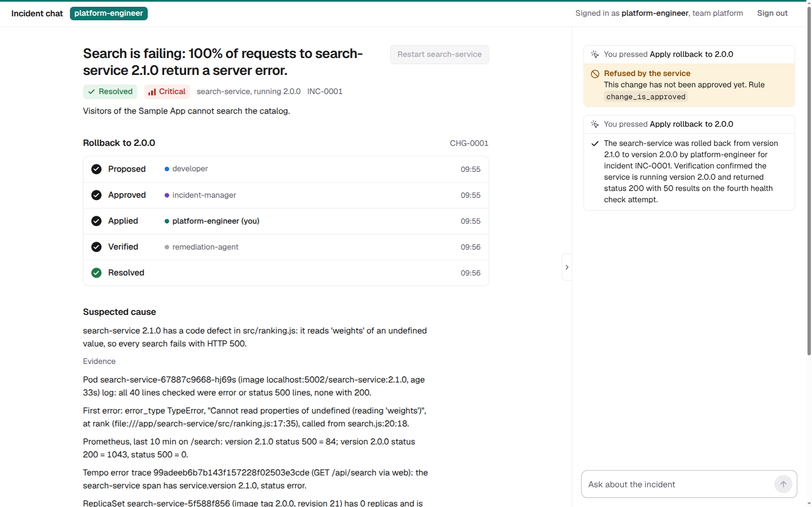

# Agent platform on AWS

| | |
|---|---|
| Status | Proposed: decision requested |
| Owner | Platform architecture |
| Audience | Managers, architects, developers and platform engineers |
| Updated | 4 November 2026 |

> **In short**
> - We propose one governed way for people, pipelines and apps to use AI models, tools and agents, built on the EKS, GitLab and AWS setup we already run.
> - It costs about $590,000 a year at 200 developers, three quarters of it people. We start with what already exists: coding tools and the MR reviewer.
> - We ask for approval of an 11-week first stage, with measurable results and agreed stop conditions.

## What we propose

1. **One door.** Every call to a model, a tool or an agent goes through
   Agentgateway. It checks who is calling, allows only approved models and
   tools, limits usage and records the cost per person and team.
2. **Identity that travels.** When an agent acts for a person, the tool it
   calls sees both: the person, and the agent acting for them. Each tool keeps
   its own business rules.
3. **Ordinary applications.** Agents run as normal Kubernetes applications
   and GitLab jobs, so teams use the skills, pipelines and on-call they
   already have. New runtimes wait until a workload needs one.
4. **One supported way to build,** with a template, two deployment charts
   and tests that any team's agent must pass.
5. **Records that answer four questions:** is it healthy, is it any good, who
   did what, and what did it cost.

## Why now

- Developers already use AI coding tools, but today's main tool cannot be
  routed through a gateway. We cannot see or control that usage per person.
- Teams already build agentic tools, such as the MR reviewer and shared
  skills, but each solves model access, identity and logging its own way, and
  skills run inconsistently.
- A working demo shows the approach end to end: an alert, a diagnosis by an
  agent, a proposal, a refused change, an approval and a fix in under two
  minutes, with every step recorded.

## What it costs

| | Per year, steady state |
|---|---:|
| Platform team (2 FTE) | $440,000 |
| AI model usage for coding tools (200 developers) | $94,000 |
| Infrastructure, monitoring, agents' model usage | $53,000 |
| **Total** | **about $590,000** |

The first year adds about $290,000 for building and training. Staffing is the
biggest lever. The biggest avoidable risk is losing prompt caching through the
gateway, which would add about $180,000 a year. Details: [Cost](05-cost.md).

## What we are asking for

| Ask | Why |
|---|---|
| Approve stages 0 and 1 (11 weeks) | Governed access for the largest usage (coding tools) and the existing MR reviewer, with measurable criteria |
| Staff 2.9 FTE for the first year, inside the existing platform team | Staff is 75% of the cost; a separate team would push it toward $1 million |
| Answer eight questions: our identity licenses, GitLab version, who runs identity on-call, data rules, team size | Each changes what we build ([Decisions and open questions](07-decisions-and-open-questions.md)) |
| Agree the stop conditions | A missed result narrows the program instead of extending it |

## Where things stand

| | |
|---|---|
| Decided | Nothing yet. This is a proposal |
| Built | A demo on one machine, rerun on 4 November 2026. It is evidence of what works, not proof of production readiness |
| Next | Stage 0: decisions, an inventory of what we run, and baselines to measure against |

## Read next

| If you are | Read |
|---|---|
| A manager | [Cost](05-cost.md), [Roadmap and pilots](06-roadmap-and-pilots.md), [Decisions and open questions](07-decisions-and-open-questions.md) |
| An architect | [Architecture](01-architecture.md), [Security and identity](03-security-and-identity.md), [Decisions and open questions](07-decisions-and-open-questions.md) |
| A developer | [Building on the platform](02-building-on-the-platform.md), then [Security and identity](03-security-and-identity.md) |
| A platform engineer | [Architecture](01-architecture.md), [Running the platform](04-running-the-platform.md), [Technology assessments](11-technology-assessments.md) |

> **Go deeper**
> The full architecture review, with evidence and sources, is in GitLab: [the review's starting page](../00-recommendation.md).
