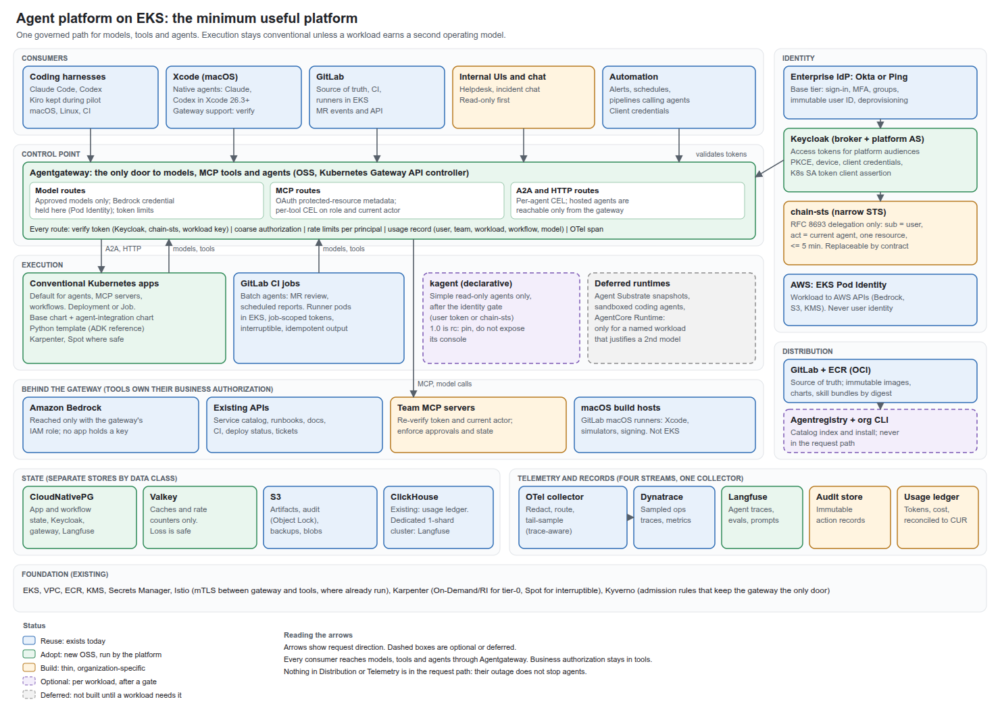

# Agent platform: Architecture

| | |
|---|---|
| Status | Proposed |
| Owner | Platform architecture |
| Audience | Architects, developers, platform engineers |
| Updated | 4 November 2026 |

> **In short**
> - Agentgateway is the only door to models, tools and agents; calls around it are blocked and tested.
> - Each decision has one owner: the gateway decides who may use what, the identity service decides which agent may act for whom, and the tool decides what may happen to its data.
> - Agents run as ordinary Kubernetes apps and GitLab jobs; kagent, Agent Substrate and AgentCore are optional or deferred.

## The picture

Colors show what is new: blue exists today, green is open source the platform
adopts, amber is the little the platform builds, dashed is optional or
deferred.

## Five principles

1. **One door.** Every model, tool and agent call goes through Agentgateway.
   A call around it is a defect. It is prevented by AWS permissions, network
   rules and deployment checks, and tested.
2. **Identity travels, keys do not.** The person's identity reaches the tool
   in a short-lived token for that tool alone, naming the agent acting for
   them. The Bedrock credential stays in the gateway.
3. **One owner per decision.** No two systems decide the same question (see
   below).
4. **Ordinary execution first.** An agent is a Deployment or a Job until a
   workload proves it needs something else.
5. **Only what is in the request path can stop agents.** Identity and the
   gateway are critical. The catalog, Langfuse and dashboards can fail
   without stopping work.

## Who decides what

| Question | Decided by |
|---|---|
| Who is this person? | The enterprise IdP (Okta or Ping), brokered by Keycloak |
| May this caller use this route, tool, agent or model? | Agentgateway |
| May this agent act for this person, against this target? | chain-sts, the delegation service |
| May this happen to this resource now (ownership, approvals, state)? | The tool or service itself |
| May this workload connect to that one? | Network policy (or Istio, where it runs) |
| Which Bedrock models may the platform call? | AWS IAM: only the gateway's role |
| How much work may one task do? | The application, through the shared package |

## Who owns what

| Owner | Owns |
|---|---|
| Platform team | Gateway, delegation service, charts, templates, shared package, CLI, catalog, Langfuse, conformance tests |
| Identity team, or platform (to decide) | Keycloak, IdP federation, role mapping, leaver process |
| Application teams | Their agents: code, prompts, evaluations, budgets, their own on-call |
| Tool owners | Their MCP servers: business rules, approvals, audit records |
| Infrastructure and observability (existing) | EKS, network, Karpenter, ECR, KMS, the OTel collector, Dynatrace |
| Security | Delegation policy, data classes, retention, bypass tests |
| FinOps | Reconciling usage with the AWS bill; chargeback |

## Built, reused, adopted

Almost everything is reused or adopted. The platform builds only: a narrow
delegation service (already about 1,750 lines in the demo), a shared package,
two charts, two templates, a thin CLI, a catalog generator and the
conformance tests. The component-by-component verdicts are in
[Technology assessments](11-technology-assessments.md).

> **Not decided yet**
> Who runs Keycloak and the delegation service around the clock, and whether Istio or network policy enforces "only the gateway may connect". See [Decisions and open questions](07-decisions-and-open-questions.md).

> **Go deeper**
> [Architecture and responsibility boundaries](../01-architecture.md) and [Build, reuse, buy or defer](../02-build-reuse-buy-defer.md) in the review.
