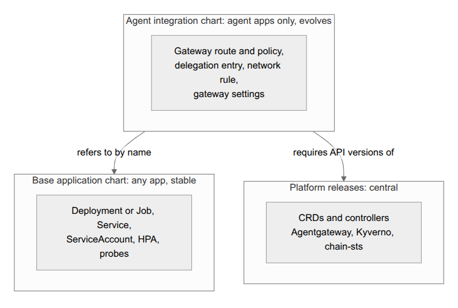

# Agent platform: Building on the platform

| | |
|---|---|
| Status | Proposed |
| Owner | Platform team |
| Audience | Developers, platform engineers |
| Updated | 4 November 2026 |

> **In short**
> - One supported path: a Python template with a small shared package, two Helm charts, and GitOps deployment you already know.
> - Teams with another stack can build their own way, as long as they pass the same conformance tests.
> - Coding tools (Claude Code first, Xcode included) reach models through the same gateway, with shared skills installed by one CLI.

## Three ways to build

| Path | For | What you get |
|---|---|---|
| **Python template** (supported) | Agents, MCP servers and workflows with real logic | Generated project, shared package, both charts, CI, evaluation setup, platform support |
| **Your own stack** | Teams with another language or framework | Gateway, identity and charts. You own your code; you pass the same tests |
| **Declarative agent** (later) | Simple read-only assistants defined as configuration | Waits until kagent reaches a stable release and can carry user identity |

The conformance tests, not the template, are the rule. They check identity
handling, retries and limits, telemetry and network behavior for any agent.

## From idea to retirement

| Step | What you do | What the platform does |
|---|---|---|
| Scaffold | `platform new python-agent` | Generates the project with everything wired |
| Develop | Run locally against the dev gateway with your own sign-in | Mirrors production identity, so what works locally works deployed |
| Get access | Merge request naming the tools your agent needs | Tool owner approves; security approves new write access |
| Release | Tag a version | Builds, signs and records the exact configuration; refuses deploys without passing evaluations |
| Deploy | Merge request to the deployment repo | GitOps applies it: staging, then production |
| Upgrade | Review the automated merge requests | Template, package and chart updates arrive as MRs; small ones merge after tests pass |

What you never have to do: hold a model key, write token handling, set up
tracing, or install cluster components.

## Deploying: two charts

- **Base application chart:** the ordinary app (Deployment or Job, Service,
  autoscaling). Used by every app, agentic or not. Stable.
- **Agent integration chart:** the gateway route, its rules, the delegation
  entry and the network rule. Only for agent apps. It changes as the platform
  evolves, without touching your app.
- They are **separate releases**, so you can upgrade or roll back one without
  the other. Existing apps can adopt the integration chart with five small
  changes.

## Coding tools

| Tool | Status | Notes |
|---|---|---|
| Claude Code | **Supported** | Routed through the gateway to Bedrock; settings managed centrally; full telemetry |
| Codex | Supported if OpenAI models on Bedrock are approved | Uses OpenAI models only |
| Kiro | Kept for current users, measured | Cannot be routed through a gateway today |
| Xcode | Validating | Terminal tools with Xcode's MCP bridge first; Xcode's own agents after a test on a Mac |

Signing, provisioning and device tests stay on macOS runners; agents never
receive signing credentials.

## Sharing skills and tools

- GitLab stays the source of truth. Releases are immutable, signed and pinned
  by digest.
- A catalog lists every agent, tool and skill with its owner, support status,
  version and last evaluation.
- One CLI (`platform login`, `search`, `install`, `check`) installs skills and
  tools into whichever coding tool you use.
- Repeatable workflows become explicit, typed definitions run by GitLab
  pipelines, with skills as guidance inside them. A pilot on one workflow
  decides the details.

> **Not decided yet**
> Whether Google ADK or Strands Agents is the reference framework (a two-day comparison decides), and the workflow runner (decided by the pilot). See [Decisions and open questions](07-decisions-and-open-questions.md).

> **Go deeper**
> In the review: [Developer lifecycle](../03-developer-lifecycle.md), [Frameworks and charts](../15-frameworks-and-charts.md), [Developer harnesses](../16-developer-harnesses.md), [Workflow automation](../05-workflow-automation.md).
