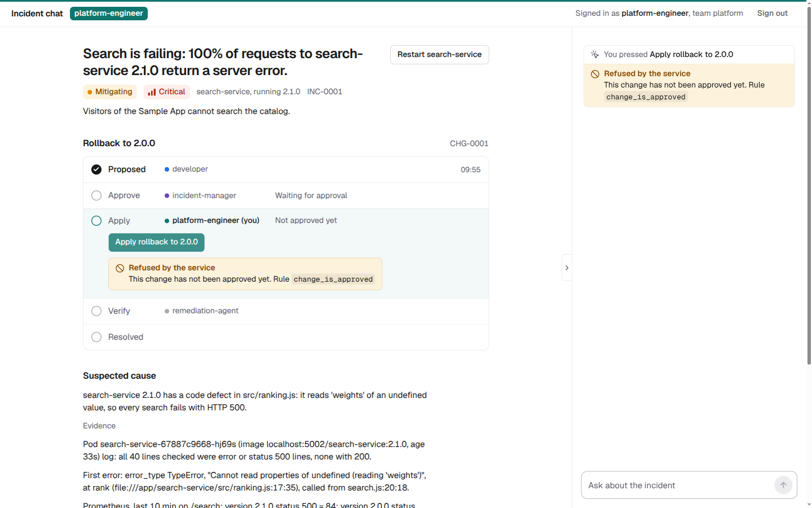

# Agent platform: Security and identity

| | |
|---|---|
| Status | Proposed |
| Owner | Platform architecture, with security and identity |
| Audience | Architects, security, platform engineers |
| Updated | 4 November 2026 |

> **In short**
> - People sign in through Okta or Ping as today; Keycloak issues the platform's tokens; a small delegation service lets an agent act for a person without ever holding their password or long-lived token.
> - Every tool sees who the person is and which agent is acting, and enforces its own rules. Writes need an approval of the exact change, enforced by the tool.
> - The delegation service follows a written standard profile with automated tests, so a commercial product can replace it the day one passes.

## How identity travels

In plain terms:

- **The person** signs in once, with MFA at the enterprise IdP.
- **The agent** never reuses the person's token elsewhere. For each tool it
  asks the delegation service for a token that names the person, names
  itself, works for that one tool only, and expires in five minutes.
- **The gateway** checks the token and that this role, through this agent,
  may use this tool.
- **The tool** checks again, and applies its own rules: ownership, approvals,
  state.
- **AWS credentials never carry a person,** and person tokens never reach AWS.

## Changes need an approval of the exact change

**Observed in the demo on 4 November 2026:** applying a rollback before it
was approved was refused by the tool itself, within a tenth of a second,
under its own rule. The gateway had allowed the call, because this role may
apply. Two layers, each with its own rule.

Production adds what the demo does not have yet:

- The approval covers the **exact parameters and the version of the resource**
  it was approved against. If either changed, execution is refused.
- Approvals **expire**, and the person who approves is never the person who
  proposed.
- Approvals and their execution are kept in a **durable, append-only record**.

## Keeping the gateway the only door

| Way around the gateway | Blocked by |
|---|---|
| A workload calls Bedrock directly | Only the gateway's AWS role may invoke models |
| A workload calls a public AI service | Outbound network rules |
| A workload calls a tool or agent directly | Network rules: only the gateway may connect; the tool also checks the agent |
| A team deploys a route that skips the rules | Deployment checks (Kyverno) |
| A developer uses personal AWS keys for Bedrock | Developer roles have no Bedrock access; regular audit of AWS logs |

Each has an automated test that runs before production.

## Untrusted text

Code, documents, logs and tool output can contain instructions aimed at the
model. We do not rely on the model to ignore them. Instead:

- Read-only agents have no write tools at all.
- Every write needs a human approval of the exact change.
- Agents act with the person's permissions, never more.
- Model output that drives code must match a fixed schema.

## A replaceable delegation service

Keycloak cannot do multi-step agent delegation today (its delegation feature
is a preview and single-step). Okta and Ping offer agent products as add-ons
we do not license today. So the platform keeps its own small delegation
service, defined by:

- a **profile** of the standards it follows (token exchange, one target per
  token, current actor only, five-minute lifetime), and
- about **30 automated tests** any replacement must pass.

When a commercial product passes them, it replaces ours. Details:
[Identity profile and tests](13-identity-profile-and-tests.md).

> **Not decided yet**
> Which Okta or Ping licenses we hold, who runs identity on-call, and how fast a leaver must be cut off (proposed: 20 minutes). See [Decisions and open questions](07-decisions-and-open-questions.md).

> **Go deeper**
> In the review: [Identity and the interoperability profile](../04-identity-profile.md), [Gateway and bypass prevention](../11-gateway-and-registry.md).
