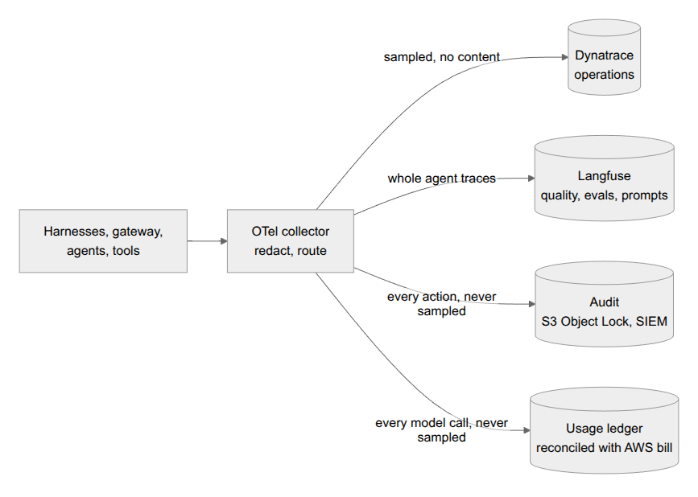
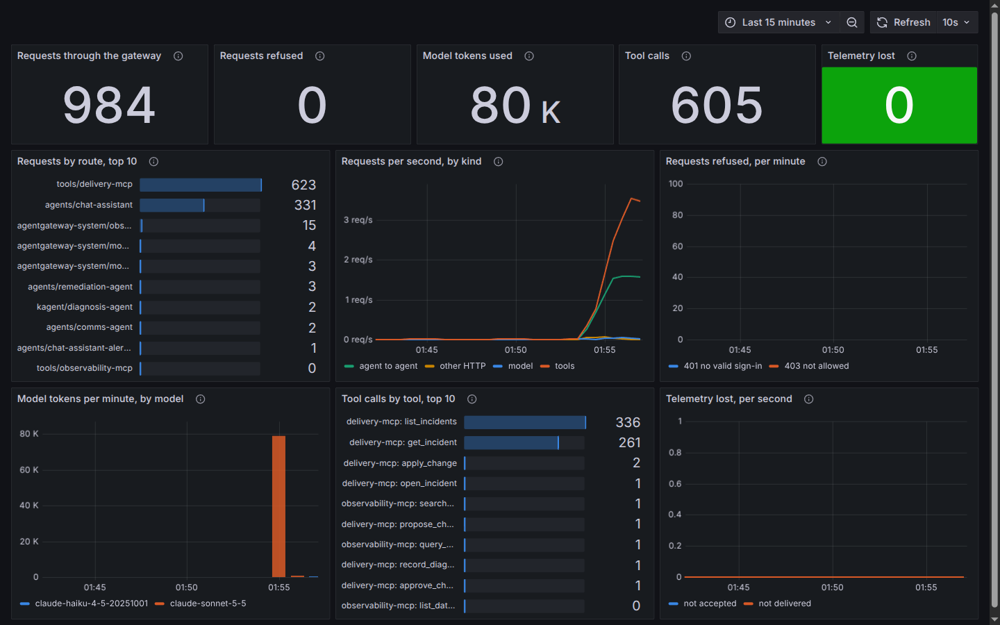

# Agent platform: Running the platform

| | |
|---|---|
| Status | Proposed |
| Owner | Platform team |
| Audience | Platform engineers, architects, managers |
| Updated | 4 November 2026 |

> **In short**
> - Three services are critical (gateway, Keycloak, delegation service) and join the existing platform on-call. Everything else can fail without stopping agents.
> - One OTel collector feeds four kinds of record: operations to Dynatrace, agent quality to Langfuse, audit to an immutable store, usage to a ledger reconciled with the AWS bill.
> - Upgrades follow a monthly train through staging and the automated tests; the gateway changes behavior almost every month, so this is planned work.

## What is critical

| Tier | Services | On-call |
|---|---|---|
| 0 | Agentgateway, Keycloak, the delegation service | Platform rotation, 24x7 |
| 1 | Audit and usage pipelines, platform databases | Platform rotation, business hours |
| 2 | Langfuse, catalog, CLI, templates | Business hours |
| Teams | Each agent, tool and workflow | The owning team |

Proposed starting objectives: gateway 99.9% available with under 50 ms
added latency; Keycloak and the delegation service 99.9%; a leaver cut off
within 20 minutes; no lost audit record.

## When something fails

| Failure | What happens |
|---|---|
| Bedrock slow or throttled | Typed error; agents retry within their deadline |
| Keycloak down | Existing sessions work until their tokens expire (15 minutes); new sign-ins fail |
| Delegation service down | Agents acting for people stop safely; nothing falls back to a weaker path |
| Langfuse, catalog or dashboards down | Agents keep working |
| Approval store down | Changes wait; reads continue |

## Observability: four kinds of record

Traces are not an audit log, and an audit log is not a bill. Each record type
has its own sampling, retention and readers.

**Observed in the demo:** the gateway sees every request, token and tool
call. It does not, on its own, give a readable agent trace or tell who used
a hosted agent, so applications add a few standard attributes through the
shared package.

## Data

- Each application keeps its own state in PostgreSQL (CloudNativePG), with
  tested backups.
- No shared "agent memory" service: retention and permissions differ per use
  case, so memory waits for a use case that defines them.
- Langfuse gets its own small ClickHouse cluster. Our existing cluster is
  fine for a proof of concept, but Langfuse needs a single-shard setup in UTC
  and heavy maintenance operations.

## Isolation and upgrades

- **Environments** (dev, staging, production) have separate gateways, sign-in
  realms and AWS roles; a token from one is never valid in another.
- **Teams** are the tenant unit: own namespace, routes, budgets and Langfuse
  organization.
- **Upgrades:** gateway monthly, Keycloak quarterly, security patches within
  7 days; always staging first with the full test suite.
- **Model changes** go through an alias (for example `claude-sonnet`), so
  switching a model version is one reviewed change with evaluation results.

> **Not decided yet**
> Disaster-recovery target for the critical services (proposed: rebuild in another region within 4 hours) and whether Dynatrace monitors the new nodes in full. See [Decisions and open questions](07-decisions-and-open-questions.md).

> **Go deeper**
> In the review: [Operating model](../07-operating-model.md), [Observability](../14-observability.md), [Infrastructure and data](../13-infrastructure-and-data.md).
