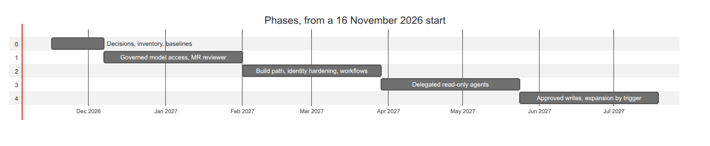

# Agent platform: Roadmap and pilots

| | |
|---|---|
| Status | Proposed. Dates assume a start on 16 November 2026 |
| Owner | Platform architecture |
| Audience | Managers, architects |
| Updated | 4 November 2026 |

> **In short**
> - Start with what exists and is measurable: coding tools and the MR reviewer through the gateway.
> - Then explicit workflows, then read-only agents that act for people, and only then agents that change things.
> - Each stage has measurable criteria and stop conditions; a missed criterion narrows the program instead of extending it.

## Five stages

| Stage | Weeks | Delivers | Done when |
|---|---|---|---|
| **0. Decisions and baselines** | 3 | Answers to the eight questions; inventory; today's MR reviewer and Kiro numbers | Every decision has an owner and an answer |
| **1. Governed model access** | 8 | Gateway to Bedrock; Keycloak with our IdP; Claude Code through the gateway; MR reviewer moved behind it | 20 pilot developers (3 or more on iOS) use it for 2 weeks; no feature loss; no calls around the gateway; usage matches the AWS bill within 5%; reviewer at least as good and as cheap |
| **2. Build path and workflows** | 8 | Template, shared package, charts, CLI, tests; hardened delegation service; one workflow pilot | All identity tests pass; a new team deploys an agent in 2 days; workflow decision recorded |
| **3. Read-only agents for people** | 8 | Developer helpdesk; platform assistant (investigation only) | No permission leaks in 50 test queries; every answer cites a source |
| **4. Approved changes** | 8+ | One write path with approvals bound to the exact change | 30 days with no change executed without a valid approval |

## Pilot use cases, in order

| Order | Use case | Why here |
|---|---|---|
| 1 | **MR reviewer**, improved | Exists today, so value is measurable; no delegation needed |
| 1 | **Coding tools through the gateway** | Largest usage and most users |
| 2 | **CI failure triage** | Tests explicit workflows; the eventual fix is the ground truth |
| 3 | **Developer helpdesk**, read-only | First agent acting for people; read-only limits risk |
| 4 | **Platform assistant** | Investigation first, changes only with bound approvals |
| Later | Incident summaries, dependency-update triage, release notes | Each reuses what the pilots build |

None of these needs kagent, Agent Substrate or AWS AgentCore.

## The MR reviewer, as the first example

- **Two jobs, two credentials:** one reads the merge request and calls the
  model (read-only); a separate job publishes comments with a narrow GitLab
  service account.
- **No stale or duplicate comments:** results are tied to the commit they
  reviewed, re-checked before publishing, and updated rather than repeated.
- **Untrusted code stays data:** the analysis step has no write access, and
  its output must match a fixed format.
- **Measured against today:** useful-finding rate, false positives, cost per
  MR and time to review.

## Stop conditions

We stop or narrow the program if:

1. Claude Code loses features through the gateway that developers will not
   accept.
2. Calls around the gateway cannot be blocked.
3. Nobody can run identity on-call.
4. Usage cannot be reconciled with the AWS bill within 10%.
5. Running cost exceeds the agreed budget by more than 25%.

> **Go deeper**
> In the review: [Implementation plan](../09-implementation-plan.md), [Use cases](../06-use-cases.md), [Workflow automation](../05-workflow-automation.md).
