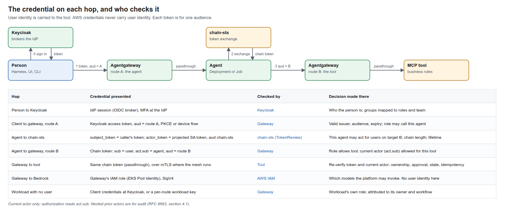

# Agent platform: Identity profile and tests

| | |
|---|---|
| Status | Proposed contract. Any delegation service or IdP product that replaces ours must pass it |
| Owner | Platform architecture, with security and identity |
| Audience | Architects, security, identity and platform engineers |
| Updated | 4 November 2026. Checked against Keycloak 26.8.1, MCP specification 2026-07-28 and the RFCs named below |

> **In short**
> - Three levels: what every issuer and verifier must do, optional profiles adopted after a test, and our own policy choices.
> - About 30 black-box tests check the contract. They run in CI against our delegation service and against any product before we buy it.
> - Failing a test on delegation, narrowing, audience or approvals disqualifies a replacement.

## Who is who

| Principal | Proven by | Identified by |
|---|---|---|
| Person | IdP sign-in and MFA, brokered by Keycloak | Keycloak user ID (stable), with the IdP's ID kept for joins |
| Agent acting for a person | Its Kubernetes service account | The person's ID as subject; the agent as current actor |
| Workload acting for itself | Its service-account token as a client credential at Keycloak | A Keycloak client per workload |
| Any workload calling AWS | EKS Pod Identity | An IAM role. Never a person |

## Required

| # | Requirement | Source |
|---|---|---|
| R1 | Issuers publish standard metadata at an HTTPS address | RFC 8414 |
| R2 | Tokens are signed with an allowed algorithm; `none` and shared-secret algorithms refused | RFC 8725 |
| R3 | Every token has issuer, subject, audience, expiry, issue time and ID; verifiers check them | RFC 8725, RFC 9068 |
| R4 | Tokens declare their type (`at+jwt`); ID tokens and untyped tokens are refused | RFC 9068, RFC 8725 |
| R5 | Each hop token is for exactly one target, named with the `resource` parameter; tools refuse tokens not issued for them | RFC 8707, MCP |
| R6 | A token is never forwarded to a different audience; a new one is obtained | MCP |
| R7 | Delegation, not impersonation: the person is the subject, the agent the actor | RFC 8693 |
| R8 | Access decisions use the **current** actor only; earlier actors are kept for audit | RFC 8693, section 4.1 |
| R9 | An exchange only narrows: scope, roles and lifetime never grow | RFC 8693; this profile |
| R10 | The service refuses an agent not allowed to act on that target, or after that previous agent | This profile |
| R11 | Delegated tokens live at most 5 minutes and are never refreshable | This profile; RFC 9700 |
| R12 | Agents prove themselves with a short-lived service-account token, checked against reuse | Keycloak docs; RFC 7523 update |
| R13 | People sign in with PKCE; no password grant; refresh tokens rotated | RFC 9700, MCP |
| R14 | Tools publish protected-resource metadata and answer missing or insufficient tokens in the standard way | RFC 9728, MCP |
| R15 | Signing keys rotate with overlap, published at least 10 minutes before use | Gateway refreshes keys every 5 minutes |
| R16 | Clock tolerance at most 60 seconds | |

**Optional, after a test passes:** sender-bound tokens (DPoP); client
metadata documents for outside MCP clients; Okta Cross App Access; shared
signals from the IdP to end sessions sooner; per-request AWS session tags for
billing attribution.

**Our policy (configuration, not standard):** which agent may act on which
target; at most 4 agents in a chain; token lifetimes (15 minutes for people,
5 for delegated); roles from IdP groups named `app-agentplatform-<role>`;
leaver cut off within 20 minutes.

## Long-running tasks

A task that outlives the person's token never stores that token. It holds an
offline session for its own confidential client, refreshes when it needs to
act, exchanges at the delegation service for the step's target, and ends the
session when the task ends. A leaver's task stops at its next step with
"authorization lost".

## Tests

Discovery, signatures, types, audience

| ID | Test | Pass when |
|---|---|---|
| DISC-1 | Read the issuer's metadata | Issuer matches exactly; token exchange is listed |
| ALG-1 | Present a token signed with `none` or an unlisted algorithm | Refused |
| TYP-1 | Present an ID token or an untyped token | Refused by every route and tool |
| AUD-1 | Get a token for target A, use it at B | B refuses |
| AUD-2 | Exchange without naming a target | Refused (`invalid_target`) |
| AUD-3 | Exchange for a target outside the allowed list | Refused |

Delegation and narrowing

| ID | Test | Pass when |
|---|---|---|
| ACT-1 | Agent A exchanges a person's token | Subject is the person, current actor is A |
| ACT-2 | Agent B exchanges A's token where B may follow A | Current actor B, previous actor A |
| ACT-3 | Allowed actor appears only as a previous actor | Refused |
| DEL-1 | Agent not allowed on the target | Refused |
| DEL-2 | Same agent twice, or a chain longer than 4 | Refused |
| DEL-3 | Exchange without an actor (impersonation) | Refused |
| DEL-4 | Actor token of a deleted pod | Refused |
| NAR-1 | Ask for a scope or role the person lacks | Not granted |
| NAR-2 | Person's token expires in 60 seconds | Result expires no later |
| LIFE-1 | Any delegated token | At most 300 seconds; no refresh token |
| REPL-1 | Reuse an actor token | Second use refused |

Time, keys, revocation, outages, caching

| ID | Test | Pass when |
|---|---|---|
| SKEW-1 | Token from 90 s in the future, or 30 s expired | Both refused |
| ROT-1 | Rotate the signing key during 15 minutes of load | No failures |
| REV-1 | Disable the test person at the IdP | Cut off within the agreed time |
| OUT-1 | Stop Keycloak | Valid tokens keep working until expiry; clear sign-in error |
| OUT-2 | Stop the delegation service | Agents fail safely; no fallback |
| CACHE-1 | 50 people through one agent at once | Nobody ever receives another person's token |
| LONG-1 | Long task across a token expiry, then disable the person | Continues after expiry; stops after disable |

Tools, approvals, audit

| ID | Test | Pass when |
|---|---|---|
| MCP-1 | Call a tool with no token | 401 pointing to the sign-in metadata |
| MCP-2 | A coding tool signs in end to end | Token is for that tool only |
| APR-1 | Approve, change the live resource, then execute | Refused as a stale approval |
| APR-2 | Execute after the approval expired | Refused |
| APR-3 | Proposer approves, or the approver applies against policy | Refused |
| APR-4 | Execute twice with the same operation ID | One effect |
| AUDIT-1 | Any allowed or refused call | Record names the person, the agents, the token, the target and the decision |

> **Go deeper**
> [Identity and the interoperability profile](../04-identity-profile.md) in the review, with the comparison of Keycloak, our service and the commercial options.
