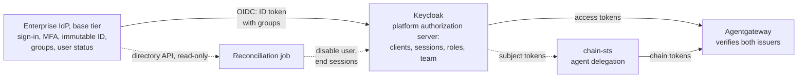
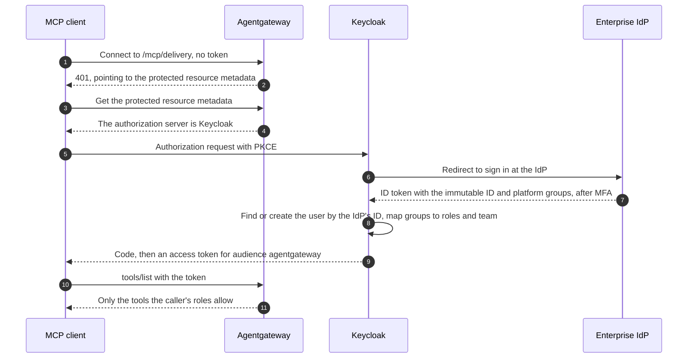

# Production design: the enterprise identity provider, and the path to production

> **Owner:** coordinator · **Type:** proposal · **Checked:** 2026-11-03 against Agentgateway 1.7.0, Keycloak 26.7.5, chain-sts 0.2.1, kagent and Agent Substrate 1.0.0-rc1

| | |
|---|---|
| Status | A proposal. Its broker has been run in the demo, with a second Keycloak realm standing in for the IdP (section 2.1); a vendor's IdP, MFA and step-up have not. The decisions it needs are in section 6 |
| Builds on | [`system-architecture.md`](system-architecture.md): how the demo works today. This document changes it only where it says so |
| Where it differs from the architecture document | `../Docs/AgentGateway/architecture.md` has Okta issue the tokens the gateway verifies (its sections 3.1, 4, 6.1, 6.2, 7.1 to 7.3, 9.1, 9.2, 9.4, 13.2, 13.4 and decision D-4). Here Keycloak issues them, federated to the enterprise identity provider (IdP), because the licensed IdP tiers cannot issue tokens for the platform's own APIs (section 1.1). That document needs the same change, and so do the places in this repository that call Keycloak a stand-in for Okta (section 5, item 19) |
| Detail lives in | [`chain-sts/docs/okta-comparison.md`](../components/chain-sts/docs/okta-comparison.md) (Okta for AI Agents compared with chain-sts, with prices and sources), and [`system-architecture.md`](system-architecture.md), Appendix A, for terms |

Claims carry the evidence labels in
[`CONTRIBUTING.md`](../CONTRIBUTING.md#documentation).

## How to read this document

| If you want | Read |
|---|---|
| Which ways an enterprise IdP can connect, compared case by case, and the choice | Section 1 |
| The chosen design: the IdP behind Keycloak | Section 2 |
| How to use the platform in an enterprise | Section 3 |
| What changes from kind to production, and what must be hardened first | Sections 4 and 5 |
| The decisions this adds | Section 6 |
| What a base-tier Okta or Ping gives, need by need | Appendix A |

## 1. Choosing how to connect the enterprise IdP

The question is not which IdP to use. It is which of the platform's identity
needs the licensed tier can meet. This section assumes a base tier: sign-in
and MFA, with no API, agent or governance add-ons. On Okta that means the
Starter through Professional suites, which sell API Access Management as an
add-on. Okta's Enterprise suite includes it (`okta-comparison.md`, sections
1.1 and 1.2), and section 1.5 says what changes if you have that. On Ping it
means an edition without custom resources or agent products.

### 1.1 What a base tier can and cannot do

- **It can** sign people in with MFA, give each person an ID that never
  changes, say which groups they are in, say through its API whether they
  still work here, and keep a log of sign-ins.
- **It cannot** issue access tokens with an audience and claims you define.
  On Okta that needs API Access Management, which provides custom
  authorization servers: the org authorization server, the one every Okta org
  has, issues access tokens only for Okta's own APIs. PingOne documents
  custom resources that would do it, and whether your edition includes them
  is **to verify**.
- **No tier licensed here** provides agent delegation with a nested `act`,
  workload identity for pods, or a credential for model clients that take
  only a key. Those are the platform's in any case.

Every token that reaches the gateway in [`system-architecture.md`](system-architecture.md), section 7 needs the second point:
the Chat UI's, the MCP client's, the script's and Alertmanager's. Appendix A
has the need-by-need evidence for each vendor.

One trap is worth naming here. Okta's org authorization server does issue
signed JWT access tokens, and a gateway could be configured to accept them.
Their audience is the Okta org, which every application in the org shares, so
the gateway would accept a token issued to any other application. Okta also
says that only Okta should validate them (documented upstream:
`okta-comparison.md`, section 1.2). Do not use them.

### 1.2 Five ways to connect

| Option | Who signs the person in | Who issues the token the gateway checks | The path of a person's token |
|---|---|---|---|
| 1. Pass-through | The IdP | The IdP: its ID token, used as a bearer token | IdP, client, gateway |
| 2. chain-sts as the authorization server | The IdP | chain-sts, which maps the IdP's groups to `roles` and `team` (`okta-comparison.md`, section 4.5) | IdP, client, chain-sts, client, gateway |
| 3. Broker (the design in section 2) | The IdP, which Keycloak sends the person to | Keycloak | IdP, Keycloak, client, gateway |
| 4. The IdP as the authorization server | The IdP | The IdP: an access token for the platform's audience | IdP, client, gateway |
| 5. The IdP's agent products | The IdP | The IdP, for people and agents. chain-sts goes | IdP, client, gateway, with agents exchanging at the IdP |

In options 1 to 4, chain-sts still adds the agents and the gateway still
enforces. Only who issues the person's token differs. Option 5 needs add-ons
that are not licensed (Okta for AI Agents, Ping's Identity for AI), so it is
not compared below. [`system-architecture.md`](system-architecture.md), section 6.6 compares those products with chain-sts, and
section 1.5 says how to keep the option open.

### 1.3 The options, scenario by scenario

The scenarios are those of [`system-architecture.md`](system-architecture.md), section 7, plus the events an identity design must
survive.

| Scenario | 1. Pass-through | 2. chain-sts as authorization server | 3. Broker | 4. IdP as authorization server |
|---|---|---|---|---|
| **A, C, D.** A person uses the Chat UI | **Works, with changes.** The Chat UI sends the IdP's ID token, whose audience is the Chat UI's own client ID. Every verifier must accept that, and read roles and team from groups | **Works, with code.** The Chat UI or chat-assistant exchanges the ID token first | **Works.** As in the demo. Keycloak sends the person to the IdP | **Works.** The IdP issues the token for the audience `chat-assistant` |
| **E.** A developer's MCP client, the pilot's first step | **Fails.** MCP clients ask for an access token, and the IdP's are for its own APIs | **Fails,** unless chain-sts becomes a full authorization server: sign-in redirect, PKCE, discovery and client registration | **Works,** once the last of the three gaps in section 2.4 is closed. Agentgateway documents a `keycloak` provider | **Works on Okta,** which has an Agentgateway provider. **To validate on Ping,** which has none |
| **E.** A script or CLI | **Poor.** Device flow at the IdP, then the ID token used as a bearer token, which OAuth advises against | **Works, with code.** Device flow at the IdP, then an exchange in every script | **Works.** Device flow at Keycloak | **Works.** Device flow at the IdP |
| **B.** Alertmanager, or any machine | **Fails.** A base tier issues no machine token for your audience | **Partly.** In-cluster callers can present a service-account token. Outside callers need a credential you build | **Works.** Client credentials at Keycloak, outside the IdP's licensing | **Works.** Client credentials at the IdP. Okta licenses machine tokens by count |
| An agent acts for the person, in every scenario | **Works,** once chain-sts trusts the IdP's ID tokens as subjects | **Works.** chain-sts issues both | **Works, unchanged** | **Works.** chain-sts trusts the IdP as its subject issuer |
| A person's role or team changes at the IdP | At their next ID token | At their next sign-in at the IdP | At their next sign-in at the IdP, after the Keycloak session ends, unless the reconciliation job acts first | At their next token from the IdP |
| A person leaves | Cut off when their ID token expires | Cut off when their ID token expires, because a client can exchange it again until then | Cut off when the reconciliation job disables them, within minutes, or when the Keycloak session ends | Cut off when their current access token expires, because the IdP stops refreshing it once they are deactivated |
| The IdP is down | New sign-ins fail. Tokens already issued work until they expire | The same | New sign-ins fail. Keycloak sessions that exist keep working until they end | New sign-ins and refreshes fail |
| A second IdP after an acquisition, or a move to another vendor | Every verifier and client changes | Mapping code for each IdP | One identity provider entry in Keycloak. Clients and verifiers are unchanged | Every client registers again, and every verifier gets a new issuer |
| Who did it, in the audit trail | `sub` is the IdP's ID: one log | The same | Two logs, Keycloak's and the IdP's, joined on `idp_sub` | One log |

Cost, from the estimates in `okta-comparison.md`, section 4:

| | 1. Pass-through | 2. chain-sts as authorization server | 3. Broker | 4. IdP as authorization server |
|---|---|---|---|---|
| License | None | None | None | Okta's API Access Management add-on, or a Ping edition with custom resources |
| New to run | Nothing | chain-sts grows into a full authorization server | Keycloak and its database | Nothing beyond chain-sts |
| Run cost a year | None | Not estimated. `okta-comparison.md`, section 4.5, puts a chain-sts that only maps groups at about $20k to $90k, without sign-in, PKCE, discovery or client registration | About $35k to $145k, less if Keycloak already runs in production | Low, plus chain-sts |

### 1.4 Pros and cons

**1. Pass-through**

- **For:** nothing new to run, no cost, and one audit log.
- **Against:** fails for MCP clients and machines, so it fails the pilot's
  first step. It uses ID tokens as access tokens. Every verifier is tied to
  one IdP's claims. A token meant for another application can be mistaken
  for the platform's.
- **Fits:** one browser application for one IdP. Not this platform.

**2. chain-sts as the authorization server**

- **For:** no new product. chain-sts already runs, already holds a signing
  key, and maps claims in code the platform controls.
- **Against:** to serve MCP clients it must become a full authorization
  server, with sign-in, PKCE, discovery, client registration and sessions.
  That is security code you write and maintain. Every client needs an extra
  exchange step. A leaver keeps access until their ID token expires.
- **Fits:** a platform with no MCP clients and only in-house clients, where
  another service cannot be added. `okta-comparison.md`, section 4.5, calls
  this variant the cheapest, with chain-sts accepting the Chat UI's ID token.
  That holds only while MCP clients, scripts and machines are out of scope.

**3. Broker**

- **For:** it works in every scenario on base-tier licenses. Component code
  does not change (section 2.8). The demo already runs Keycloak and has
  drilled it. Agentgateway documents a provider for it. A second IdP is one
  configuration entry. Vendor support exists through the Red Hat build of
  Keycloak.
- **Against:** Keycloak becomes a tier-0 service you run, with high
  availability, a database, upgrades and on-call. Revocation lags the IdP
  unless the reconciliation job runs. Sign-ins are recorded in two logs.
  Keycloak's `sub` must be protected.
- **Fits:** base-tier licenses, several kinds of client, and a chance of a
  second IdP.

**4. The IdP as the authorization server**

- **For:** nothing new to run beyond chain-sts, the vendor's SLA, one log,
  and revocation at the source.
- **Against:** it needs the add-on on Okta, which also prices machine tokens
  by count. On Ping it depends on the edition, and Agentgateway has no Ping
  provider. Every client registration is tied to one vendor, so a second IdP
  is a migration.
- **Fits:** one IdP, the add-on bought, and nobody to run Keycloak around the
  clock.

### 1.5 The choice, and when to choose differently

**The broker,** because it is the only option that works in every scenario on
base-tier licenses:

- Pass-through fails the pilot's first step, an MCP client signing in.
- chain-sts as the authorization server means building one.
- The IdP as the authorization server is not available on base-tier Okta,
  and on Ping it depends on the edition.

Keycloak is the broker for four reasons: the demo already runs it and has
drilled it; Agentgateway documents an MCP provider for it; it accepts
Kubernetes service-account tokens as client credentials (26.6); and vendor
support exists through the Red Hat build. Authentik is the other broker that
Agentgateway has a provider for.

**Choose the IdP as the authorization server instead** when all three of these
hold. An organization on Okta's Enterprise suite already meets the first:

- the licensed tier issues access tokens with your own audience and claims,
  through authorization code with PKCE, device flow and client credentials
  (Okta with API Access Management does; Ping depends on the edition);
- there is one IdP, and no second one is expected;
- nobody can staff Keycloak around the clock.

Then compare the add-on's quoted price with the broker's run cost. The
break-even tables in `okta-comparison.md`, section 5.1, show the method.

**Keep the agent products open.** If an agent add-on is bought later and
replaces chain-sts, `act.sub` becomes the IdP's agent identifier instead of a
service-account name. The `delegation.agents` map in `identity.yaml` already
turns agent names into `act.sub` values for every route, so only that map and
the issuers change. Do not write vendor IDs into route files.

## 2. The design: the enterprise IdP behind Keycloak

### 2.1 The target

People are authenticated by the enterprise IdP. Every token the platform's
parts see is issued by Keycloak or chain-sts, and nothing behind Keycloak
talks to the IdP. This is the broker option of section 1.

**Observed in the demo** (2026-11-03), with a second Keycloak realm, `corp`,
standing in for the IdP
([`measurements.md`](measurements.md#the-identity-broker-2026-11-03)): a
user who signs in through it gets a demo-realm token that the gateway
accepts, with the roles their groups map to, `team` as one string and
`idp_sub`; accounts link by the IdP's ID, and an email that matches an
existing user is refused, not linked; the reconciliation job prototype cuts a
leaver off at the job's interval plus the access token's remaining lifetime.
The demo keeps its own users and shows the IdP as a button, not the
redirector of item 1. **To validate** with a vendor's IdP: its claims, MFA
and step-up, and a base tier's limits.

| Part | Does | Does not |
|---|---|---|
| Enterprise IdP | Authenticates the person, applies MFA, and supplies an immutable user ID and group membership, through one OIDC application per environment | Issue tokens for the platform's APIs, know about agents, or see machine clients |
| Keycloak | Holds every platform client (Chat UI, MCP clients, CLI, automation, the platform's consoles), issues access tokens for `agentgateway` with `roles` and `team`, owns session lifetimes, and writes sign-in events | Authenticate people itself. It holds no passwords except those of break-glass administrators |
| Reconciliation job | Reads leavers and group removals from the IdP, then disables the user in Keycloak and ends their sessions | Create users or grant roles |
| chain-sts | Trusts Keycloak as its one subject issuer and adds agents to `act`, as today | Talk to the IdP |
| Agentgateway | Verifies Keycloak's and chain-sts's tokens, as today | Talk to the IdP |

### 2.2 Designing the IdP-to-Keycloak link

**What to configure at the IdP.** All of it should be in a base tier. Check
each row on yours.

| Setting | Why | Okta | Ping |
|---|---|---|---|
| One OIDC web application per environment, each a Keycloak realm | Assignment in the IdP decides who may reach each environment | An OIDC web app on the org authorization server | An OIDC application in PingOne, or a connection in PingFederate |
| Groups in the ID token, filtered to the platform's prefix | `roles` and `team` | The groups claim filter on the app | An attribute mapping of group membership |
| An immutable user ID | Linking accounts, and audit | `sub` is the Okta user ID | The PingOne user ID; in PingFederate, map an attribute that never changes |
| MFA | Assurance | An authentication policy on the app | A sign-on policy on the app |
| Read-only directory access for the reconciliation job | Leavers | A service app with read-only scopes for users and the System Log | A worker application with read-only access to users |

What matters in the design:

1. **Users never see Keycloak's form.** Make the Identity Provider Redirector
   the default in the browser flow, turn registration off, and keep no local
   users in the platform realm. With more than one IdP, for example Okta for
   most of the workforce and Ping for an acquired business, Keycloak's
   Organizations feature routes each user to their IdP by email domain
   (documented upstream).
2. **Link accounts by the IdP's immutable ID, never by email.** The first
   broker login creates the Keycloak user from the upstream subject. Do not
   let it link to an existing account by matching email. With two IdPs that
   is an account-takeover path: whoever controls an email address in one IdP
   gets the other's account.
3. **`sub` is Keycloak's, so protect it.** Keycloak's `sub` is the user ID it
   creates at first login, and it lasts only as long as Keycloak's database.
   The demo pins `sub` in its realm file because its Keycloak keeps no state.
   Production needs a backed-up database and users who are disabled, never
   deleted. It also needs the IdP's immutable ID carried as the `idp_sub`
   claim, which joins the platform's audit trail to the IdP's log and lets a
   rebuilt realm be reconciled.
4. **Map groups on every sign-in.** The IdP sends only the platform's groups
   (`app-agentplatform-*`). Keycloak's identity provider mappers turn them
   into `roles` with sync mode `force`, so a change at the IdP takes effect
   at the user's next sign-in at the IdP. **Observed in the demo:** while the
   Keycloak session lives, refresh and single sign-on keep the old roles
   without asking the IdP, so a removal waits for the session to end, or for
   the reconciliation job to end it (item 6). Keycloak's mappers cannot
   filter groups by prefix (the stand-in IdP sent `all-staff` as well), so
   the filter has to be the IdP's. Brokered users also get the realm's
   default roles, `offline_access` among them: remove it from the platform
   realm's defaults, or an offline token outlives the session the job ends.
5. **Emit `team` as one string.** delivery-mcp
   (`components/delivery-mcp/src/delivery/identity.py:118`) and chat-assistant
   (`components/chat-assistant/packages/server/src/auth.ts:39`) read a `team`
   that is not a string as no team, so `propose_change` would be refused for
   everyone. That fails safe, but it fails. Use a single-valued mapper, and
   decide what happens to a person in two team groups, for example a primary
   team attribute at the IdP. A list of teams is a code change (section 2.5).
6. **Revocation is Keycloak's session lifetime unless the job acts sooner.**
   Keycloak learns about a change at the IdP only when the user next signs in
   there, so a removed user keeps working until their Keycloak session ends.
   Bound it from both sides:
   - **Short lifetimes:** access tokens of 5 minutes (the demo's are 30),
     rotating refresh tokens, a session idle timeout of 30 to 60 minutes, and
     a maximum session of one working day.
   - **The reconciliation job:** every few minutes it acts on leavers and
     group removals. Do not count on SCIM provisioning or back-channel logout
     from a base tier. A prototype is `local/identity/reconcile.py`. **Observed
     in the demo:** it disabled a leaver and ended their session in 0.12 s,
     after which refresh failed at once; the access token they held was
     accepted until its `exp`. It needs `manage-users`, which can also set
     passwords, so scope and watch its credential. It ends the sessions of a
     user removed from a group rather than disabling them, so they keep their
     other roles, and it never enables anyone again: a rehire is a manual
     step.

   Measure the time from deactivation at the IdP to refusal at the gateway,
   against the number security sets (section 6).
7. **One issuer address for browsers and pods.** Give Keycloak a public HTTPS
   hostname, so that the issuer in tokens is reachable from the gateway's pods
   too. That closes gap 3 in section 2.4, and the `keycloak` MCP provider
   needs it for discovery.
8. **Keep the realm as code.** Use keycloak-config-cli or the Keycloak
   Terraform provider, in Git, reviewed by the identity team. The demo's
   import at start is for a realm with no state; it is not how a production
   realm changes.
9. **Keycloak becomes tier 0.** Run three or more replicas across zones on
   highly available PostgreSQL (RDS or CloudNativePG), with backups, a restore
   drill, signing-key rotation, a minor upgrade about every quarter, and
   on-call.
   - **If Keycloak is down:** nobody can sign in or refresh. With 5-minute
     access tokens and 300-second chain tokens, agent work stops within
     minutes.
   - **If the IdP is down:** Keycloak sessions that already exist keep
     working until they expire. New sign-ins fail.
10. **MFA stays at the IdP.** If approve and apply should need a recent MFA
    (step-up), pass the IdP's `acr` or `amr` through Keycloak and check it on
    those routes. Whether a base tier supports step-up is **to validate**.
11. **Put machine clients only in Keycloak.** Automation clients live there,
    away from the IdP's licensing. An in-cluster caller that can present a
    Kubernetes service-account token can use Keycloak 26.6's federated client
    authentication instead of a client secret.

**Cost.** `okta-comparison.md` (sections 4.1 to 4.4) estimated this
arrangement at about $35k to $145k a year, mostly people, and less if
Keycloak already runs in production. The IdP license does not change: it
covers one application per environment. The Red Hat build of Keycloak is the
route to vendor support, through OpenShift or Runtimes entitlements.

### 2.3 How each kind of client connects

| Client | Flow | What it presents to the gateway |
|---|---|---|
| Chat UI | Authorization code with PKCE at Keycloak, which redirects to the IdP | A Keycloak token with the audience `chat-assistant` |
| IDE and CLI MCP clients | The gateway's resource metadata points to Keycloak, which redirects to the IdP (section 2.4) | A Keycloak token with the audience `agentgateway` |
| Scripts and operators | Device flow at Keycloak | The same |
| Model clients that take only a key | A helper command that runs the device flow and returns a short-lived token, where the client supports one; otherwise a gateway-issued key with an expiry (D-4) | A Keycloak token, or a gateway key |
| Automation | Client credentials at Keycloak | A Keycloak token |
| Agents | A Kubernetes service-account token at chain-sts | A chain-sts token |
| The platform's own consoles (Agentgateway UI, kagent UI, Langfuse) | oauth2-proxy or their own sign-in, at Keycloak | Nothing. The gateway refuses these clients' tokens |
| Vendor consoles (New Relic, Dynatrace and other SaaS) | SAML or OIDC at the IdP directly | Nothing. They never reach the gateway |

The rule for drawing the line: anything whose token reaches the gateway, or
that reads the platform's roles, goes through Keycloak. Everything else stays
on the IdP as it does today.

The demo's direct grant (`demo-cli`, behind `task token`) does not carry over.
A user brokered from the IdP has no Keycloak password. Scripts use the device
flow, and tests that need a scripted sign-in use local test users in a
non-production realm.

### 2.4 An MCP client signs in

This is the pilot's first step. Gaps 1 and 2 below are closed in the shared
charts (route-auth 0.6.0, mcp-route 0.5.0). **Observed in the demo**
(2026-11-03, `task demo:backup:mcp-oauth-check`): the 401 points to the
metadata, the protected resource metadata is served, a sign-in as client
`mcp-client` gives a token, and `tools/list` answers with it. Gap 3 is open,
so the authorization server's metadata answers HTTP 500 and a real client
stops before it registers.

| Gap, as found in the demo | Closed by | Status |
|---|---|---|
| 1. The 401 does not point to the resource metadata | `mcpAuthentication` in `route-auth`: a second policy with Agentgateway's `Keycloak` provider, on a route rule for requests without a token. Agentgateway 1.7.0 allows MCP authentication only in a policy with one trusted issuer (documented upstream), and `/mcp/delivery` trusts two | Closed for `/mcp/delivery`. A request with an expired token still gets a 401 without the pointer |
| 2. The route does not serve the well-known metadata paths | `mcpAuthentication` in `mcp-route`: the rule `sign-in` with the two metadata paths. `clientId: mcp-client`, so the gateway answers registration itself | The protected resource metadata is served. The authorization server metadata waits on gap 3 |
| 3. The issuer is `localhost`, which the gateway's pods cannot reach | Keycloak's public hostname (section 2.2, item 7) | Open: the authorization server metadata answers 500 |

### 2.5 Claims, groups and entitlements

- **Roles come from IdP groups, filtered.** Use a naming convention such as
  `app-agentplatform-<role>`. Filter at the IdP, so that only matching
  groups leave the IdP, and map them to `roles` in Keycloak. Never put every
  group in the token.
- **`team` stays a single string for now.** The code reads it that way
  (section 2.2, item 5), and delivery-mcp compares it with a hard-coded owner
  (`components/delivery-mcp/src/delivery/service.py:255`,
  `src/delivery/config.py`). Enterprise people belong to several teams, and
  service ownership already lives in a service catalog or CMDB. Moving to a
  `teams` list, and to ownership looked up in the system of record, is a code
  change in delivery-mcp and chat-assistant, and a change to the claims
  contract.
- **Separation of duties keys on `sub`, not on the user name.** Under the
  broker the user name comes from the IdP, where login names are renamed
  and reused. Since 0.2.1 delivery-mcp keys the rule on `sub` and stores it
  beside each name (`proposed_by_sub` and so on), which stays for display. A
  change stored earlier is compared by name, and a token without `sub` can
  neither propose nor approve.
  - **Do not key it on `(iss, sub)`.** The same person carries two issuers:
    their own token is Keycloak's, and their chain token is chain-sts's, with
    the same `sub` ([`system-architecture.md`](system-architecture.md), section 5.2). Comparing the pair would treat them as two
    people. Someone with both `developer` and `incident-manager` could then
    propose through the Chat UI and approve with a direct call to
    `/mcp/delivery`.
  - `sub` alone is correct because chain-sts preserves it and trusts one
    subject issuer, Keycloak. If chain-sts ever trusts a second one, it should
    carry the subject's issuer as a claim, and the key becomes that issuer
    with `sub`.
- **Entitlements follow the joiner, mover and leaver process.** An access
  request in the IGA tool (Okta Identity Governance, Ping's governance
  product, or SailPoint) adds a group at the IdP, and Keycloak turns the group
  into a claim. The reviewed files under `domains/` decide what a role may do.
  The IdP decides who has the role. Keep those two separate.

### 2.6 Revocation and sessions

- **Lifetimes and the job bound the revocation time.** chain-sts tokens live
  at most 300 seconds and never longer than the user's token. Keycloak's
  session lifetime and the reconciliation job decide how long a removed user
  keeps working (section 2.2, item 6). The time from deprovisioning to denial
  has to be measured at every boundary (architecture section 9.8). It was not
  measured in the demo.
- **Gateway-issued workload keys** (diagnosis-agent's) are not tied to any
  session. They need their own rotation and revocation.
- **Later:** Shared Signals and CAEP, where the IdP supports them, could end
  sessions sooner than the job does. **To validate** for each IdP.

### 2.7 Transport

Every in-cluster URL in the demo is plain HTTP, including the issuer, the key
URLs and chain-sts. In production, Keycloak's issuer and keys and its
connection to the IdP use HTTPS. chain-sts's issuer becomes an HTTPS URL with
a certificate the verifiers trust, and traffic from the gateway to its
backends uses mesh mTLS or TLS with an identity the backends check (D-1).

### 2.8 What it changes in the code

The broker keeps everything downstream of Keycloak as it is. The components
read their issuer, audience and keys from settings (`OIDC_ISSUER`,
`OIDC_AUDIENCE`, `OIDC_JWKS_URL`, `DELEGATION_*`). None of them has a Keycloak
path or address in its source.

| Area | Change | Kind |
|---|---|---|
| delivery-mcp, chat-assistant, remediation-agent, comms-agent, chain-sts | None | |
| `identity.yaml`, from which the chain-sts chart also renders `subject_issuers` | Keycloak's production issuer and key URL | Configuration |
| Keycloak | The realm as code, with the IdP, the mappers and no local users; a persistent, highly available database | Configuration and deployment |
| Keycloak's `team` mapper | Single-valued (section 2.2, item 5) | Configuration rule |
| Chat UI: `UI_FORCE_SIGN_IN` (chat-assistant 0.1.13) | It forces a sign-in on every visit, so that each demo tab can pick a user. Under the broker that would send every user back to the IdP, and possibly through MFA, each time. Since 2026-11-03 it is a setting, on in the dev cluster's values and to be set to `"false"` in production | Done: one setting |
| The demo's scripts that type a Keycloak password: `local/identity/token.sh` (the direct grant), and `chat_ui_login.py` and `sso_check.py` (Keycloak's sign-in form) | None while the demo keeps local users. They would need local test users if the demo realm itself were brokered | None now |
| MCP sign-in: the `route-auth` and `mcp-route` charts | Gaps 1 and 2 of section 2.4, done on 2026-11-03 | Chart change, done |
| Recommended, not required by the broker | `idp_sub` (a Keycloak mapper, chain-sts `carry_claims`, an audit field in delivery-mcp); the reconciliation job | Code |

## 3. Getting more out of it in an enterprise

### 3.1 Offer three products, in this order

1. **Governed model access.** One route, no provider keys in any team's hands,
   approved models only, and usage attributed to a verified user or workload.
   It needs no agent and no kagent, and it is the quickest win. Add the
   rate-limit server and key budgets on a verified claim such as `team`, not on
   a header the caller sends (D-6).
2. **Governed tool access for the clients developers already use** (IDE and
   CLI MCP clients). Close the last MCP sign-in gap, Keycloak's hostname, first (section 2.4).
3. **Hosted agents,** on conventional Deployments by default and kagent as the
   candidate track (WA-2).

### 3.2 Make onboarding a merge request

A team's onboarding is three files and one shared entry:

- `components/<name>/catalog.yaml`, for discovery;
- `workloads/<name>/helmfile.yaml`, which uses `charts/agent`;
- `domains/<domain>/<name>.yaml`, which says who may call what;
- two release entries for the route in `domains/<domain>/helmfile.yaml`.

An agent that acts for people also needs an entry in chain-sts's policy and
in `identity.yaml`'s `delegation.agents`, both owned by the platform.

With CODEOWNERS on `domains/` (service owners), and on `agent-platform/`,
`identity.yaml`, chain-sts's policy and the Keycloak realm (platform and
identity), the Kyverno rules make it safe to let teams own their domain
directory. They can narrow access but cannot weaken a platform route.

### 3.3 Reuse the patterns, and connect them to existing systems

| Pattern in the demo | Reuse it as | Enterprise integration |
|---|---|---|
| delivery-mcp: roles checked twice, separation of duties, idempotency on `change_id`, one `operation.id`, structured refusals, audit fields | The template for any MCP tool that changes something | Back it with ServiceNow or Jira Service Management change and incident records instead of its own store |
| The apply path: Helm upgrade from a pod, then a real request to verify | A demo shortcut | `apply_change` opens a merge request that selects the earlier version, and the protected pipeline applies it. That matches the design's recovery path and keeps one writer |
| Alert hook to an orchestrating agent | Event-driven agents | PagerDuty or Opsgenie webhooks, authenticated as a Keycloak machine client |
| An A2UI card whose buttons call code | Human-in-the-loop approvals | The same agent behind Slack or Teams, through A2A |
| A read-only diagnosis agent with a runbook skill and evals | Investigation agents per service | Runbooks published by service teams as versioned skills (architecture section 7.4) |
| Gateway access log plus service audit with shared fields | Audit for agent actions | The SIEM, joined to Keycloak's events on `sub` and `sid` (chain tokens carry it), and to the IdP's log on `idp_sub` |

### 3.4 Topology

- **Split gateways by permission and failure boundary, not one per agent.**
  For example, use one gateway for developer clients and one for hosted agents
  per environment, so that a policy mistake or an overload in one does not
  reach the other (WA-4).
- **Use one domain directory and namespace pair per business domain,** with
  the boundary policies installed per namespace.
- **Use one Keycloak realm per environment.** Each has its own application at
  the IdP and its own issuer, so a dev token is never valid in prod, and
  assignment at the IdP decides who reaches each environment.

## 4. From kind to production

| In the demo | In production |
|---|---|
| kind, one node | EKS with several nodes and zones. Karpenter for capacity |
| Local registry `localhost:5002` | ECR, pinned by digest |
| Keycloak realm `demo` with users of its own and demo passwords | Keycloak federated to the enterprise IdP, with no local users except break-glass administrators (section 2.2) |
| The realm imported at start; Keycloak keeps no state | The realm as code; a persistent, highly available database |
| Access tokens of 30 minutes | 5 minutes, with rotating refresh tokens (section 2.2, item 6) |
| No link to a directory | The reconciliation job against the IdP's directory API |
| `demo-cli` direct grant | Device flow, or PKCE |
| The Chat UI forces a sign-in on every visit (`UI_FORCE_SIGN_IN`, on) | The same setting, off (section 2.8) |
| Model endpoint on the host; Bedrock with exported keys | Bedrock through EKS Pod Identity or IRSA on the gateway, with no static keys. Bedrock has never answered a request here. It needs a first run with real credentials |
| Secrets created by tasks | The organization's secret mechanism, such as AWS Secrets Manager with External Secrets (D-9) |
| chain-sts key in a Secret, rotated by hand from a workstation | A KMS signer, scheduled rotation with overlapping key sets, replicas spread across zones, and an SLO and on-call |
| kindnet NetworkPolicy | The cluster's policy engine (VPC CNI network policy, Cilium or Calico). Repeat each denied-path check there |
| Prometheus, Loki, Tempo, Grafana | New Relic or Dynatrace through the existing collectors. Keep the audit field names |
| Loki as the audit store | Immutable object storage or the SIEM |
| API server audit file on the node | EKS control-plane audit logs |
| In-cluster PostgreSQL instances | CloudNativePG or RDS, with backup and restore drills |
| HTTP everywhere | TLS everywhere, plus mesh mTLS to backends |
| Consoles behind oauth2-proxy with Keycloak | Unchanged for the platform's own consoles. Vendor SaaS consoles sign in at the IdP directly (section 2.3). Admin consoles stay off the public network |
| `task deploy` from a workstation | GitLab CI with ID-token federation, protected runners and environment-scoped roles |

## 5. Hardening before production

These items are in priority order. Each has its source in this repository.

**Security and correctness**

1. **One audience for every chain token. Done on 2026-11-03,** in the
   code and the dev cluster's configuration; the rollout is in
   [`90-chain-sts`](../agent-deployments/clusters/dev/platform/90-chain-sts/README.md#tokens-per-target).
   An agent could replay a token it received wherever its caller was
   accepted as the newest actor: remediation-agent, given a platform
   engineer's `[chat-assistant]` token, could call `restart_workload` the way
   chat-assistant would. Now each chain token is for one target: the agent
   names the route it is about to call as `resource` (RFC 8707), chain-sts
   0.2.1 issues the token for that route alone and refuses a request that
   names none, and each route accepts a chain token only for itself, as do
   delivery-mcp, remediation-agent and comms-agent behind it
   ([`contracts.md`](contracts.md#agents-acting-for-a-user-chain-sts)). **To
   validate:** the replay is a refusal in `chain-gateway.sh`, which has not
   run since. Left open: a person's own Keycloak token keeps `agentgateway`,
   so an agent called directly with one can still present it wherever that
   person's roles reach (item 15).
2. **The reconciliation job is a prototype.** `local/identity/reconcile.py`
   runs by hand. Production needs it scheduled, with a narrow credential,
   alerting when it fails, and an interval that, with the access token's
   lifetime, meets the deactivation-to-refusal time security sets (section
   2.2, item 6).
3. **Keycloak's `sub` depends on its database.** It needs a persistent,
   backed-up database, users disabled and never deleted, and `idp_sub`
   carried (section 2.2, item 3).
4. **Accounts must link by the IdP's immutable ID only,** never by email
   (section 2.2, item 2).
5. **Separation of duties keys on `sub` since delivery-mcp 0.2.1** (section
   2.5). Keep it on `sub` alone, never on `(iss, sub)`, and keep the realm's
   user IDs stable (item 3), or the rule compares strangers.
6. **Keycloak and chain-sts are on every agent call and fail closed.**
   chain-sts needs a KMS signer, scheduled rotation, replicas spread across
   zones, and an owner with on-call. Keycloak needs the same, plus a highly
   available database (section 2.2, item 9).
7. **An agent is whoever holds its service account.** Anyone who can create a
   pod, or a token, as `agents/chat-assistant` can act as chat-assistant at
   chain-sts. The drill `chain-exchange.sh` does exactly that with `kubectl
   create token`. Allow only the platform's deployer to create pods and
   `serviceaccounts/token` in namespace `agents`.
8. **chain-sts's key can sign a token for any person, with any roles, for
   every route that takes chain tokens.** Protect it as Keycloak's key is
   protected (item 6). Since 2026-11-03 the gateway's rule on agents requires
   a token without `act` to come from Keycloak, so the key can no longer make
   a token that passes as a person's own; that refusal has not been run,
   because it needs a token signed with the real key.
9. **kagent does not verify tokens itself.** Its console is a second door
   that reaches diagnosis-agent outside the gateway. Its agents use a
   workload key, so their reads are not attributed to a user, and
   diagnosis-agent reaches its own Kubernetes tool server directly ([`system-architecture.md`](system-architecture.md), section 7.7). Decide D-2 and D-5 before giving kagent agents anything other than
   read-only access.
10. **Prompts and completions are stored unencrypted** in the gateway's
    PostgreSQL and in Langfuse, and nothing deletes old rows. Classify the
    data, then set encryption, retention and who may read it.
11. **The gateway's admin port has no login** and can shut the proxy down.
    Keep it on the pod's localhost in production, as upstream defaults it.
12. **Password grant, plain HTTP and demo secrets** go away with sections 2
    and 4.

**Reliability and operations**

13. **A gateway pod that dies while its PostgreSQL is down stays down,** and
    every route with it. **Observed in the demo:** 105 seconds without routes
    for a 90-second database outage. Make the database highly available, or
    remove the gateway's dependency on it at start.
14. **No token budgets yet.** Add the rate-limit server and decide D-6.
15. **A caller's own token is not bound by the rules on actors,** nor
    issued for one route as a chain token is (item 1). A person
    can call an agent's route directly, which the scripts rely on, and the
    alert client's own token can call `open_incident` directly ([`system-architecture.md`](system-architecture.md), section 7.6).
    Decide whether production allows that (section 6).
16. **Revocation time has not been measured** for any credential.
17. **Every principal's `sub` must survive a rebuilt realm.** The demo's realm
    file pins every user's ID, the alert client's service account included
    since 2026-11-03 (it changed on every Keycloak restart before). The
    production realm-as-code must do the same, or records do not join on
    `user.sub` across a rebuild (section 2.2, item 3).
18. **Chain tokens carry `sid` since 2026-11-03,** so an agent's call joins
    the person's Keycloak session on `session.id`. A machine client's token
    has no session, and its chain tokens carry none.

**Documentation**

19. **Other places still treat Keycloak as a stand-in for Okta:** the first
    comment of `identity.yaml`, the README's Layout table (Keycloak in
    `local/`, not in production), `local/identity/keycloak/Chart.yaml`,
    `platform/20-keycloak/helmfile.yaml`, and the architecture document
    (see this document's header). `okta-comparison.md`, sections 4.5 and
    5.2, also calls basic Okta with chain-sts and no Keycloak the cheapest
    option. Section 1.4 says why this design does not take it.

## 6. Decisions this adds

| Decision | Options | Evidence that closes it | Proposed owner |
|---|---|---|---|
| How the IdP is integrated | The broker: this document's design (section 2). Revisit only under the conditions in section 1.5 | The settings in section 2.2 confirmed on the licensed tier; federation run end to end, including the MCP client sign-in of section 2.4 | Identity team, platform, security |
| Who owns and runs Keycloak, chain-sts and the reconciliation job | Platform team or identity team | Who can staff 24x7 on-call for tier-0 identity services | Identity team, platform |
| Which IdPs connect to which environment | One IdP for everyone, or one per population (for example an acquired business) | Inventory of the IdPs and user populations | Identity team |
| What deactivation-to-refusal time security requires | A number | Agreed requirement; then the job's interval and the session lifetimes are set to meet it, and measured | Security, identity team |
| Where roles, teams and service ownership come from | IdP groups, IGA, the service catalog | Inventory of the existing sources; whether a person can have more than one team | Identity team, service owners |
| What a chain token's audience is | One audience, or one per route or tool. **Decided:** one per route, the route's URL as an RFC 8707 resource. Per tool was not needed: on `/mcp/delivery` the gateway's `toolActors` already decide per tool | Closed by section 5, item 1; its refusal in `chain-gateway.sh` is still to validate | Platform, security |
| Whether a person may call an agent's route with their own token | Allow, as today, or require every agent call to come through chat-assistant | Which clients need direct calls ([`system-architecture.md`](system-architecture.md), section 7.6) | Platform, security |

Open questions about chain-sts, from its README: whether the demo needs
`may_act` at all (consent rules out `task token`); whether a Keycloak-delegated
token (one `act`) may be the first link; whether `may_act` should require
`sub` and `client_id` to agree when both are present; TokenReview or keys
only; and where the service runs in production and who owns its key (the
owner decision above).

These sit next to D-4 (the model request credential), D-5 (the hosted agent
entry point) and D-14 (tenant meaning and delegation types) in section 16.2
of the architecture document.

## Appendix A. Base-tier evidence and vendor notes

### A.1 What the platform needs, and what a base tier gives

| # | Need | Used by | Base-tier Okta | Base-tier Ping | If the IdP cannot |
|---|---|---|---|---|---|
| 1 | Browser sign-in with MFA | Chat UI, consoles | Yes | Yes | |
| 2 | Directory facts: an immutable user ID, active or not, group membership | Every rule on roles and team | Yes: a filtered groups claim in the ID token; the Users API for status | Yes: attribute mapping into the ID token; the management API for status | |
| 3 | JWT access tokens for an audience you define, with claims you define | Gateway, services, chain-sts | No. The org authorization server allows only Okta-defined scopes, and its access tokens are for Okta's own APIs. A custom authorization server needs the API Access Management add-on | Maybe. PingOne documents custom resources with their own audience, scopes and attribute mappings. Whether your edition includes them is **to verify** | A platform authorization server |
| 4 | OAuth for MCP clients: discovery, PKCE, registration, a token for the gateway | IDE and CLI MCP clients | No, because of 3 | Only if 3; Agentgateway has no Ping provider | Same |
| 5 | Tokens for CLIs and scripts (device flow) | Operators, scripts, the replacement for `task token` | ID tokens only | Only if 3 | Same |
| 6 | Machine tokens (client credentials) for the platform's audience | Alertmanager, automation | No. On the org server, client credentials are for Okta's own APIs | Only if 3 | Same |
| 7 | A credential for model clients that take only a base URL and a key | IDE assistants | No | No | Gateway-issued keys, or a helper command that fetches a short-lived token (D-4) |
| 8 | Agent workload identity | chain-sts | No | No | Kubernetes service-account tokens |
| 9 | Delegation chains with nested `act` | Gateway, services | No: Okta for AI Agents | No: Ping's agent identity products | chain-sts |
| 10 | A signal when someone leaves | Revocation | Pull from the Users API or System Log. Push on a base tier: **to verify** | Pull from the management API. Push: **to verify** | A reconciliation job |
| 11 | A record of sign-ins | Audit | System Log, 90 days | Audit events | Shipped to the SIEM |

So a base-tier IdP is good at people: who they are, how they proved it,
which groups they are in, and whether they still work here (1, 2, 10 and 11).
It is not good at tokens for your own APIs (3 to 6), and 7 to 9 are the
platform's whatever the IdP. Okta also says that only Okta should validate
the org authorization server's access tokens (`okta-comparison.md`, section
1.2).

### A.2 Vendor notes

- Ping's PingGateway is an MCP gateway of its own and overlaps with
  Agentgateway. Use one policy point per path.
- Both vendors document agent token exchange with `act`: Okta with nested
  `act` (`okta-comparison.md`, section 3), and Ping in PingFederate 13.1,
  PingAM 8.1 and Identity for AI. Whether Ping nests `act` across two agents
  is **to verify** ([`system-architecture.md`](system-architecture.md), section 6.6). A Ping developer blog post describes
  verifying a SPIFFE workload token as the actor, as chain-sts verifies a
  service-account token.

## Sources outside this repository

Accessed 2026-11-03.

- Agentgateway, MCP authentication providers:
  <https://agentgateway.dev/docs/standalone/latest/documentation/configuration/security/mcp-authn/>
- Okta, custom scopes need a custom authorization server (API Access
  Management):
  <https://support.okta.com/help/s/article/understanding-authorization-error-custom-scopes-are-not-allowed-for-this-request>
- PingOne, custom resources (audience, scopes, attribute mappings):
  <https://docs.pingidentity.com/pingone/applications/p1_adding_custom_resource.html>
- PingFederate 13.1, OAuth token exchange:
  <https://docs.pingidentity.com/pingfederate/13.1/administrators_reference_guide/pf_oauth_exchange.md>
- PingAM 8.1, token exchange (`act`, `may_act`):
  <https://docs.pingidentity.com/pingam/8.1/am-oauth2/token-exchange.html>
- Ping Identity for AI, release notes (GA 2026-03-31; PingGateway MCP
  protection):
  <https://developer.pingidentity.com/identity-for-ai/release-notes/idai-whats-new.html>
- Ping developer blog, token exchange with SPIFFE workload identity:
  <https://developer.pingidentity.com/blog/securing-agentic-workflows-with-token-exchange-and-workload-identity/>
- Okta sources, prices and terms: [`okta-comparison.md`](../components/chain-sts/docs/okta-comparison.md#sources),
  as of 2026-10-21.
