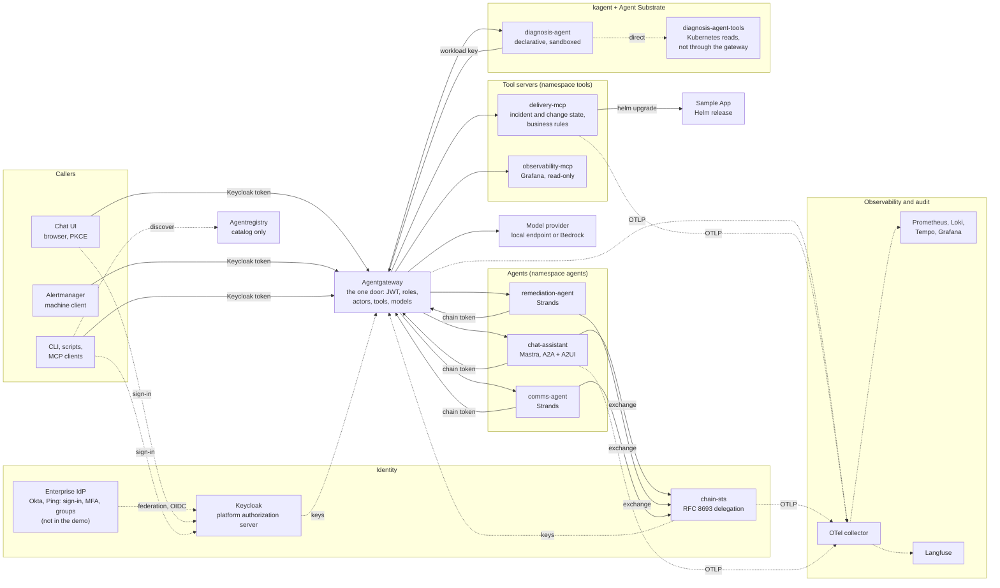
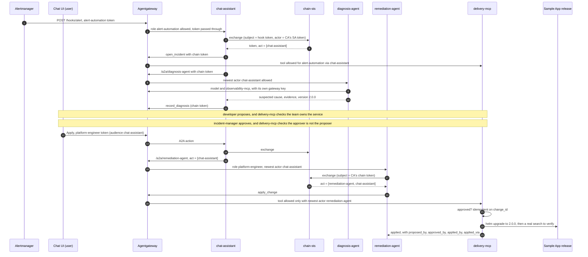
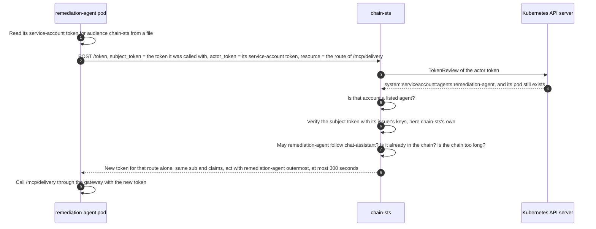

# System architecture: how the demo works

> **Owner:** coordinator · **Type:** explanation · **Checked:** 2026-11-03 against Agentgateway 1.7.0, Keycloak 26.7.5, chain-sts 0.2.1, kagent and Agent Substrate 1.0.0-rc1

| | |
|---|---|
| Design it follows | The architecture document `../Docs/AgentGateway/architecture.md`, next to this repository. That document is the target design. This one says how the demo realizes it, and how its identity and delegation work |
| The path to production | [`production-design.md`](production-design.md): connecting the enterprise identity provider (IdP), such as Okta or Ping, the options compared, hardening and open decisions |
| Detail lives in | [`contracts.md`](contracts.md) (identities, tokens, tools, routes), [`cluster.md`](cluster.md) (names, ports, tasks, the audit trail), [`measurements.md`](measurements.md) (every figure), and each component's README, in particular [`chain-sts`](../components/chain-sts/README.md) |

Claims carry the evidence labels in
[`CONTRIBUTING.md`](../CONTRIBUTING.md#documentation): **Observed in the
demo**, **Documented upstream**, **To validate** and **To verify**.

## How to read this document

| If you want | Read |
|---|---|
| The whole system on one page | Section 1 |
| What each part is, and who would own it | Sections 2 and 3 |
| How the parts work together on a real incident | Section 4 |
| How tokens are checked, how chain-sts adds agents, and which token travels where in each case | Sections 5, 6 and 7 |
| Why chain-sts, and not Keycloak's delegation or a vendor's product | Section 6.6 |
| What keeps the gateway the only door, delivery, and audit | Sections 8, 9 and 10 |
| How to connect an enterprise IdP, and what must change before production | [`production-design.md`](production-design.md) |
| A term you do not know | Appendix A, the glossary |

## 1. The system on a page



Six ideas carry the design:

1. **One door.** Every agent, tool and model call goes through Agentgateway.
   Network policy and admission rules make it the only door, because a route
   proves nothing if a workload can go around it. The demo has three known
   exceptions, each limited in another way (section 8): diagnosis-agent's own
   read-only Kubernetes tool server, the kagent UI, which reaches
   diagnosis-agent directly, and the Chat UI's host port to chat-assistant,
   which verifies every token itself.
2. **The IdP authenticates, and the platform authorizes.** People sign in at
   the enterprise IdP, which proves who they are and which groups they belong
   to. Keycloak turns that into the platform's tokens, with the platform's
   audience and claims, and chain-sts adds the agents. Nothing behind
   Keycloak talks to the IdP, so the IdP can change without changing a client,
   a route or a service. In the demo, Keycloak's own users stand in for the
   IdP, and a second realm, `corp`, stands in for one in a broker test.
3. **Identity is verified and never asserted.** The caller's identity comes
   from a verified token at every hop. No tool, agent or endpoint takes a user
   name, role or team as an argument or header. When an agent acts for a user,
   chain-sts issues a token that keeps the user as `sub` and names every agent
   in a nested `act`.
4. **Authorization happens in two layers.** The gateway decides coarse
   access: a valid token, the caller's role, the newest agent in the chain,
   and which tools are visible. The service decides the business rules: team
   ownership, separation of duties, state and idempotency. Neither layer
   replaces the other. **Observed in the demo:** the gateway offered a
   platform engineer `apply_change`, and delivery-mcp refused it because the
   change was not approved.
5. **State changes run in code, not in the model.** The model writes the
   diagnosis, chat answers and the status draft. Propose, approve and apply
   are buttons whose handlers call a tool or an agent directly, behind the
   same two layers. The model never decides whether one of them runs.
6. **Configuration is the access control.** Who may call what lives in one
   file per route in Git, rendered by shared charts. Kyverno admission rules
   stop anyone outside a platform release from adding a resource that would
   weaken a route.

Sections 5 to 7 explain ideas 3 and 4 in detail, and
[`production-design.md`](production-design.md) explains idea 2 for production.

## 2. Planes

The parts fall into six planes. Each plane would have a different owner in
production.

| Plane | In the demo | Production owner (architecture section 2.5) |
|---|---|---|
| Request | Agentgateway proxy; the agents; the tool servers; the model route | Platform team for the gateway; service and agent teams behind it |
| Identity | Keycloak (realm `demo`, with users of its own); chain-sts; keys the gateway issued to workloads | The identity team for the enterprise IdP and the group conventions. Keycloak, chain-sts and the reconciliation job are tier 0, and their owner is still to be named ([`production-design.md`](production-design.md), section 6) |
| Policy | `route-auth` and the route profiles in `agent-platform/`; Kyverno `gateway-rules`; NetworkPolicy boundaries | Platform team and security |
| Delivery | Helmfile globs over `agent-deployments/clusters/dev/`; the local registry; `task` | GitLab CI with ID-token federation, ECR, protected environments |
| Observability and audit | OTel collector, Prometheus, Loki, Tempo, Grafana, Langfuse, the API server's audit log | Observability team (New Relic or Dynatrace) and security (SIEM) |
| Catalog | Agentregistry, with no cluster credentials | Platform team; optional (WA-3) |

## 3. Components

| Component | Built with | Role | Reached at | In production |
|---|---|---|---|---|
| Agentgateway 1.7.0 | Upstream; controller and proxy | Verifies tokens, applies route and tool rules, holds the model credential, writes the access log and spans | Host port 18080 (kind maps each host port to a NodePort); in-cluster `agentgateway-proxy.agentgateway-system` | Keep. The core of the option |
| Enterprise IdP (Okta, Ping) | Vendor, base tier | Authenticates people, applies MFA, supplies an immutable user ID and group membership | Not in the demo. A second Keycloak realm, `corp`, stands in for it in a broker test (`task identity:broker-check`) | One OIDC application per environment, pointing at Keycloak ([`production-design.md`](production-design.md), section 2.2) |
| Keycloak 26.7.5 | Upstream | The platform's authorization server: every platform client, every platform token, sessions, roles and teams. In the demo it also holds the users | Host port 18081 | Keep, federated to the enterprise IdP, with no users of its own except break-glass administrators ([`production-design.md`](production-design.md), section 2) |
| Reconciliation job | A prototype, `local/identity/reconcile.py` | Reads leavers and group removals from the IdP, then disables the Keycloak user and ends their sessions | `task identity:reconcile` | New ([`production-design.md`](production-design.md), section 2.2, item 6) |
| chain-sts 0.2.1 | Python, Starlette | RFC 8693 exchange: user token plus Kubernetes service-account token, returns a token with a nested `act` (section 6) | In-cluster only | Keep and harden ([`production-design.md`](production-design.md), section 5). Keycloak stays its one trusted subject issuer |
| chat-assistant and Chat UI | Mastra (TypeScript); React with `@a2ui/react` | Orchestrator. Renders the incident card and handles its buttons. Receives the alert hook | `/a2a/chat-assistant`, `/hooks/alert` | Pattern to reuse. The chat surface may become Slack or Teams |
| remediation-agent | Strands, Python | Calls `apply_change` as the caller and reports the verified result | `/a2a/remediation-agent` | Example of a narrow action agent |
| comms-agent | Strands, Python | Drafts a status update and does not post it | `/a2a/comms-agent` | Example of a draft-only agent |
| diagnosis-agent | kagent, declarative (prompt, tools, runbook skill, evals) | Read-only investigation | `/a2a/diagnosis-agent` | Candidate track (D-2). kagent is a release candidate |
| diagnosis-agent-tools | kagent-tools 0.3.0 | diagnosis-agent's own Kubernetes tool server: read-only, limited by its flags and a Role in namespace `sample-app`. Reached directly, not through the gateway, and holds no caller identity | In-cluster only | Bring it behind the gateway, or accept it as a read-only exception (section 8) |
| delivery-mcp | FastMCP, Python | Incident and change state; enforces roles again and the business rules; applies a change by upgrading the Sample App's Helm release and verifying it | `/mcp/delivery` | Pattern to reuse for any tool that acts. Its store would become the enterprise's ITSM ([`production-design.md`](production-design.md), section 3.3) |
| observability-mcp | Grafana's MCP server | Read-only metrics, logs and traces for agents | `/mcp/observability` | Replace with the operational backend's MCP server |
| Sample App | Node, React | The system that breaks | Host port 18082 | Demo only |
| Agentregistry 0.4.0 chart | Upstream | Catalog of agents, MCP servers and skills from each `catalog.yaml` | Host port 18086 | Optional. **Observed in the demo:** scaled to zero, nothing in the request path stopped |
| Kyverno `gateway-rules` | Four ValidatingPolicies | Stop a non-platform resource from weakening, shadowing or bypassing a platform route | Admission | Keep. Reused Kyverno |
| NetworkPolicy boundaries | `workload-boundary`, `substrate-egress-boundary` | Default deny; in only from the gateway; out only to the platform | kindnet | Keep the intent; the enforcement is the cluster's CNI |
| OTel, Prometheus, Loki, Tempo, Grafana | Upstream | Metrics, logs, traces and the audit trail | Grafana on 18084 | Replace with New Relic or Dynatrace, keeping the field names |
| Langfuse 4.46.0 | Upstream | Model calls by verified user or workload, with tokens and cost | Host port 18085 | Optional (WA-6, D-13) |
| PostgreSQL instances | Upstream images | The gateway's usage records; kagent and Substrate; Langfuse | In-cluster | CloudNativePG or RDS, with backups and restore drills. Keycloak gets one too ([`production-design.md`](production-design.md), section 2.2, item 9) |

The agents use three frameworks and two languages on purpose. The contracts
between them are protocols (A2A, MCP, OTLP and the claims contract), not a
shared library, so a team can use any framework that speaks them.

## 4. How the parts work together: one incident

The incident covers every path. A release breaks search, an alert starts a
read-only diagnosis, and three roles propose, approve and apply the rollback.
The labels on the arrows show which token each hop carries. Section 7 follows
each path again, token by token.



What the sequence shows:

- **The browser's token goes no further than chat-assistant.** The Chat UI's
  sign-in has the audience `chat-assistant`. Only that route accepts it, and
  only chat-assistant may exchange it. Everything downstream carries a token
  that chain-sts issued, valid for at most 300 seconds.
- **Each tool names the agents that may call it.** `apply_change` accepts only
  `remediation-agent` as the newest actor, and only for a `platform-engineer`.
  `open_incident` accepts only `chat-assistant`, and only for
  `alert-automation` (`domains/operations/delivery-mcp.yaml`).
- **diagnosis-agent is outside the chain.** It runs in Agent Substrate's
  shared worker pool and has no credential that chain-sts can verify, so it
  calls the model and its tools with a key the gateway issued to that workload.
  Its reads are attributed to the workload, not to the user (section 7.7).
- **One change has one writer.** delivery-mcp upgrades the same Helm release
  that deployed the Sample App, so nothing else writes the Deployment. That
  differs from the target design, where a rollback goes through a merge
  request and a pipeline ([`production-design.md`](production-design.md), section 3.3).
- **In production every hop stays the same.** Sign-in goes from the Chat UI
  to Keycloak, on to the IdP and back, and the token the Chat UI receives is
  still Keycloak's. Nothing in this diagram changes (section 7.9).

**Observed in the demo** (2026-11-03): the whole incident runs in 75 seconds
when scripted (`task demo:drive`). It made six model calls, about 61,000
tokens in and $0.14 in model cost, almost all of it the four calls of the
diagnosis ([`measurements.md`](measurements.md#the-full-incident)).

## 5. Tokens: what they carry and how they are checked

Every request through the gateway carries a token, except diagnosis-agent's,
which carries a key. Each token is a JWT: a short JSON document of claims
(who it is about, who it is for, until when) signed by the service that
issued it. Anyone who has the issuer's public keys can check that the token
is genuine and unchanged without calling the issuer. That is why the gateway
and every service can check the token on every call, and why Keycloak and
chain-sts are not asked on each request.

Two issuers sign every token the gateway accepts:

- **Keycloak** signs the tokens of people and machine clients.
- **chain-sts** signs the tokens of agents acting for one of them.

### 5.1 Who holds which credential

| Credential | Held by | Issued by, and how | Lives | Reaches the gateway |
|---|---|---|---|---|
| A person's token from the Chat UI | The browser | Keycloak, authorization code with PKCE, client `chat-ui` | 30 minutes in the demo | Yes, but only `/a2a/chat-assistant` accepts it: its audience is `chat-assistant` |
| A person's token from a script or MCP client | The person's CLI, script or MCP client | Keycloak: the direct grant of client `demo-cli` (`task token`), or authorization code with PKCE for client `mcp-client` | 30 minutes in the demo | Yes, on every route the person's roles allow: its audience is `agentgateway` |
| A machine token | Alertmanager | Keycloak, client credentials, client `alert-automation` | 30 minutes in the demo | Yes, `/hooks/alert` |
| A chain token | An agent acting for a person or a machine client | chain-sts, in exchange for the caller's token and the agent's service-account token, for one target | At most 300 seconds, and never past the caller's token | Yes, but only on the route it was issued for, and only if that route lists the agent |
| A service-account token for the audience `chain-sts` | Each agent's pod, as a file the kubelet renews | Kubernetes | 600 seconds | No. Only chain-sts sees it, as proof of which agent is asking |
| A workload key | diagnosis-agent, added by Substrate's egress gateway | Agentgateway, which stores only its hash | Until its ConfigMap is deleted | Yes, but only on diagnosis-agent's own model and tool routes |
| A console session | Operators of Grafana, Langfuse, kagent UI and Agentgateway UI | Keycloak, through each console's own sign-in or oauth2-proxy | The session | No. The gateway refuses these clients' tokens because their audience is wrong |

In production every row stays as it is, and Keycloak still issues the tokens.
Only how a person proves who they are changes: Keycloak sends them to the
enterprise IdP instead of asking for a Keycloak password, and the direct grant
goes ([`production-design.md`](production-design.md), section 2.3).

### 5.2 What a token says

The same person's token at two points: as the Chat UI receives it from
Keycloak, and as delivery-mcp receives it after chat-assistant and
remediation-agent have each exchanged it. Both are abridged: Keycloak adds a
few claims that nothing in the platform reads.

| Claim | A platform engineer's token from the Chat UI (Keycloak) | The same request at delivery-mcp, after two agents (chain-sts) | What it is for |
|---|---|---|---|
| `iss` | `http://localhost:18081/realms/demo` | `http://chain-sts.chain-sts.svc.cluster.local` | Who signed it. A verifier checks the signature with this issuer's keys |
| `aud` | `chat-assistant` | `http://agentgateway-proxy.agentgateway-system.svc.cluster.local/mcp/delivery`, the route it was issued for | Who may accept it. Every verifier refuses a token whose audience is not its own |
| `sub` | `00000000-0000-4000-8000-000000000004` | The same | The person. chain-sts never changes it |
| `preferred_username` | `platform-engineer` | The same, copied | The name in records |
| `roles` | `["platform-engineer"]` | The same, copied | What the gateway's rules read |
| `team` | `platform` | The same, copied | What delivery-mcp's ownership rule reads |
| `azp` or `client_id` | `azp: chat-ui` | `client_id: remediation-agent` | The application or agent that asked for this token |
| `act` | None | See below | Which agents act for the person |
| `exp` | Sign-in plus 30 minutes | At most 300 seconds after the exchange, and never later than the Chat UI token's | When it stops working |
| `jti`, `sid` | A new `jti`, and the Keycloak session's `sid` | A new `jti` | Joining audit records |

The chain token's `act`, as delivery-mcp receives it:

```json
"act": {
  "sub": "system:serviceaccount:agents:remediation-agent",
  "client_id": "remediation-agent",
  "act": {
    "sub": "system:serviceaccount:agents:chat-assistant",
    "client_id": "chat-assistant"
  }
}
```

Read it from the outside in: remediation-agent is calling now, and
chat-assistant called remediation-agent. The outermost entry is the newest
actor, and only it drives a decision. The inner entries are the record. Each
agent is named by its Kubernetes service account, because that is what
chain-sts verified.

What changed between the two tokens: the issuer, the audience (now one
route, the target remediation-agent asked for), the expiry, the `jti`, the
asking client, and `act`. What did not change: the person and
their claims. That split is the whole design. The rules about the person
work the same on either token, and the rules about agents read only what
chain-sts added.

### 5.3 How the gateway checks a request

Every route that takes a token runs the same checks, in this order:

1. **Is there a token?** Every route is `Strict`. No token, or one that fails
   steps 2 to 4, gets 401.
2. **Who signed it?** Each route has two providers, Keycloak and chain-sts.
   The gateway uses the one named by the token's `iss`, and checks the
   signature with that issuer's public keys. Its controller fetches the keys
   every 5 minutes and hands them to the proxy, so the proxy never calls an
   issuer while serving a request.
3. **Is it still valid?** `exp` and `nbf`. Its library's default leeway is
   60 seconds (documented upstream), but a token was refused 1.2 seconds
   after its `exp` in the broker test
   ([`measurements.md`](measurements.md#the-identity-broker-2026-11-03)).
4. **Is it for this route?** A Keycloak token's audience must be
   `agentgateway`. On one route, `/a2a/chat-assistant`, Keycloak's provider
   also accepts `chat-assistant`, the Chat UI's audience. A chain-sts token's
   audience must be the route's own target: its in-cluster URL, which the
   route file names as `resource` from `delegation.resources` in
   `identity.yaml`. So a chain token works on one route only, and the agent
   it is passed to cannot present it anywhere else. `/a2a/chat-assistant`,
   the alert hook and `/mcp/observability` name no target: they have no
   chain-sts provider, and its tokens get 401.
5. **Does the route allow the role?** The route's `allow` rules, for example
   `"platform-engineer" in jwt.roles` on `/a2a/remediation-agent`. An empty
   list lets in every valid token. A failure here, or in step 6, gets 403.
6. **Does the route allow the agent?** A token without `act` passes this
   step only if Keycloak issued it: it is a person's or a machine's own.
   chain-sts always writes `act`, so a token without one that its key signed
   is refused. A token with `act` passes only if chain-sts signed it and its
   newest actor is an agent the route lists. The chart writes this as
   `(!has(jwt.act) && jwt.iss == "<keycloak>") || (jwt.iss == "<chain-sts>" && jwt.act.sub in [...])`.
   An `act` written by any other issuer names nobody the route expects.
7. **On an MCP route, is the tool allowed?** `tools` maps each tool to the
   roles that may use it, and `toolActors` to the agents that may call it.
   A tool the caller may not use is missing from `tools/list`, and a call to
   it answers "unknown resource". A tool not listed is hidden from everyone.
8. **The token goes on, or stops.** The agents' routes, `/mcp/delivery` and
   the alert hook pass the same token to the backend (`passthrough`).
   delivery-mcp, chat-assistant, remediation-agent and comms-agent check its
   signature, issuer, audience and expiry again themselves, a chain token
   for their own route only (`DELEGATION_AUDIENCE`), then apply their own
   rules. The model route and `/mcp/observability` remove it: the gateway
   calls the model with its own credential, and observability-mcp reads
   Grafana with its own Viewer account, the same for every caller.

### 5.4 Where each decision is made

| Layer | Decides | Configured in |
|---|---|---|
| Gateway, authentication | Steps 1 to 4 above: a valid Keycloak token for the audience `agentgateway` (or `chat-assistant` on that one route), or a chain-sts token for this route's target | `agent-platform/policies/agentgateway/route-auth` with `identity.yaml`, and `resource` in the route file |
| Gateway, route | Steps 5 and 6: which roles may call, and which agent may be the newest actor | `domains/<domain>/<route>.yaml` (`allow`, `actors`) |
| Gateway, MCP | Step 7: which roles and which agents see and call each tool | `tools`, `toolActors` in the route file; chart `profiles/gateway/mcp-route` |
| Gateway, model | A valid token or workload key; approved model IDs only (403 otherwise) | `platform/30-model-route/access.yaml`, `model-provider.yaml` |
| chain-sts | Which agent may act for users, which may follow which (`after`), chain length, the targets it issues for (`audiences`), which claims are carried (section 6) | `platform/90-chain-sts/policy.yaml` |
| Service | Roles again; team ownership; approver is not the proposer; the change is approved; idempotency | delivery-mcp source |

### 5.5 The claims contract

The parts depend on this contract, not on a vendor. Keycloak meets it, today
and in production. The enterprise IdP never issues a token that the parts see.
It gives Keycloak much less: an immutable ID, groups and MFA ([`production-design.md`](production-design.md), section 2.2).

| Claim | Used by | For |
|---|---|---|
| `iss`, `aud`, `exp`, signature | Gateway (`jwtAuthentication: Strict`, two providers), delivery-mcp, chat-assistant, remediation-agent, comms-agent, chain-sts | Token validity |
| `sub` | chain-sts (kept unchanged along the chain), the audit trail | The person, stable across sessions. In production, Keycloak's user ID ([`production-design.md`](production-design.md), section 2.2, item 3) |
| `preferred_username` | delivery-mcp (`proposed_by`, `approved_by`, `applied_by`, and the separation-of-duties check), the audit trail | Display and records. See [`production-design.md`](production-design.md), section 2.5 for why it should not drive a rule |
| `roles` (array) | Route `allow` CEL, the gateway's `tools` map, delivery-mcp's role checks | Coarse authorization |
| `team` (string) | delivery-mcp's ownership rule; chat-assistant | Business authorization. It must stay a single string, because both read any other type as no team ([`production-design.md`](production-design.md), section 2.2, item 5) |
| `act` (nested) | Route `actors` CEL (newest actor only), per-tool `toolActors`, audit `actor.chain` | Which agent may call for the user |
| `sid`, `jti`, `azp` | Audit joins (`session.id`, `token.jti`, `user.client`) | Correlation. chain-sts carries `sid` into chain tokens, so an agent's call joins the person's Keycloak session |

Production adds two claims, and the existing parts ignore claims they do not
read:

| Claim | Set by | For |
|---|---|---|
| `idp_sub` | A Keycloak mapper from the IdP's immutable ID; in the demo, for users who sign in through `corp`. chain-sts carries it in chain tokens | Joining the platform's audit trail to the IdP's log, and reconciling a rebuilt realm |
| `acr` | Keycloak, from the IdP's authentication. Approve and apply arrive as chain tokens, so chain-sts must list it in `carry_claims` too | Step-up on approve and apply, if adopted ([`production-design.md`](production-design.md), section 2.2, item 10) |

The three values every verifier reads (issuer, audience and key URL) live in
one file, [`identity.yaml`](../agent-deployments/clusters/dev/identity.yaml),
which also maps each agent name to the `act.sub` that chain-sts writes for it,
and each target to the URI a chain token for it carries as `aud`.
In every environment these are Keycloak's and chain-sts's values. The
enterprise IdP never appears in this file. It enters the system only in
Keycloak's realm configuration.

## 6. How chain-sts works

### 6.1 What it is for

When an agent calls the next hop for a person, it needs a token. Without
chain-sts it has two poor choices:

- **Forward the person's token.** Every log downstream names the person, and
  nothing signed names the agent. A tool cannot tell a person's own call from
  an agent's, so it cannot limit what an agent may do. The demo worked this
  way before chain-sts.
- **Use a credential of its own.** The tool sees the agent and loses the
  person, so the person's roles and team no longer apply and the audit trail
  names a service account.

chain-sts is the third choice. The agent trades the token it was called with
for a new one that keeps the person as the subject and adds the agent, signed
so that every verifier can check it. Each agent that passes the request on
adds itself. This is token exchange as RFC 8693 defines it, and nothing more.

Keycloak, the IdPs and Agentgateway's vendor all offer something similar.
Section 6.6 says why the demo built chain-sts instead, and when to replace it.

### 6.2 One exchange, step by step

remediation-agent was called with a `[chat-assistant]` chain token and needs
to call `apply_change`:



chain-sts checks the asking agent before it looks at the person's token, so
a caller that is not a known agent learns nothing about a user. The checks, in
order:

1. **The request is well formed,** and names one target chain-sts issues
   for, as `resource`: a gateway route that takes chain tokens, by its
   in-cluster URL. A request that names none, two, or one not listed is
   refused (`invalid_target`).
2. **The actor's token is genuine.** Kubernetes confirms it through a
   TokenReview: signed by the cluster, for the audience `chain-sts`, and its
   pod still running. **Observed in the demo:** a token stopped working 10 to
   13 seconds after its pod was deleted.
3. **The actor is a listed agent.** Its service account must be in the
   policy's `agents`. Otherwise `unauthorized_client`.
4. **The subject's token is genuine.** It must come from a trusted issuer:
   Keycloak, for a person's or a machine's own token, or chain-sts itself, for
   a token an earlier agent got, which is for this agent's own route. A person's token must also carry an audience
   this agent may exchange (`subject_audiences`, otherwise `agentgateway`).
5. **If the subject is a person's own token:** it must not carry an `act`
   already, and the agent must be allowed to act for users (`act_for_users`).
6. **If the subject is a chain token:** its newest agent must be in this
   agent's `after` list, this agent must not already be in the chain, and the
   chain must not grow past `max_chain` (4).

A refusal is an OAuth error that says which rule failed. If Keycloak's keys
or the API server cannot be reached, chain-sts answers 503 rather than guess.
The agents treat any failure as a stop, so nothing goes downstream.

### 6.3 The token it returns

- **`sub` is unchanged**, and so are the claims listed in `carry_claims`
  (`preferred_username`, `roles`, `team`, `email`, `name`, `sid`,
  `idp_sub`). The gateway's and
  the services' rules about the person work unchanged.
- **`act` gains the agent, outermost,** with the previous `act` inside it
  (section 5.2).
- **`iss` is chain-sts, `aud` is the one target the agent named, and
  `client_id` is the agent.** Only that target's route accepts it, and the
  service behind the route (section 5.3, step 4). An agent that calls three
  targets asks three times.
- **`exp` is the earlier of 300 seconds from now and the subject's own
  `exp`.** A chain never outlives the token it started from.
- **A new `jti`** goes into chain-sts's audit line, which joins the gateway's
  access log line when the token is used.
- **It is signed with RS256** by chain-sts's key, published at `/jwks`. The
  verifiers fetch that the way they fetch Keycloak's.

### 6.4 The policy

Everything chain-sts allows is in one reviewed file,
[`policy.yaml`](../agent-deployments/clusters/dev/platform/90-chain-sts/policy.yaml).
Abridged, without its comments and its top-level `policy:` key:

```yaml
agents:
  chat-assistant:
    service_account: system:serviceaccount:agents:chat-assistant
    act_for_users: true                                # may be the first agent
    subject_audiences: [agentgateway, chat-assistant]  # alone may take a Chat UI token
  remediation-agent:
    service_account: system:serviceaccount:agents:remediation-agent
    act_for_users: true                                # a person may call it directly
    after: [chat-assistant]                            # or it follows chat-assistant
  comms-agent:
    service_account: system:serviceaccount:agents:comms-agent
    act_for_users: true
    after: [chat-assistant]
max_chain: 4
token_ttl_seconds: 300
audiences:                                           # the targets, one per token
  - http://agentgateway-proxy.agentgateway-system.svc.cluster.local/mcp/delivery
  - http://agentgateway-proxy.agentgateway-system.svc.cluster.local/a2a/remediation-agent
  - http://agentgateway-proxy.agentgateway-system.svc.cluster.local/a2a/comms-agent
  - http://agentgateway-proxy.agentgateway-system.svc.cluster.local/a2a/diagnosis-agent
  - http://agentgateway-proxy.agentgateway-system.svc.cluster.local/v1         # the model route
carry_claims: [preferred_username, roles, team, email, name, sid, idp_sub]
require_may_act: false
```

Read it as a graph of who may follow whom: a person or machine, then
chat-assistant, then remediation-agent or comms-agent. Nothing may follow
remediation-agent or comms-agent. diagnosis-agent is not listed, so it can
never be in a chain.

The policy says which agent may act, and for which targets. The gateway's
routes say what each agent may then reach (section 5.3, steps 4, 6 and 7).
Both have to allow a call. `audiences` is the same list as
`delegation.resources` in `identity.yaml`, and the chart refuses to render
while they differ. While the dev cluster rolls out tokens per target, both
also hold `agentgateway`, the one audience every token carried before
([`contracts.md`](contracts.md#agents-acting-for-a-user-chain-sts)).

### 6.5 What it does not do

- **It does not authenticate people.** It trusts Keycloak's token for that.
- **It does not decide what a person may do.** Roles stay as Keycloak issued
  them. The gateway and the services decide.
- **It does not ask for the person's consent.** `may_act`, a person's word
  about which agent may act for them, is supported but not required, because
  Keycloak writes it only through a consent screen.
- **It does not narrow a person's own token.** Each chain token is for one
  route (section 6.3), but a person's Keycloak token keeps `agentgateway`.
  An agent called directly with one, as remediation-agent is by a script,
  could present it wherever the person's roles reach (section 7.6).
- **It cannot add diagnosis-agent,** which has no credential chain-sts can
  verify (section 7.7).
- **It is on the path of every agent call.** If it is down, the agents stop.
  **Observed in the demo:** `task demo:backup:sts-down` scaled it to zero, and
  nothing reached delivery-mcp.

### 6.6 Why chain-sts, and not Keycloak or a product

**First, why a token service at all.** Two ways need none, and both fail the
scenarios of section 7:

- **Forward the person's token,** as the demo did before chain-sts. Nothing
  names the agent, so the gateway's rules on actors cannot exist.
  chat-assistant could call `apply_change`, and any agent that holds a
  platform engineer's token has every right that person has.
- **Give each agent its own credential,** for example a Keycloak client per
  agent. The tool sees the agent and not the person, so delivery-mcp's team
  and separation-of-duties rules have nobody to check, and each agent needs
  the combined rights of everyone it serves.

**Then, which token service.** Four can put the person and the agent into one
signed token. They differ on the needs that sections 5 and 7 rely on:

| Need | Keycloak's delegation (26.8, preview) | The IdP's agent products: Okta for AI Agents, Ping Identity for AI | Solo Enterprise for agentgateway, its built-in STS | chain-sts |
|---|---|---|---|---|
| The person and the agent in one signed token (scenarios A to C) | Yes, one agent | Okta: yes, documented upstream. Ping: token exchange with `act` is documented for PingFederate 13.1 and PingAM 8.1 | Documented upstream for impersonation, which carries the person only. Whether its on-behalf-of mode adds the agent in `act` is **to verify** | Yes |
| Two agents in a row (scenario D) | **No.** **Observed** on a throwaway Keycloak 26.8.1 with the demo realm: a token that already carries `act` cannot be exchanged again | Okta: documented, though the examples stop at two agents and no maximum is published. Ping: **to verify** | **To verify** | Yes, up to `max_chain`. **Observed in the demo** for two agents, and on a test instance for the limit |
| Rules on which agent may follow which, and how long a chain may be | Not applicable with one agent | Okta: connections between agents and resources. Ping: **to verify** | **To verify** | `act_for_users`, `after` and `max_chain` (section 6.4) |
| The agent proves who it is without a secret | Yes. Keycloak 26.6 accepts a Kubernetes service-account token as client authentication, with each agent registered as a Keycloak client | Okta: not documented. An agent authenticates as a registered Okta client (`okta-comparison.md`, section 2). Ping: a Ping developer blog post describes verifying a SPIFFE workload token as the actor | kagent sends the pod's service-account token as the actor. How the STS checks it is **to verify** | Yes, by TokenReview, which also refuses the token of a pod that is gone |
| The person's `roles` and `team` travel with the chain, so the rules in section 5 still apply | Yes, through Keycloak's mappers | Okta: not documented. Ping: **to verify** | **To verify** | Yes, `carry_claims` |
| Speaks the protocol of kagent's token exchange clients | **To verify.** kagent sends the agent's token as `actor_token`, and Keycloak identifies the agent as the client that authenticated | Okta: no. Each hop is two calls, an ID-JAG and then a JWT-bearer grant, and kagent's clients make one. Ping: **to verify** | **To verify.** kagent and this STS are both Solo's | The protocol, yes: tested with kagent's Python client, `agentsts-core`, and run against its Go client with stand-in tokens. Stock kagent runtimes still cannot be an agent in the middle of a chain, because they put the caller's own token on A2A and MCP calls ([`60-kagent/README.md`](../agent-deployments/clusters/dev/platform/60-kagent/README.md#kagent-and-agent-substrate-in-a-chain)) |
| Licensed today | Yes, but as a preview feature, which Keycloak does not recommend for production | No. Okta's is an add-on priced per user per month. Ping's needs a product or edition beyond the base tier | No. It needs a Solo Enterprise subscription | Built here, open source |
| Who runs it | You, inside Keycloak | The vendor | You, with vendor support | You, and you own its code |

Sources: the Keycloak test is recorded in
[`chain-sts/README.md`](../components/chain-sts/README.md#why). The Okta rows
come from [`okta-comparison.md`](../components/chain-sts/docs/okta-comparison.md),
sections 3.1 to 3.5. The Ping and Solo rows come from the sources at the end
of this document.

**Why chain-sts.** Scenario D is the deciding case: an apply goes through two
agents, and `apply_change` admits only remediation-agent following
chat-assistant. Among the licensed options, only chain-sts can record two
agents. Keycloak stops at one, and the services that document more are not
licensed. chain-sts also has four smaller strengths:

- it proves each agent by its Kubernetes identity, with no secret to issue or
  rotate;
- it carries the person's claims unchanged, so every rule written for people
  holds for chains;
- it speaks the protocol kagent's clients already use;
- it is small: one token endpoint and one reviewed policy file. It is not a
  full authorization server: it has no users, clients, sessions or sign-in
  pages.

**What it costs.** It is security code the platform owns, and a tier-0
service the platform runs. Its key can sign a token for any person with any
roles, so it needs the protection Keycloak's key gets. Before production it
needs a KMS signer, scheduled key rotation, replicas across zones and
on-call ([`production-design.md`](production-design.md), section 5, items 6 and 8).

**When to replace it.** The rest of the system names agents through the
`delegation.agents` map in `identity.yaml` and trusts one delegation issuer.
Changing the delegation service therefore changes that map and that issuer,
not the routes or the services:

- **Keycloak** becomes the better home once its delegation is supported for
  production and can exchange a token that already carries `act`. The test is
  scenario D on the new release. chain-sts would then retire, and Keycloak
  would be the only issuer.
- **An IdP's agent add-on, if bought,** replaces chain-sts as [`production-design.md`](production-design.md), section 1.5
  describes.
- **Solo Enterprise, if bought for other reasons,** should be measured
  against the rows above before it replaces chain-sts.

**Two things that look like alternatives and are not:**

- **Agentgateway's own token exchange.** The open-source gateway can exchange
  a request's token at an authorization server before forwarding it, and can
  send an actor token taken from a request header (documented upstream; the
  version that added it is not stated, so it is **to validate** on 1.7.0). It
  calls a token service; it is not one. It could move the exchange call out
  of the agents' code, but the service it calls would still have to be
  chain-sts or one of the options above.
- **SPIFFE or SPIRE.** These give a workload an identity, which could one day
  replace the service-account token as an agent's proof. They do not issue
  tokens that name a person and a chain of agents.

## 7. Scenarios: which token travels where

### 7.1 The scenarios

| | Scenario | Started by | Chain the tool sees |
|---|---|---|---|
| A | A person asks the assistant a question | A person in the Chat UI | `[chat-assistant]` |
| B | An alert opens an incident and asks for a diagnosis | Alertmanager | `[chat-assistant]`, with the machine client as the subject |
| C | A person uses another button on the card: propose, approve, reject, draft, post or restart | A developer, an incident manager or a platform engineer | `[chat-assistant]`; for a draft, `[comms-agent, chat-assistant]` |
| D | A person applies a change on the card | A platform engineer | `[remediation-agent, chat-assistant]` |
| E | A caller uses its own token directly on an agent or a tool | A script, an MCP client, or the alert client | `[remediation-agent]`, or no chain |
| F | diagnosis-agent investigates | chat-assistant | No chain: diagnosis-agent uses a workload key |

The tables below show each hop: the token it carries, its issuer and
audience, its chain, and who checks what. "Keycloak" and "chain-sts" in the
issuer column stand for their issuer URLs. A chain token's audience is the
one route it was issued for, written by its path: `<gw>/mcp/delivery`
stands for `http://agentgateway-proxy.agentgateway-system.svc.cluster.local/mcp/delivery`.

### 7.2 A. A person asks the assistant a question

The person signs in to the Chat UI at Keycloak and asks "What is open?".

| Hop | Token | `iss` | `aud` | `act`, newest first | Checked by |
|---|---|---|---|---|---|
| Chat UI to `/a2a/chat-assistant` | The person's own | Keycloak | `chat-assistant` | None | The gateway accepts the audience on this route only, and requires no `act`. chat-assistant verifies it again and refuses any token with `act` (403) |
| chat-assistant to chain-sts, once per target | The person's token as subject, chat-assistant's service-account token as actor, the target as `resource` | | | | chat-assistant is listed, may act for users, and may take the audience `chat-assistant` |
| chat-assistant to `/mcp/delivery` (`list_incidents`) and the model route | A chain token for each | chain-sts | `<gw>/mcp/delivery`; `<gw>/v1` for the model route | `[chat-assistant]` | The gateway lists chat-assistant as an actor on both routes, and each route takes only the token for itself. delivery-mcp verifies again, for its own route, and records the person and the chain |

**Why it holds:** the person's token works at one route only. Everything after
chat-assistant carries a token of at most 5 minutes that names
chat-assistant and works at one route. chat-assistant keeps each chain token,
per person's token and target, while it is valid, so a conversation does not
exchange on every message.

### 7.3 B. An alert opens an incident

Alertmanager posts to the alert hook. No person is involved.

| Hop | Token | `iss` | `aud` | `act`, newest first | Checked by |
|---|---|---|---|---|---|
| Alertmanager to Keycloak | Client credentials, with the client's secret | | | | Keycloak returns a token whose `preferred_username` is `service-account-alert-automation`, `roles` is `["alert-automation"]` and `team` is `automation` |
| Alertmanager to `/hooks/alert` | Machine token | Keycloak | `agentgateway` | None | The gateway allows only the role `alert-automation`, and no `act` |
| chat-assistant to chain-sts | The machine token as subject | | | | chain-sts treats it as a user's token, which chat-assistant may act for |
| chat-assistant to `open_incident` | Chain token | chain-sts | `<gw>/mcp/delivery` | `[chat-assistant]` | The tool is offered only to the role `alert-automation` with the newest actor `chat-assistant` |
| chat-assistant to `/a2a/diagnosis-agent` | Chain token | chain-sts | `<gw>/a2a/diagnosis-agent` | `[chat-assistant]` | The gateway allows the newest actor `chat-assistant`. kagent does not verify tokens itself ([`production-design.md`](production-design.md), section 5, item 9), and the token works on no other route |
| chat-assistant to `record_diagnosis` | Chain token | chain-sts | `<gw>/mcp/delivery` | `[chat-assistant]` | As for `open_incident` |

**Why it holds:** only the alert client, through chat-assistant, can open an
incident or record a diagnosis. No person's role is offered those tools.

### 7.4 C. A person uses a button on the card

The card's buttons call code, not the model (section 1, idea 5). Each button
sends the person's Chat UI token to chat-assistant, which exchanges it as in
scenario A, then calls the tool or the agent. Apply is scenario D.

| Button | Tool or agent | The gateway requires | delivery-mcp then requires |
|---|---|---|---|
| Propose, by a developer | `propose_change` | Role `developer`, newest actor `chat-assistant` | The token's `team` owns the service: `search` for `search-service`. A developer on another team is refused |
| Approve, by an incident manager | `approve_change` | Role `incident-manager`, newest actor `chat-assistant` | The change is proposed, and the approver is not the proposer |
| Reject, by an incident manager | `reject_change` | The same | The change is proposed or approved. There is no proposer check |
| Draft, by an incident manager | comms-agent, at `/a2a/comms-agent` | Role `incident-manager`, newest actor `chat-assistant`. comms-agent then exchanges, as remediation-agent does in scenario D, and reads the incident with the chain `[comms-agent, chat-assistant]` | Nothing changes: comms-agent drafts and never posts |
| Post, by an incident manager | `post_status_update` | Role `incident-manager`, newest actor `chat-assistant` | The incident exists |
| Restart, by a platform engineer | `restart_workload` | Role `platform-engineer`, newest actor `chat-assistant` | The service is one it knows. No approval is needed |

**Why it holds:** the gateway checks the role and the agent, and delivery-mcp
checks the facts only it knows. A person with both roles still cannot approve
their own proposal: the check compares `sub`, which chain-sts keeps unchanged, so it holds across the person's own token and a chain token ([`production-design.md`](production-design.md), section 2.5). A restart needs no approval:
it changes no version, only replaces pods.

### 7.5 D. A person applies a change through two agents

A platform engineer clicks Apply on an approved change.

| Hop | Token | `iss` | `aud` | `act`, newest first | Checked by |
|---|---|---|---|---|---|
| Chat UI to `/a2a/chat-assistant` | The person's own | Keycloak | `chat-assistant` | None | As in scenario A |
| chat-assistant to chain-sts | | | | | As in scenario A |
| chat-assistant to `/a2a/remediation-agent` | Chain token | chain-sts | `<gw>/a2a/remediation-agent` | `[chat-assistant]` | The gateway allows only the role `platform-engineer`, with the newest actor `chat-assistant`. remediation-agent verifies it again, for its own route |
| remediation-agent to chain-sts, for delivery-mcp, and later for the model route | The chain token as subject, the target as `resource` | | | | remediation-agent is listed, and `after: [chat-assistant]` matches the newest agent. The chain grows to 2 of at most 4 (section 6.2) |
| remediation-agent to `apply_change` | Chain token | chain-sts | `<gw>/mcp/delivery` | `[remediation-agent, chat-assistant]` | The gateway offers the tool only to the role `platform-engineer` with the newest actor `remediation-agent`. delivery-mcp checks the change is approved, applies it once per `change_id`, and records `applied_by: platform-engineer` and `applied_via` with both agents |

**Why it holds:** chat-assistant cannot apply a change itself, because
`apply_change` is not offered to it as the newest actor. The only path runs
through the narrow agent built for it. A developer's token cannot reach
remediation-agent at all. And remediation-agent cannot act as chat-assistant
with the token it was handed: that token is for `/a2a/remediation-agent`
alone, so at `restart_workload` or the model route the gateway refuses it
(section 7.8).

### 7.6 E. A caller uses its own token directly

Not every call starts in the Chat UI.

- **A platform engineer calls remediation-agent directly,** as
  `demo/scenarios/drive.py` does, with a `task token` token (audience
  `agentgateway`). The token has no `act`, so the route decides by role
  alone. remediation-agent exchanges the person's own token, which its
  `act_for_users` allows, for delivery-mcp's route, and calls `apply_change`
  with the chain `[remediation-agent]`.
- **A developer's MCP client calls `/mcp/delivery` directly,** with a token of
  client `mcp-client` (audience `agentgateway`). The token has no `act`, so
  `toolActors` does not apply. `tools/list` shows the tools the role
  `developer` may use: `list_incidents`, `get_incident` and
  `propose_change`. delivery-mcp records the call with no chain.
- **The alert client calls `open_incident` directly** with its own token. The
  token has no `act`, so `toolActors` does not apply, and the role
  `alert-automation` is allowed the tool.

The rules on actors bind agents, not callers. A caller's own token is decided
by roles alone, which the scripts rely on, and it is for `agentgateway`, not
for one route. Whether production allows that is
an open decision ([`production-design.md`](production-design.md), section 5, item 15).

### 7.7 F. diagnosis-agent, outside the chain

diagnosis-agent runs on kagent and Agent Substrate, which give it no
credential chain-sts can verify. It is reached with a chain token like any
other agent, but it does not exchange:

| Hop | Credential | Checked by |
|---|---|---|
| chat-assistant to `/a2a/diagnosis-agent` | Chain token `[chat-assistant]`, for that route alone | The gateway, as in scenario B |
| diagnosis-agent to its model route, `/workloads/diagnosis-agent/v1/...` | Its workload key, added by Substrate's egress gateway as a bearer token | The gateway knows only the key's SHA-256 hash, and the key must be the one issued to `diagnosis-agent`. How a workload key works: the header of [`model-access/values.yaml`](../agent-platform/profiles/kagent/model-access/values.yaml) |
| diagnosis-agent to `/workloads/diagnosis-agent/mcp/observability` | The same key | The same |
| diagnosis-agent to its Kubernetes tool server, `diagnosis-agent-tools` in namespace `kagent` | None. Reached directly, not through the gateway | Nothing checks the caller. The server is read-only, limited by its flags and a Role in namespace `sample-app`, and its calls are not in the gateway's access log |

**What it costs:** the model calls and the reads are attributed to
diagnosis-agent, not to the person or the alert that asked for them, and its
Kubernetes reads are not audited by the gateway at all. That is
acceptable for a read-only agent. An agent that acts must be in the chain
(decisions D-2 and D-5, [`production-design.md`](production-design.md), section 5, item 9).

### 7.8 What is refused, and where

| Attempt | Stopped by | Answer | Run by |
|---|---|---|---|
| The Chat UI's token sent to any route but `/a2a/chat-assistant` | The gateway: audience | 401 | `chain-gateway.sh` |
| remediation-agent or comms-agent exchanges a Chat UI token | chain-sts: `subject_audiences` | `invalid_request` | `chain-exchange.sh` |
| A chain token sent to `/a2a/chat-assistant` or `/hooks/alert` | The gateway: these routes do not trust chain-sts at all. chat-assistant also refuses a token with `act` | 401 | `chain-gateway.sh`, **to validate** |
| An agent presents a chain token at a route other than the one it was issued for: remediation-agent or diagnosis-agent, at `restart_workload` on `/mcp/delivery` or at the model route, with the `[chat-assistant]` token it was called with | The gateway: audience. delivery-mcp, remediation-agent and comms-agent also refuse a chain token for another route | 401, `InvalidAudience` in the gateway's log | `chain-gateway.sh`, **to validate** |
| An agent asks chain-sts for no target, or for one it does not issue for, such as `/mcp/observability` or `agentgateway`; or for two targets at once | chain-sts: `audiences` | `invalid_target` | `chain-exchange.sh`, **to validate**; two targets in chain-sts's unit tests |
| chat-assistant calls `apply_change` | The gateway: `toolActors` | Missing from `tools/list`; "unknown resource" | `chain-gateway.sh` |
| A developer calls `/a2a/remediation-agent` | The gateway: role | 403 | Not in a check |
| comms-agent exchanges a token whose newest agent is remediation-agent | chain-sts: `after` | `unauthorized_client` | `chain-exchange.sh` |
| An agent adds itself twice, or a fifth agent joins | chain-sts: the chain rules | `unauthorized_client` | `chain-exchange.sh`, the limit on a test instance |
| A pod that is not a listed agent asks for an exchange | chain-sts: `agents` | `unauthorized_client` | `chain-exchange.sh` |
| A token whose `act` was written by an issuer other than chain-sts | The gateway: the actor rule requires `iss` to be chain-sts. chain-sts refuses a Keycloak token that carries `act` | 403, `invalid_request` | The gateway's half is not in a check. chain-sts's half is in its unit tests |
| An agent's service-account token after its pod is gone | chain-sts: TokenReview | `invalid_request` | `chain-exchange.sh` |
| A forged or altered token | Every verifier: signature | 401 | `chain-gateway.sh`, at the gateway |
| Any call while chain-sts is down | The agents fail closed | The card says chain-sts failed; the hook answers 502 | `task demo:backup:sts-down` |

**Observed in the demo:** `task sts:check` runs `chain-gateway.sh`,
`chain-exchange.sh` and `chain-network.sh` from `agent-platform/tests`, each
refusal next to the call it should allow. The rows marked **to validate**
are in those checks, written for tokens per target (2026-11-03), and have
not been run since. The chain-sts and service halves are in each
component's unit tests.

### 7.9 What changes in production

Only how a person proves who they are. In scenarios A, C, D and E, the
sign-in at Keycloak becomes:

1. Keycloak sends the person to the enterprise IdP.
2. The IdP signs them in, with MFA, and returns their immutable ID and their
   platform groups.
3. Keycloak issues the same token as today, with `idp_sub` added.

Every hop after that is unchanged: the same issuers, audiences, chains and
rules. Scenario B does not touch the IdP, because Alertmanager is a Keycloak
machine client, and neither does scenario F. The script in scenario E uses
the device flow instead of the direct grant ([`production-design.md`](production-design.md), section 2.3).

## 8. What keeps the gateway the only door

**Observed in the demo:** before these controls existed, Agentgateway 1.6.0
could be bypassed five ways by anyone who could create gateway resources in a
namespace. The bypasses were a second policy that made the token optional, a
second route that offered a developer all ten tools, the same route from
another namespace through a backend that named the Service by DNS, a backend
that named the model host and answered without a token, and a route that took
a platform route's path, callers' tokens included. The controls below closed
all five on kind. Their gaps are written down next to them.

| Control | What it does | Where |
|---|---|---|
| `workload-boundary` NetworkPolicies | Default deny per agent or tool namespace. In: only the gateway's proxy. Out: DNS, the gateway, Keycloak's keys, the collector and chain-sts | `agent-platform/policies/network/workload-boundary` |
| `substrate-egress-boundary` | Substrate's egress gateway may reach cluster pods only. kagent adds `api.openai.com` or `api.anthropic.com` to an actor's allowlist whatever `baseUrl` says, so this rule is needed | `agent-platform/policies/network/substrate-egress-boundary` |
| Kyverno `gateway-policy-targets` | No non-platform `AgentgatewayPolicy` may target a platform Gateway, route, backend or Service | `agent-platform/policies/kyverno/gateway-rules` |
| Kyverno `gateway-route-claims` | No non-platform route may lead to a platform backend, or claim a platform path or a host name | same |
| Kyverno `gateway-backend-destinations` | No non-platform backend may name a platform Service, the model host, a bare address, a model backend or a forward proxy | same |
| Kyverno `gateway-platform-objects` | Only a platform deployer may change or delete a platform gateway resource | same |
| Admin port NetworkPolicy, `UI_READ_ONLY` | Only the UI's sign-in proxy reaches the gateway's admin port, and writes are refused | `platform/10-agentgateway` |

What these controls do not cover:

- **NetworkPolicy:** cluster admins, `kubectl port-forward`, kubelet probes,
  and anything at path level, because NetworkPolicy sees only addresses and
  ports. The CI job pod path was not exercised (D-7).
- **Kyverno**, as its values file records
  (`agent-platform/policies/kyverno/gateway-rules/values.yaml`): a deployer
  applying by hand with Helm's labels written in; a team that uses Helm for
  its own gateway resources, which then look like the platform's; a backend
  that reaches a platform Service through an ExternalName Service, endpoints
  written by hand, or an outside DNS name that resolves inside the cluster;
  and a GRPCRoute that claims a platform path.
- **Known doors besides the gateway** (section 1, idea 1):
  - diagnosis-agent's Kubernetes tool server, reached directly. It is
    read-only, and its calls are not in the gateway's log (section 7.7).
  - The kagent UI, which reaches diagnosis-agent without the gateway
    ([`production-design.md`](production-design.md), section 5, item 9).
  - The Chat UI's host port. chat-assistant's Service is a NodePort, and a
    NetworkPolicy exception (`chat-ui-from-this-machine` in
    `platform/80-policies`) lets this machine reach the pod directly.
    chat-assistant verifies every token itself, and production would serve
    the UI through the gateway or an ingress instead.

## 9. Configuration and delivery

- **Three directories stand in for three kinds of repository.**
  `agent-platform/` holds reusable charts, profiles and policies.
  `agent-deployments/` says what runs where and who may call it.
  `components/<name>/` holds one team's source, prompts, skills, evals and its
  `catalog.yaml`. The layout follows section 11.1 of the architecture
  ([`architecture-layout.md`](architecture-layout.md)).
- **Adding something edits little that is shared.** The root helmfile globs
  `platform/*/`, `workloads/*/` and `domains/*/`. A new team's tool is a new
  directory under `workloads/`, one file under `domains/<domain>/`, and two
  release entries in that domain's `helmfile.yaml`, which lists its routes'
  releases by name.
- **A route is two releases from one file.** `<name>-route-auth` (chart
  `route-auth`) and `<name>-route` (chart `mcp-route`, `a2a-route` or
  `http-route`) both read `domains/<domain>/<name>.yaml`, so the people who
  review access review one file.
- **Each object has one writer.** Helm releases write declared resources. The
  controllers write what they generate. delivery-mcp writes the Sample App
  only through its Helm release. Agentregistry writes nothing in the cluster.

## 10. Observability and audit

- Every component exports OTLP and propagates W3C trace context. The gateway's
  spans and access log carry `user.id`, `actor.sub` and `actor.chain`.
- **The audit trail is one set of field names across five sources:** the
  gateway, delivery-mcp, chain-sts, Keycloak's events and the API server's
  audit log. Records join on `operation.id`, `trace_id`, `token.jti` and
  `session.id` ([`contracts.md`](contracts.md#audit-records)). A chain
  token's exchange, in chain-sts's audit line, joins its use, in the gateway's
  access log, on `token.jti`. `task audit:change -- CHG-0001` reconstructs who
  changed what from Loki alone.
- **Model calls are attributed to a verified user or workload,** with tokens
  and cost, in Langfuse and in the gateway's own PostgreSQL. **Both keep the
  prompts and completions.**
- **In production a sign-in is recorded twice.** The IdP's log records the
  authentication and the MFA. Keycloak's events record which platform client
  the session was for. Keycloak's `sub` is not the IdP's, so the two join on
  `idp_sub` (section 5.5). The reconciliation job's actions are audit records
  as well.
- **It records but does not prove.** An admin can delete data from Loki. In
  production the audit store needs immutable object storage or a SIEM, and
  the API server's log comes from EKS control-plane logging.

## Appendix A. Glossary

| Term | Meaning here |
|---|---|
| A2A | Agent2Agent, the protocol one agent uses to call another |
| A2UI | Agent-to-UI, the format in which chat-assistant sends the incident card and its buttons to the Chat UI |
| Access token | A token a client presents to an API. Here, a JWT: Keycloak's for the audience `agentgateway` or `chat-assistant`, or chain-sts's for one route |
| `acr`, `amr` | Claims that say how strongly, and by which methods, the person signed in. Used for step-up |
| `act` | The actor claim of RFC 8693: who acts for the subject. Nested, newest outermost (section 5.2) |
| Actor token, subject token | In a token exchange: the token that proves who is asking (here an agent's service-account token), and the token of whom the request is for |
| Agent Substrate, Actor | The sandboxed runtime kagent runs diagnosis-agent on. An Actor is one conversation's sandbox, not an agent |
| API Access Management | Okta's add-on for custom authorization servers, which issue access tokens for your own audience and claims. Included in Okta's Enterprise suite |
| Audience, `aud` | Whom a token is for. A verifier refuses a token whose audience is not its own |
| Authorization code with PKCE | The browser sign-in flow. PKCE ties the code to the client that asked for it, so a stolen code is useless |
| Authorization server | The service that issues access tokens. Here, Keycloak. chain-sts issues chain tokens by token exchange only, with no sign-in, clients or sessions |
| Break-glass account | A local administrator account kept for when the IdP cannot be reached |
| Broker, federation | An authorization server that sends people to another IdP to sign in, then issues its own tokens. Keycloak, in this design |
| CAEP, Shared Signals | Standards for an IdP to push events, such as a revoked session, to other services |
| CEL | Common Expression Language, in which the gateway's rules on claims are written |
| Chain token | A token chain-sts issued: the person as `sub`, the agents in `act` |
| Claim | One field of a token, such as `sub` or `roles` |
| Client credentials | The flow in which a machine gets a token with its own secret or key, with no person |
| CMDB | Configuration management database: the enterprise's record of services and their owners |
| D-n, WA-n | Open decisions (D, the architecture document's section 16.2) and working assumptions (WA, its section 3.3) |
| Device flow | Sign-in for a CLI: it shows a code, and the person signs in with it in a browser |
| Direct grant | The client sends a person's password to Keycloak. `task token` uses it. Not for production |
| ID token | A token that tells an application who signed in. Meant for that application, not for APIs |
| ID-JAG | Identity Assertion JWT Authorization Grant: the token Okta for AI Agents issues at the first step of an agent's exchange |
| Identity Provider Redirector | A Keycloak sign-in step that sends the person straight to the upstream IdP, so Keycloak's own form never shows |
| IdP | Identity provider. Here, the enterprise's Okta or Ping |
| IGA | Identity governance and administration: access requests, reviews and certifications, such as Okta Identity Governance or SailPoint |
| Issuer, `iss` | Who signed a token. A verifier checks the signature with that issuer's keys |
| ITSM | IT service management: the system of record for incidents and changes, such as ServiceNow |
| JWKS, `kid` | An issuer's public keys, published at a URL, and the key ID in a token that says which key signed it |
| JWT | JSON Web Token: claims, signed by the issuer |
| `may_act` | A claim in a person's token naming an agent that may act for them. Not required in the demo |
| MCP | Model Context Protocol, which agents and clients use to call tools |
| Org authorization server, custom authorization server | Okta's built-in server, whose access tokens are for Okta's own APIs, and the servers API Access Management adds, whose tokens are for your APIs |
| Passthrough | The gateway sends the token it checked on to the backend, which checks it again |
| Projected service-account token | A short-lived Kubernetes token for one audience, mounted in a pod as a file |
| Protected resource metadata | RFC 9728: a document a resource such as the gateway publishes, naming the authorization server an MCP client should sign in at |
| Reconciliation job | Disables Keycloak users that the IdP has disabled, and ends the sessions of those removed from the platform's groups. A prototype in `local/identity/reconcile.py` |
| Route | A path on the gateway with its own rules: `allow`, `actors`, and for MCP `tools` and `toolActors` |
| SCIM | A standard for an IdP to create, change and remove users in an application |
| Step-up | Asking for a recent or stronger sign-in before a sensitive action |
| Subject, `sub` | Whom a token is about. Stable for a person |
| Tier 0 | A service everything else depends on, run with the highest availability |
| Token exchange | RFC 8693: trading one token for another. Here, to add an agent |
| TokenReview | A Kubernetes API that says whether a service-account token is genuine and current |
| Workload key | A key the gateway issued to one workload and stores as a hash. diagnosis-agent's credential |

## Sources outside this repository

Accessed 2026-11-03.

- Agentgateway, standard token exchange (RFC 8693) for backend
  authentication:
  <https://agentgateway.dev/docs/standalone/latest/documentation/configuration/security/backend-authn/token-exchange/standard/>
- Solo Enterprise for agentgateway, on-behalf-of token exchange with its
  built-in STS:
  <https://docs.solo.io/agentgateway/latest/mcp/token-exchange/obo/impersonation/>
- PingFederate 13.1, OAuth token exchange:
  <https://docs.pingidentity.com/pingfederate/13.1/administrators_reference_guide/pf_oauth_exchange.md>
- PingAM 8.1, token exchange (`act`, `may_act`):
  <https://docs.pingidentity.com/pingam/8.1/am-oauth2/token-exchange.html>
- Ping developer blog, token exchange with SPIFFE workload identity:
  <https://developer.pingidentity.com/blog/securing-agentic-workflows-with-token-exchange-and-workload-identity/>
- Okta sources, prices and terms: [`okta-comparison.md`](../components/chain-sts/docs/okta-comparison.md#sources),
  as of 2026-10-21.
